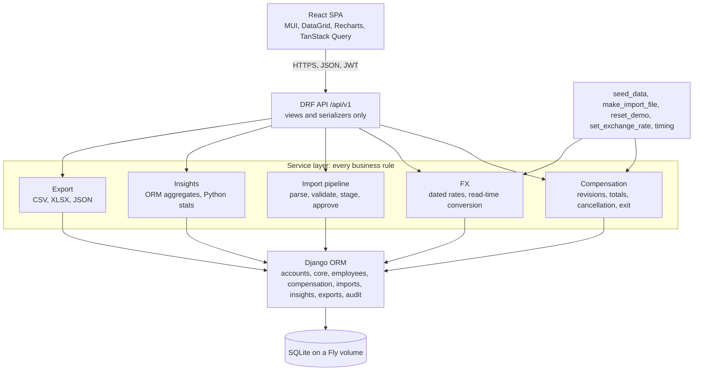

# ACME Salary Management

Web replacement for an HR team's salary spreadsheets: import, review, maintain and query compensation for 10,000 employees across six countries. Django and Django REST Framework on SQLite, React with MUI, one container on Fly.io.

Live: **https://acme.nutanprabhat.dev**. The demo video is linked here at the Ship step.

## Signing in

The demo login is in the submission email, not in this public repository: anyone holding it can change the demo data, and the Demo data page can empty the database. There is one account, the HR Manager. Nothing is readable without it.

## A three-minute tour

1. **Dashboard.** What ACME spends, how pay is structured and whether it is fair, on the seeded organisation. Change the period (last 3 months to the whole history since 1 April 2020), filter by country or department, switch the reporting currency, and export any card as CSV, Excel or JSON.
2. **Employees.** The directory of 10,000 on staff, server-side paging, filters, search and sort, with gross in the local currency and the reporting currency side by side. Open one: the current record with its lines, every revision since joining, scheduled revisions and cancellations, the audit trail. Add a revision, schedule one for a later date, mark someone exited, or create an employee.
3. **Imports.** Drop a spreadsheet. The import stages every row with its validation messages, lets you skip rows, and applies the rest in one transaction. The review page shows what each row would do: create, update, revise, exit, or nothing.
4. **Demo data.** Seven sample files built from the live data: new hires, a Diwali bonus, April raises, promotions, exits, a sheet with planted errors to fix, and the whole organisation. Import them in any order, twice if you like, and watch the dashboard move. The danger zone empties the database so the 15,000-row base file can be imported from nothing, which takes about a minute on the small shared machine the demo runs on.

## Beyond the brief, and why

The brief asked for a spreadsheet replacement with a dashboard. Three things went further, each after a question Incubyte answered on 6 October (the clarifications table in `docs/REQUIREMENTS.md`):

- A live public URL rather than a local Docker setup, since "deployed" meant a URL anyone can open.
- Effective-dated pay records with revision history, scheduled revisions and exits, since a current salary was sufficient but history makes the dashboard's trend and cost bridge possible.
- Ten fixed insights with filters, a period and a reporting currency, with a privacy rule that withholds any figure a group under five could be read back from, since a focused dashboard was wanted and salary data is sensitive.

## The seed

The first boot seeds 10,000 employees on staff and 5,000 who left, across India, the United States, the United Kingdom, Germany, Singapore and the Netherlands, deterministically from seed 42. Each has a career on an experience ladder of six levels, every April review since joining as a revision, and pay drawn from a level and department profile with noise. Reporting starts on 1 April 2020, the start of FY 2020-21, so every employee on staff that day has a record starting then. Gender is drawn and has no effect on pay, so the gender-gap cards show what a fair organisation looks like and the import files can change it.

## Run

One container, the way it is deployed: copy `backend/.env.example` to `backend/.env`, set `SECRET_KEY` and `SEED_ADMIN_PASSWORD`, then from the repo root:

```
docker compose up
```

and open http://localhost:8000. The database lives on the `acme-data` volume, the port is published on 127.0.0.1 only, and nothing proxies the app there, so `NUM_PROXIES` is 0.

For development, two processes:

```
cd backend && uv sync && uv run python manage.py migrate && uv run python manage.py runserver
cd frontend && npm ci && npm run dev
```

Open http://localhost:5173. Vite proxies `/api` and `/healthz` to the Django server on port 8000. The dev settings have safe defaults, so `backend/.env` is optional; pass it with `uv run --env-file .env ...` when needed.

## Test

```
cd backend && uv run ruff format --check . && uv run ruff check . && uv run pytest
cd frontend && npm run lint && npx tsc -b && npm test -- --run && npm run build
```

The same commands run in CI on every push, with `pip-audit` and `npm audit` on the locked runtime dependencies, and in the pre-commit gate on every commit. `backend/tests/security/` holds the leads of a static security audit of 8 October, each a guard where its weakness was fixed and an expected failure where it was accepted (`docs/reviews/security-audit-2026-10-08.md`).

## Operator notes

The app runs as the user `acme` inside the container, so a command run on the live machine runs as that user too: `fly ssh console -u acme -C "python manage.py <command>"`.

- **Rotating the HR password** is two commands, since a session outlives a password change until its 12 hours are up: `python manage.py changepassword <the HR email>`, then `python manage.py revoke_sessions <the HR email>`, which ends every session. Changing `SEED_ADMIN_PASSWORD` never changes a live password; it is read only when the account is first created.
- **`python manage.py reset_demo`** rebuilds the demo database: it empties every business table and seeds the organisation again, about a minute on Fly with the CPU burst balance in hand, longer when the balance is spent. Lookups and rates are rebuilt; the HR account and its password are kept, so rotating the password is the step above, not this. The Demo data page's reset is the same truncation without the seed.
- **`python manage.py timing`** measures the directory, the insights, the imports and the seed on the seeded database (`docs/PERFORMANCE.md`).

## Architecture



Every business rule lives in a `services.py` or `queries.py` module and is tested without HTTP. Money is `Decimal(14, 2)`, converted at read time from dated exchange rates and never stored converted. Nothing deletes pay that has been in effect: employees are exited, records superseded, scheduled revisions cancelled, and every write lands in the audit log with before and after snapshots.

## Documents

- `docs/REQUIREMENTS.md`, the one-page requirements document with Incubyte's clarifications
- `docs/SPEC.md`, the engineering spec, v2.20: data model, API, rules, acceptance criteria
- `docs/DECISIONS.md`, why things are the way they are, D1 to D74
- `docs/PLAN.md` and `docs/DESIGN.md`, what was built, in what order, and how
- `docs/PERFORMANCE.md`, measured timings, locally and on Fly
- `docs/reviews/`, the Engineering Manager spec reviews and the security audit with its triage
- `docs/AI-WORKFLOW.md`, how this was built

## How this was built

By one person directing Claude Code through a fixed loop: a spec reviewed by an independent agent, a plan and a design approved before any code, build steps with hooks that format, guard history and gate every commit on lint and tests, four read-only reviewers at each step's close, and the owner's approval before each step was committed. The planning commits before step 1 were written by hand; from step 1 every commit Claude Code wrote carries its `Co-Authored-By` trailer. `docs/AI-WORKFLOW.md` has the loop as a diagram, what the `.claude` folder holds, what went wrong, and the decisions the owner made along the way.
