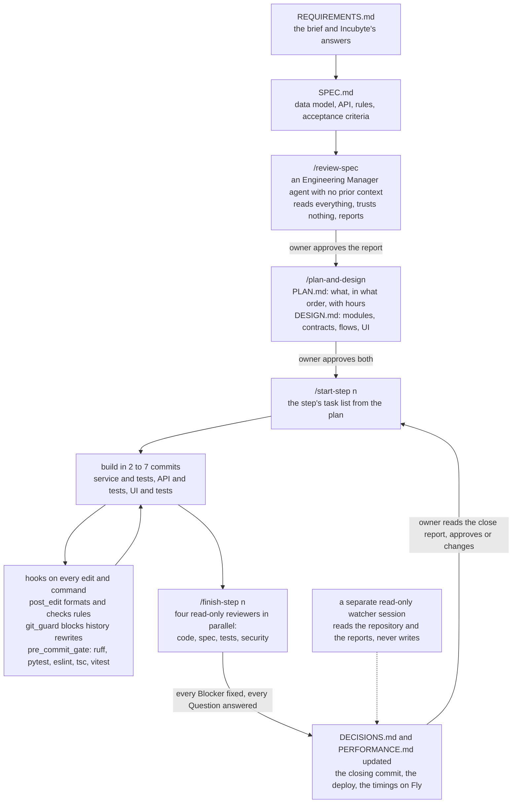

# How this was built

One person directed Claude Code (Fable 5.1 and Opus 5.5) through a loop that was fixed before the first line of code and did not change: specify, review, plan, build in steps, gate every commit, review every step, approve, commit. The documents came first and the code was derived from them. Where the code and a document disagreed, the document was fixed and the code followed, never the other way round.

## The loop

Two gates are the owner's alone. `/review-spec` and `/plan-and-design` are marked so the model cannot invoke them, and after the security audit so is `/finish-step`. The owner's approval is a line at the top of the document (`Owner decision: approved`), which the session-start hook reads from that one line and nowhere else, so a reviewer quoting the phrase cannot open a gate.

## What the `.claude` folder holds

- `settings.json`: the permission rules (what runs without asking, what asks, what is denied) and the five hooks wired to their events.
- `hooks/`: `session_start.py` puts the repository state, the gate status and the skill list into every session's context and exports the virtualenv onto PATH. `post_edit.py` formats every edited file and checks a few rules (no floats for money, no logic in API modules, no non-deterministic tests). `pre_commit_gate.py` runs lint, the type check and both test suites before any `git commit`, however it is spelled, and fails closed. `git_guard.py` blocks any command that rewrites history, in every spelling the audit and the reviews could think of, read with its quotes and escapes removed; a spelling it cannot read still meets the permission prompt on a push and the commit gate on a commit. `dependency_note.py` reminds that a new dependency needs a decision.
- `skills/`: the recipes. `start-step` and `finish-step` bracket every build step; `add-endpoint`, `add-validation-rule`, `add-insight` and `frontend-page` are the recurring kinds of work; `log-decision` and `perf-timing` record a choice and a timing; `review-spec` and `plan-and-design` are the owner's gates.
- `agents/`: five read-only reviewers. `eng-manager-spec-review` for the planning documents, then `code-reviewer`, `spec-checker`, `test-reviewer` and `security-reviewer` for every build step. Each gets the step's diff and reports Blockers, Should-fixes and Nits; a Blocker is fixed before the step is committed, and a `Question for the human` stops the work until the owner answers.
- `CLAUDE.md` at the repository root: the rules that are not negotiable (thin views, money as Decimal, totals computed on the server, one validator module, one transaction per approve, nothing deleted, everything audited, a deterministic seed, no dependency without a decision, secrets from the environment), the commit conventions, and the order of the gates.

## What went wrong

- **A plugin took over the sessions.** The first session of 7 October announced it was in "learning plus explanatory" mode, and the owner set `/output-style` to Default. At the start of step 4 it was back: replies carried "★ Insight" blocks and the plan set aside a function for the owner to write ("Your piece", a TODO(human) of five to ten lines), while `/output-style` still read Default and the repository sets no style. The source was Anthropic's marketplace `learning-output-style` plugin, installed beside `frontend-design`; it adds its instructions through a SessionStart hook, so the style setting never showed it. The owner disabled it (`claude plugin disable learning-output-style`) and gave the running session one line, "Write all code yourself, no TODO(human) handovers, no Insight blocks", before any hand-over reached the code. The lesson: a plugin's hook sits beside the project's hooks and the project cannot see it; `/hooks` names where each one comes from, and that is the first place to look when a session behaves oddly.
- **A test claimed but missing.** At the start of step 4, Claude Code's plan stated that `tests/audit/test_snapshots.py` already checked that the audit snapshots equal the detail serializer's output, and on that basis dropped the "matching the detail serializer" half of SPEC F7 from the step. The file only compared key sets; its own docstring said step 4 would add the equality check (DESIGN 1.8, D34). Claude Code had read the design's description of the test as the test itself. The watcher caught it by opening the file before the step started, the owner sent the correction, and the test, once written, failed on two real differences: a line's component was a code in the snapshot and `{code, name, kind}` in the serializer, and the snapshot carried an `employee` key the serializer lacked. That is why the serializer returns component codes today (D34). The lesson: a report's claim about the repository is checked against the repository, never against the report.
- **The blockers the reviewers caught.** Among them: in step 9 the security reviewer built a crafted spreadsheet that passed every size check and peaked at 1.2 GB in memory, which led to the element and object caps on the import preflight (D68); in step 10 three reviewers found that two sample files drew their new joiners from one random stream at the same start, so the second file imported found the first's people, fixed with a named stream at an offset (D72). None would have been caught by the tests the step had written for itself.
- **The guardrails are advisory.** A static security audit of 8 October (`docs/reviews/security-audit-2026-10-08.md`) found that the hooks could be bypassed by spellings their regexes did not know, that the commit gate failed open on a global git option or a broken tool, and that the permission rules protect one developer from the agent's mistakes on his own machine, not a security boundary. The spellings and the failing-open were fixed in step 11 with the audit's own tests as guards; the boundary is the owner approving each step, which no setting replaces.

## The end-to-end UI test

Step 13 had Claude Code drive the app in Chrome through the Claude in Chrome tools, the way the HR Manager uses it. The owner did what an agent should not: signed in whenever a session was needed, stopped, started and rebuilt the container (the last rebuild, for the final local check, Claude Code ran with the owner's approval), and typed the password for the database reset, so no real password ever passed through the agent. The full pass ran on a local container of the release, every write included, and a read-only pass ran on the live site after the deploy.

The owner paused the run once, on 9 October, so that the layout and Help were fixed first (step 12), and the record describes the final screens. It counts 66 scenarios and 104 error paths and edge cases, SPEC section 7's rules and section 8's refusals walked row by row, with 28 defects found and fixed in the step, six of them by the four reviewers at the close, every defect in the app fixed with a test that fails without the fix and the README's tour a docs fix, and one item left to P1, search on accented capitals. One fix at the close, `46dfd9c`, made an import cycle that stopped `seed_data` loading, which the boot runs. The gate passed it, because the tests import the modules in another order, and the spec checker caught it before any push. `0142ab1` fixed it with a test that loads each command in a fresh process, as the boot does. The full report is `docs/TESTING.md`.

## Decisions

<!-- OWNER: the decision rows go here. Left for the owner to write; not filled by the agent. -->

The rows are mine. Each names what I asked, what the AI put forward, and what I decided and why; the D-numbers point at docs/DECISIONS.md.

| What I asked | What the AI put forward | What I decided, and why |
| --- | --- | --- |
| My first spec: PySpark for telemetry, telemetry tables, a salary schema table and a monthly salary history table | Drop PySpark and the telemetry tables and compute insights on demand; salary components as data rather than columns; effective-dated revisions instead of a month-by-month history (D1, D2, D3) | Took it. Ten thousand rows is a query, not a pipeline, and a revision with an effective date gives the history without a table per month. |
| Incubyte said annual gross alone is sufficient. Do the components and the history go? | Dropping them would save about five hours (D12) | Kept both, trimmed to ten components. The brief pays people in six countries, and a country's pay structure is the one thing a salary system cannot retrofit once records exist. The history is what makes the trend and the cost bridge possible. |
| Does "deployed" mean a public URL or Docker on a laptop? | Local Docker would satisfy the brief as written | I asked Incubyte: a URL anyone can open. One container on Fly.io, SQLite on a volume, my own domain, paid by me (D5, D11, D17). |
| The 7 October review said 30 to 35 hours does not fit one night | Cut components, history and two insights and ship the same day | Full scope, no cuts planned, and the decision taken at the end of each step against the hours in PLAN.md. The release valve shrinks export and hardening first and never the data layer, the import or the deployment (D19, D23). |
| Can pay data ever be deleted? | — | No pay row is ever deleted; cancelling a scheduled revision is a mark, and every write leaves an audit entry (D9, D20). The demo reset is the one endpoint that deletes, and it is recorded as the exception (D72). |
| Fly throttled the by-level view during a 900-request timing run | A performance CPU would hold the speed under any load | Shared CPU stays (D65). One HR user's dashboard costs about a second of CPU, inside the burst balance. The two cases over their targets are recorded as accepted exceptions with their numbers (D71, D72), not bought away. |
| What does the dashboard show for a small group? | Withhold under 5 people for totals and means and under 20 for percentiles and distributions (D59) | Took the thresholds and added a rule: no figure that adds up across rows is published where a withheld row could be recovered from it. So bonus means went, quartiles rank women and men alone, the cost bridge withholds all three moving parts together, and comparing figures across filters is out of scope (D59, D62). |
| The dashboard had a single "as of" date | Keep the as-of date | A period, from and to, with presets and the Indian financial year, because the questions I wanted answered are about a period: what we spent, who joined, who left (D64, D69). |
| In the seed, people who joined in 2015 were still at level 1 | A ladder on years at ACME, and a "founding team" dated before 2015 | Rejected both. The ladder is total experience (L1 0–3 years to L6 12 and above), anyone can join at any level and moves up as their experience passes the thresholds, 15,000 employees with 5,000 who left at a steady eleven percent a year, and no founding team: reporting starts on 1 April 2020 and everyone employed that day has a record from it (D64, D70). |
| How do we keep imports honest without stressing the database? | A sync token on the staged batch, and chunked approves for the large files | Rejected both. Why put stress on unique keys if the row rules protect the database: a revision that lowers gross is a warning row, an approve stays one transaction, and the second sample file's joiners come from a named stream at an offset (D72). |
| How many rows may a file hold? | 10,000 | 15,000, so the whole seeded organisation fits one file, with a cap of 25,000 employees checked at staging and again at approve (D64, D72). |
| A reviewer needs data to play with | — | My feature: a Demo data page with sample files built from the live data (new hires, a Diwali bonus, April raises, promotions, exits, a fix-me sheet and the 15,000-row base) and a reset gated on typing RESET. After my own testing on the live site found Cancel leaving the server to finish, every long action got a dialog that cannot be dismissed while the work runs (D72). |
| The directory opened an employee on a row click and hid its sort | — | A pencil on each row, visible sort icons, code as the default sort, and sorting never counts towards Clear filters (D63). |
| Which insights are worth a card? | Research into the EU pay-transparency directive, the UK gender-pay measures and common HR dashboards, ten candidates | Took the trend, the cost bridge, pay by tenure, the cost mix and the gender views including by level with the five percent flag. One control per card, and the dashboard bar decides the population (D62). |
| Is the per-step security reviewer enough before shipping? | It is the project's own check; an outside audit would be a second opinion | Ran Cloudflare's security-audit skill on the repository as well, static only: nothing confirmed, fourteen leads, each triaged in docs/reviews and either fixed with the audit's own test as a guard or accepted with a reason. The demo login goes in the submission email, never the repository (D73). |
