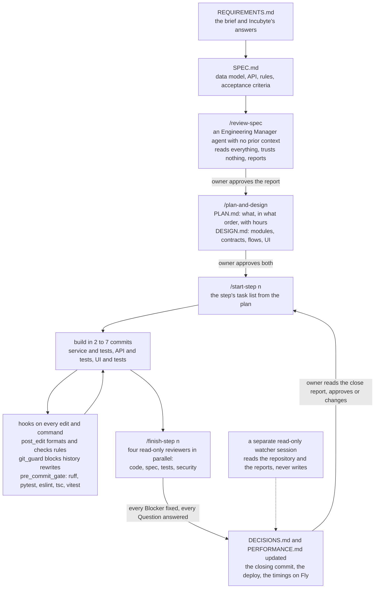

# How this was built

One person directed Claude Code (Fable 5.1 and Opus 5.5) through a loop that was fixed before the first line of code and did not change: specify, review, plan, build in steps, gate every commit, review every step, approve, commit. The documents came first and the code was derived from them. Where the code and a document disagreed, the document was fixed and the code followed, never the other way round.

## The loop

Two gates are the owner's alone. `/review-spec` and `/plan-and-design` are marked so the model cannot invoke them, and after the security audit so is `/finish-step`. The owner's approval is a line at the top of the document (`Owner decision: approved`), which the session-start hook reads from that one line and nowhere else, so a reviewer quoting the phrase cannot open a gate.

## What the `.claude` folder holds

- `settings.json`: the permission rules (what runs without asking, what asks, what is denied) and the five hooks wired to their events.
- `hooks/`: `session_start.py` puts the repository state, the gate status and the skill list into every session's context and exports the virtualenv onto PATH. `post_edit.py` formats every edited file and checks a few rules (no floats for money, no logic in API modules, no non-deterministic tests). `pre_commit_gate.py` runs lint, the type check and both test suites before any `git commit`, however it is spelled, and fails closed. `git_guard.py` blocks any command that rewrites history, in every spelling the audit and the reviews could think of, read with its quotes and escapes removed; a spelling it cannot read still meets the permission prompt on a push and the commit gate on a commit. `dependency_note.py` reminds that a new dependency needs a decision.
- `skills/`: the recipes. `start-step` and `finish-step` bracket every build step; `add-endpoint`, `add-validation-rule`, `add-insight` and `frontend-page` are the recurring kinds of work; `log-decision` and `perf-timing` record a choice and a timing; `review-spec` and `plan-and-design` are the owner's gates.
- `agents/`: five read-only reviewers. `eng-manager-spec-review` for the planning documents, then `code-reviewer`, `spec-checker`, `test-reviewer` and `security-reviewer` for every build step. Each gets the step's diff and reports Blockers, Should-fixes and Nits; a Blocker is fixed before the step is committed, and a `Question for the human` stops the work until the owner answers.
- `CLAUDE.md` at the repository root: the rules that are not negotiable (thin views, money as Decimal, totals computed on the server, one validator module, one transaction per approve, nothing deleted, everything audited, a deterministic seed, no dependency without a decision, secrets from the environment), the commit conventions, and the order of the gates.

## What went wrong

- **A plugin took over the sessions.** An output-style plugin injected its own instructions into every session: it asked the owner to write parts of the code by hand and decorated replies with explanation blocks. Until the standing instruction "write all code yourself" was added, some of that reached the work. The lesson: a plugin's instructions sit beside the project's and win by recency unless the project says otherwise.
- **A test claimed but missing.** A step report once named a test the suite did not hold. The reviewers read the diff, not the report, and the close now lists test counts from the run, not from memory.
- **The blockers the reviewers caught.** Among them: in step 9 the security reviewer built a crafted spreadsheet that passed every size check and peaked at 1.2 GB in memory, which led to the element and object caps on the import preflight (D68); in step 10 three reviewers found that two sample files drew their new joiners from one random stream at the same start, so the second file imported found the first's people, fixed with a named stream at an offset (D72). None would have been caught by the tests the step had written for itself.
- **The guardrails are advisory.** A static security audit of 8 October (`docs/reviews/security-audit-2026-10-08.md`) found that the hooks could be bypassed by spellings their regexes did not know, that the commit gate failed open on a global git option or a broken tool, and that the permission rules protect one developer from the agent's mistakes on his own machine, not a security boundary. The spellings and the failing-open were fixed in step 11 with the audit's own tests as guards; the boundary is the owner approving each step, which no setting replaces.

## Decisions

<!-- OWNER: the decision rows go here. Left for the owner to write; not filled by the agent. -->

_This section is the owner's. The rows are theirs to write._
