Owner decision: approved. Steps 1 to 7 on 7 October, steps 8 to 10 on 8 October with the changes recorded in D62, D64 and D72.

# ACME Salary Management: Plan

What gets built, in what order, from `docs/SPEC.md` v2.1 section 15, the way `docs/DESIGN.md` describes it. Fourteen steps, each 2 to 6 commits, each closed by `/finish-step` (lint, tests, the four reviewers, DECISIONS and PERFORMANCE updates, one closing commit named after the step). A later step does not start before the earlier one is green and committed. Nothing marked P1 is built before the Ship step. Hours are focused wall-clock hours with Claude Code doing the work and the owner reviewing at each step close; they include the `/finish-step` cycle (two suite runs plus four reviewer agents, 20 to 30 minutes per step).

## Dependency graph

```mermaid
flowchart LR
  S1["1 Scaffold and skeleton,<br/>deployed"]
  S2["2 Data layer, services,<br/>seed"]
  S3["3 Auth and directory"]
  S4["4 Compensation API and<br/>employee pages"]
  S5["5 Import pipeline"]
  S6["6 Insights"]
  S7["7 Export"]
  S8["8 Insights,<br/>second set"]
  S9["9 Realistic seed,<br/>a period, numbered pages"]
  S10["10 Demo data"]
  S11["11 Hardening"]
  S12["12 Layout and Help"]
  S13["13 End-to-end<br/>UI test"]
  S14["14 Ship"]
  S1 -->|settings, test harness, CI, live target| S2
  S2 -->|models, fx, validators, pick_shown, factories| S3
  S3 -->|JWT, app shell, session, ServerGrid, FilterBar, detail serializer| S4
  S2 -->|bulk_apply, validators, exit rules| S5
  S3 -->|ServerGrid, StatusChip, auth coverage test| S5
  S4 -->|record serializer for audit snapshots in rows| S5
  S2 -->|population predicate pieces, RateTable| S6
  S3 -->|FilterBar, resolve_reporting_currency, shell| S6
  S3 -->|directory queryset and FilterSet| S7
  S6 -->|insight dicts to tabulate| S7
  S6 -->|population, published, cards, figures| S8
  S7 -->|export tables, menus, the Reason test| S8
  S2 -->|generator, bulk_apply, seed_data| S9
  S5 -->|make_import_file, the import timing| S9
  S8 -->|dated population, cards, controls| S9
  S3 -->|ServerGrid, FilterBar| S9
  S5 -->|staging, approve, make_import_file| S10
  S9 -->|seed and base file| S10
  S9 -->|seed and period timings| S11
  S8 -->|cards to polish| S11
  S10 -->|demo page and reset| S11
  S11 -->|shell, grids, pages| S12
  S12 -->|the final layout, deployed| S13
  S13 --> S14
```

## Step 1. Scaffold and skeleton, deployed

Goal: an empty but real application on `https://acme.nutanprabhat.dev` with CI green, so every later step lands on a working target.

Files to create: `backend/pyproject.toml` (the pins in SPEC section 1, ruff and pytest config, `-m "not slow"` marker), `backend/uv.lock`, `backend/.python-version`, `backend/manage.py`, `backend/acme_salary/{__init__,wsgi,urls,spa}.py`, `backend/acme_salary/settings/{__init__,base,dev,prod,test}.py` (DESIGN 1.0), `backend/apps/__init__.py`, `backend/apps/accounts/{models,apps}.py` and `migrations/0001_initial.py`, `backend/apps/core/{views,apps}.py` (`healthz`), `backend/tests/{conftest.py,factories.py}` (user factory only), `backend/tests/core/test_healthz.py`, `backend/tests/accounts/test_user_model.py`, `backend/.env.example`. Frontend from `npm create vite@latest` (react-ts): `frontend/{.nvmrc,.npmrc,package.json,package-lock.json,vite.config.ts,vitest.config.ts,tsconfig.json,eslint.config.js,.prettierrc,index.html}`, `frontend/src/{main.tsx,App.tsx}` (create-vite 9 declares the Vite client types in `tsconfig.app.json`, so there is no `vite-env.d.ts`), `frontend/src/pages/Login.tsx` (placeholder form, no submit), `frontend/src/test/{setup.ts,handlers.ts,render.tsx}`, `frontend/src/App.test.tsx`. Root: `Dockerfile`, `docker-compose.yml`, `entrypoint.sh`, `.github/workflows/ci.yml`, `fly.toml` (exists; step 1 adds `[http_service.checks.headers] Host = "acme.nutanprabhat.dev"` under the health check, because Fly's checker sends the machine's internal address as `Host` and Django's `ALLOWED_HOSTS` answers 400, D29), `README.md` run section.

Tests: `/healthz` returns `{"status": "ok"}` and 200 unauthenticated; the custom user model logs in by email and has no username; the frontend smoke test renders the login placeholder; CI runs both suites and the Docker build.

Commits:

1. `build(backend): Django 6.1 project with accounts.User, settings split and /healthz`
2. `build(frontend): Vite 8 React 19 app with ESLint, Prettier, Vitest and MSW setup`
3. `build: multi-stage Dockerfile, compose, entrypoint and .env.example`
4. `ci: GitHub Actions for backend, frontend and the Docker build`
5. `build: scaffold deployed with domain and TLS (step 1)` (the finish-step commit: DECISIONS entries for the SQLite version check and the measured first boot, PERFORMANCE note)

Hours: 2.5.

Acceptance closed: SPEC section 8 line 373 (`GET /healthz` unauthenticated, one query); section 14 lines 494 to 502 (empty skeleton deployed with domain and TLS, Dockerfile stages, WhiteNoise serving, gunicorn flags, entrypoint sequence, settings from the environment, compose, CI jobs); section 14 line 499 (measured first boot recorded against the 300 s grace).

Risks: the Fly volume, secrets, certificate (verified on IPv4 and IPv6) and the Cloudflare CNAME were put in place by the owner on 7 October, so the deploy is only the `fly deploy` prompt at the end of the step and the step closes with the custom domain live (D30). Docker Desktop is not running on this machine, so the local image build needs it started; CI's Docker job builds the image regardless. `python:3.14-slim` must carry SQLite 3.37 or later (checked in commit 3). `node:26-slim` and `vite` 8 on Node 26 are new enough that `npm ci` may surface peer warnings; the pins in SPEC section 1 were verified on the registry on 7 Oct.

Plugin skills and connectors: Context7 for Django 6.1 settings and `urls`, DRF 3.18 defaults, SimpleJWT 5.5 settings, Vite 8 and Vitest 5 config, MSW 3 setup. No design skill in this step.

## Step 2. Data layer, services, seed

Goal: every table, rule and service exists and is tested without HTTP, and `seed_data` builds the 10,000-employee demo deterministically in under 60 s.

Files to create: `apps/core/{models,fx,services,money,dates,exceptions,pagination,filters}.py` (and with them the three `REST_FRAMEWORK` keys that name these modules, `DEFAULT_PAGINATION_CLASS`, `DEFAULT_FILTER_BACKENDS` and `EXCEPTION_HANDLER`, which step 1 left out of `settings/base.py` because the modules did not exist), `apps/core/management/commands/set_exchange_rate.py`, `apps/core/migrations/0001_initial.py`; `apps/employees/{models,services,queries}.py` (`pick_shown`, `shown_record_subquery`, `shown_label`; the directory queryset comes in step 3) and migration; `apps/compensation/{models,services,validators,messages}.py` and migration; `apps/imports/models.py` and migration (models only; the pipeline is step 5); `apps/insights/__init__.py`, `apps/exports/__init__.py`; `apps/audit/{models,services}.py` and migration; `seed/{__init__,apps,profiles,lookups,generator}.py`, `seed/management/commands/{seed_data,reset_demo}.py`; `apps/imports/management/commands/make_import_file.py`; `tests/factories.py` (all factories), `tests/conftest.py` (the fixtures in DESIGN 9), `tests/core/{test_fx,test_set_exchange_rate,test_money}.py`, `tests/compensation/{test_totals,test_services,test_validators,test_bulk_apply}.py`, `tests/employees/{test_services,test_queries}.py`, `tests/audit/{test_record,test_snapshots}.py`, `tests/seed/{test_seed.py,golden.txt}`, `tests/imports/test_make_import_file.py`.

Tests: the SPEC section 12 service rows in full: totals, net and cost maths; revision dating (half-open chaining, next-day revision, scheduled revision, cancel and reopen, exit closing the record, the one-open-record invariant, version assignment); FX (rate by date, earliest-rate fallback, routing through USD, `set_exchange_rate` closing the previous row and refusing non-first-of-month, backdated and duplicate months, `convert` precision); every section 7 rule with one passing and one failing case; `bulk_apply` equal to the single path; audit snapshots equal to the serializer output; the determinism hash at 500 employees and again after `--reset`, the shares and invariants, `--if-empty`.

Commits:

1. `feat(core): lookups, exchange rates, read-time fx and set_exchange_rate`
2. `feat(compensation): models, migrations, validators and totals`
3. `feat(compensation): revise, cancel, exit and the bulk entry point with audit`
4. `feat(seed): profiles, generator, seed_data, reset_demo and make_import_file`
5. `feat: data layer, services and seed (step 2)` (finish-step: DECISIONS entries for the lookup-as-data choice, the snapshot functions, the seed rounding; PERFORMANCE seed row)

Hours: 6.5.

Acceptance closed: SPEC F3 lines 261 to 267 at the service level (the API form of the same criteria closes in step 4); F7 line 312 at the service level; section 11 line 433 `[measured]` (seed under 60 s, one transaction, `--if-empty`, `--reset` clearing `sqlite_sequence`) and line 457 (determinism hash, golden file); section 7 lines 331 to 363 (every rule with a passing and a failing test, except the rows the parser produces, lines 333 to 335, 346, 355 for non-numeric text, 356 and 357, which close with the parser in step 5); section 12 line 467 service rows.

Risks: the biggest step and the one everything else stands on; if it runs long the owner sees it first (D23). `bulk_create` returning primary keys on SQLite is a Django-on-SQLite-3.35 behaviour and is asserted by a test on the first commit that needs it. The golden hash changes whenever `profiles.py` changes, which is expected during this step and settles at its close. Seed timing on a laptop is not Fly timing; the Fly number is recorded at the first boot in step 1 and again at step 8.

Plugin skills and connectors: Context7 for Django 6.1 constraints (`condition=`), `Subquery`, `Case`, `bulk_create` and `bulk_update`, Faker's seeding API, factory_boy `post_generation`, freezegun on 3.14. `/add-validation-rule` for every section 7 rule. `/log-decision` for the choices above.

## Step 3. Auth and directory

Goal: the HR Manager can sign in on the live URL and page, sort, filter and search 10,000 employees under 300 ms.

Files to create: `apps/accounts/{views,serializers,urls}.py`; `apps/core/{views,urls}.py` (meta endpoints); `acme_salary/settings/base.py` gains a Content-Security-Policy through Django 6.1's `ContentSecurityPolicyMiddleware` (`script-src 'self'`, `connect-src 'self'`, `img-src 'self' data:`, `font-src 'self'`, `frame-ancestors 'none'`, `object-src 'none'`, and `style-src 'self' 'unsafe-inline'` because MUI's Emotion injects styles), logged with `/log-decision` and asserted by a test on an API response (owner's answer at the step 1 close); `apps/employees/{filters,serializers,views,urls}.py` and `queries.directory_queryset`; `acme_salary/urls.py` wiring; `apps/core/management/commands/timing.py` (directory cases; the rest lands in steps 5, 6 and 8); `tests/accounts/test_api.py`, `tests/test_auth_coverage.py`, `tests/core/test_meta_api.py`, `tests/employees/test_api.py`. Frontend: `src/api/{client,auth,meta,employees,keys,types}.ts`, `src/lib/{auth,money,dates,theme,constants}.ts`, `src/components/layout/{AppShell,RequireAuth,SessionGate,PageHeader,ErrorState,EmptyState,StatusChip}.tsx`, `src/components/grid/{ServerGrid.tsx,serverModel.ts,columns.ts}`, `src/components/filters/{FilterBar.tsx,useUrlFilters.ts}`, `src/pages/{Login,Employees,NotFound}.tsx`, `src/router.tsx`, `src/test/fixtures/{employees,meta}.ts`, handlers; tests `serverModel.test.ts`, `money.test.ts`, `dates.test.ts`, `client.test.ts`, `useUrlFilters.test.ts`, `Login.test.tsx`, `Employees.test.tsx`.

Tests: SPEC F8's three criteria plus rotation; the route-coverage test; directory filters combining with AND and surviving page and sort changes; `currency=local` with two countries 400; ordering on every allowed field including `-gross`; the pinned query count; the frontend list in DESIGN 9 for this step.

Commits:

1. `feat(auth): SimpleJWT login, refresh, logout, me and the login throttle`
2. `feat(directory): employee list and detail API with filters, search and the reporting-currency annotation`
3. `feat(frontend): theme, app shell, session handling and login page`
4. `feat(directory): server-side employee grid with FilterBar state in the URL`
5. `feat: auth and directory (step 3)` (finish-step: `/perf-timing` directory row, DECISIONS entry for `@fontsource/ibm-plex-sans` and any dependency added, deploy)

Hours: 4.

Acceptance closed: SPEC F8 lines 323 to 325; F4 lines 278 `[measured]`, 279 and 280; section 8 rows at lines 371 to 375, 377 and 378 (GET only); section 12 line 470 (FilterBar mapping, formatters, adapter with zero-based pages, session handling, login redirect).

Risks: the annotation query is measured right after commit 2, before any UI work, so a miss is found with the most time left; the fallback if it misses is to narrow the subquery to the two indexed columns and re-measure, not to materialise anything. MUI X 9, TanStack Query 5 and React Router 8 are newer than training data, so every prop and import is checked against Context7 before use. Dependency additions (`@fontsource/ibm-plex-sans`, `@mui/x-data-grid`, `@tanstack/react-query`, `react-hook-form`, `zod`, `recharts` are all in SPEC section 1 except the font package, which gets its DECISIONS line) prompt under rule 9.

Plugin skills and connectors: `/add-endpoint` for each API route, `/frontend-page` for the login and directory pages, `frontend-design` and `ui-ux-pro-max` for the shell, grid density and login layout following DESIGN 7, Context7 for SimpleJWT, DRF throttling, django-filter `OrderingFilter`, MUI 9 `createTheme`, MUI X 9 DataGrid server mode, TanStack Query 5, React Router 8.

## Step 4. Compensation API and employee pages

Goal: an employee can be created, edited, revised, scheduled, cancelled and exited from the browser, with the audit list visible.

Files to create: `apps/compensation/{serializers,views,urls}.py`; `apps/employees/views.py` additions (create, PATCH, exit, audit list) and serializers; `tests/compensation/test_api.py`, `tests/employees/test_api.py` additions, `tests/audit/test_api.py`. Frontend: `src/api/{compensation,audit}.ts`, `src/components/forms/{schemas.ts,EmployeeForm,RecordLinesFields,RevisionDialog,ExitDialog,EditIdentityDialog,applyServerErrors.ts}`, `src/components/employee/{CurrentRecordCard,HistoryList,AuditList}.tsx`, `src/pages/{EmployeeDetail,NewEmployee}.tsx`, fixtures and handlers; tests `EmployeeForm.test.tsx`, `EmployeeDetail.test.tsx`, `NewEmployee.test.tsx`.

Tests: SPEC F3's eight criteria through `APIClient` (the eighth, an exit before pay starts, from D50) (400 and 409 cases assert the field and message), `gross_annual` in a body ignored, `version` unique per employee, F7 one entry per entity per write path, the audit list pinned; frontend: zod message shown, server field error mapped, cancelled row greyed, Cancel only on scheduled rows, exit dialog 409 shown inline.

Commits:

1. `feat(compensation): create employee, revise, cancel, exit and audit list endpoints`
2. `feat(frontend): employee detail with current record, history, cancel, exit and audit tab`
3. `feat(frontend): new employee page, edit dialog and revision form`
4. `feat: compensation API and employee pages (step 4)` (finish-step: DECISIONS entries for any choice made in the step; deploy)

Hours: 4.5.

Acceptance closed: SPEC F3's eight criteria through the API, the eighth from D50, except the insights half of the scheduled-revision and exit criteria, which closes in step 6; F7's one-entry-per-write-path criterion through the API; section 8 rows `POST /employees/`, `PATCH /employees/{id}/`, `POST /employees/{id}/exit/`, `GET` and `POST /employees/{id}/compensation/`, `DELETE /compensation/{id}/` and `GET /employees/{id}/audit/`.

Risks: the first-record form carries up to six amount inputs that depend on the chosen country, so the component list must load before the lines render; zod 4 changed its API from zod 3 and react-hook-form 7's resolver is checked on Context7; the detail page is the densest page and the first real test of the visual direction.

Plugin skills and connectors: `/add-endpoint`, `/frontend-page`, `frontend-design` for the detail card and history list, `ui-ux-pro-max` for inline validation and the error summary, Context7 for react-hook-form 7, zod 4, MUI 9 Dialog and Tabs.

## Step 5. Import pipeline

Goal: a 10,000-row template file is staged with per-row messages in under 30 s, reviewed, and applied in one transaction in under 15 s.

Files to create: `apps/imports/{parser,services,applier,template,serializers,views,urls}.py`, `tests/imports/{test_parser,test_staging,test_review,test_applier,test_template,test_api}.py`, `apps/core/management/commands/timing.py` import cases, `sample-data/acme-sample-50.xlsx` and `.csv`. Frontend: `src/api/imports.ts`, `src/components/imports/{UploadDropzone,BatchList,BatchSummaryStrip,RowMessagesCell,SkipToggle}.tsx`, `src/pages/{Imports,ImportReview}.tsx`, `columns.importRows`, fixtures and handlers; tests `Imports.test.tsx`, `ImportReview.test.tsx`.

Tests: SPEC F1's eight criteria (the first `[measured]`) and F2's four, the decision table row by row over a fixture that includes a promotion row (identity and amounts) and an exit-with-raise row so F2's audit count is exercised in full, header aliases, the three number cases, the 10,001st row, the content-type and size rejections, skip and unskip restoring status, re-validation after a UI revision, the simulated failure; frontend: status filter calls the API with `status=`, Approve disabled with the reason, skip toggles a row and refetches the summary.

Commits:

1. `feat(import): template download, parser, header aliases and number and date normalisation`
2. `feat(import): staging with validation, the decision table and batch counts`
3. `feat(import): skip, unskip, discard and atomic approve through bulk_apply`
4. `feat(frontend): imports page with upload, template download and batch list`
5. `feat(frontend): import review grid with cell messages, skip toggle, approve and discard`
6. `feat: import pipeline (step 5)` (finish-step: sample data, `/perf-timing` import row, DECISIONS entries for any choice made in the step; deploy)

Hours: 5.

Acceptance closed: SPEC F1's eight criteria (the 10,000-row staging time `[measured]`); F2's four; section 8 rows `GET /imports/template/`, `GET` and `POST /imports/`, `GET /imports/{id}/`, `GET /imports/{id}/rows/`, `POST /imports/{id}/rows/{rowId}/skip/` and `/unskip/`, and `POST /imports/{id}/approve/` and `/discard/`; section 7's three header rows (required column missing, unknown column in header, file not UTF-8) through the upload tests.

Risks: the 30 s staging budget is spent in Python validation and the context build, both measured on the first 10,000-row run (commit 2) with `make_import_file --all --raises 1000`; 10,000 `ImportRow` objects before `bulk_create` are the memory peak and are measured there too. openpyxl returns dates as `datetime` and numbers as floats, both covered by the parser tests. The review grid has the most columns of any page.

Plugin skills and connectors: `/add-validation-rule` for any rule wiring, `/add-endpoint`, `/frontend-page`, `ui-ux-pro-max` for the dropzone, summary strip and cell-message pattern, Context7 for openpyxl read-only and write-only modes, DRF `MultiPartParser`, MUI X 9 cell rendering.

## Step 6. Insights

Goal: the dashboard answers the six questions in SPEC section 9 for any country and department filter, in under 500 ms per card.

Files to create: `apps/insights/{queries,views,urls}.py`, `tests/insights/{fixture,test_queries,test_api}.py`, `timing.py` insight cases. Frontend: `src/api/insights.ts`, `src/components/insights/{InsightCard,KpiCard,KpiRow,ByCountryCard,ByDepartmentCard,DistributionCard,ByLevelCard,GenderGapCard,chartTheme.ts}`, `src/components/filters/FilterBar` dashboard variant, `src/pages/Dashboard.tsx`, fixtures and handlers; tests `Dashboard.test.tsx` and one test per card.

Tests: the thirty-row fixture with the hand-computed values in DESIGN 9 for every insight, one test per filter per insight (`country`, `department`, `include_exited`, `on`, `currency=eur`, `currency=local`), the small-group rule, the empty group, the single-band distribution, the 404, pinned query counts; frontend: each card renders the fixture numbers, a filter change refetches every card, the include-exited box changes the headcount by the fixture's exited count, the local currency option appears only with one country.

Commits:

1. `feat(insights): population predicate, summary, by-country and by-department`
2. `feat(insights): distribution, by-level and gender-gap with the small-group rule`
3. `feat(dashboard): FilterBar, rate month label, KPI row and the five charts`
4. `feat: insights dashboard (step 6)` (finish-step: `/perf-timing` insight rows, DECISIONS entries for any choice made in the step; deploy)

Hours: 4.

Acceptance closed: SPEC F5's two criteria (every insight under 500 ms `[measured]`, the filter refetch and include-exited headcount `[test]`); section 9's population rule, maths and six definitions; section 8 row `GET /insights/{name}/`; section 12's service-test row for insights (the fixture with an exited employee, a scheduled revision, an empty group and a small gender group); and the insights half of F3's scheduled-revision and exit criteria as two named tests: the DESIGN 9 fixture's U1 shows its scheduled revision under `on=2027-01-01`, and an exited employee is counted with `on=` its `last_date` and gone with `on=` its `last_date + 1`.

Risks: Recharts 3 changed its API (`ErrorBar` on `Scatter` for the by-level whiskers, `ReferenceLine` for the markers) and is checked on Context7 before the chart commit; medians pull up to 10,000 values into Python per request, which is well inside 500 ms but is measured; the five charts are where the visual direction is most visible and the dataviz mark specs are applied as written.

Plugin skills and connectors: `/add-insight` for every query, `dataviz` for the series hues, mark specs and the no-legend rule on single-series charts, `frontend-design` for the KPI figures and card layout, `ui-ux-pro-max` for the chart accessibility fallbacks, Context7 for Recharts 3.

## Step 7. Export

Goal: any filtered directory view and any insight table downloads as CSV, XLSX or JSON from the page it is shown on.

Files to create: `apps/exports/{writers,tables,views,urls}.py`, `tests/exports/{test_writers,test_api}.py`. Frontend: `src/api/exports.ts` (bearer fetch, blob, programmatic save), `src/components/ExportMenu.tsx` wired into the directory header and every insight card; tests `ExportMenu.test.tsx`.

Tests: a filtered export has exactly the filtered rows across pages; the unfiltered directory export has 10,000 rows (`[measured]`, through the timing command on the seed); a name starting with `=` is escaped in CSV and XLSX; column order and headers; JSON shape; unknown insight 404; a by-level export with a level under twenty people carries its headcount and empty figures, as the card does (D59); the export endpoints need auth (covered by the route-coverage test).

Commits:

1. `feat(export): CSV, XLSX and JSON writers with formula escaping`
2. `feat(export): directory and insight export endpoints sharing the list filters`
3. `feat(frontend): export menus with bearer blob download`
4. `feat: export (step 7)` (finish-step: DECISIONS entries for any choice made in the step; deploy)

Hours: 2.

Acceptance closed: SPEC F6's three criteria (filtered rows across all pages, the 10,000-row unfiltered export `[measured]`, formula escaping in CSV and XLSX); section 8 rows `GET /exports/employees/` and `GET /exports/insights/{name}/`.

Risks: a 10,000-row XLSX is built in memory (a few megabytes, fine on 1 GB); streaming CSV under gunicorn threads holds a database cursor open for the duration, acceptable with one user. This step shrinks first if time runs short (below).

Plugin skills and connectors: `/add-endpoint`, Context7 for openpyxl write-only mode and `StreamingHttpResponse`.

## Step 8. Insights, second set

Added by the owner after step 7 closed, exports included (D62, SPEC v2.13). Built in the owner's order, each insight end to end, query, export and card, before the next.

Goal: the dashboard answers four more questions, `trend`, `cost-bridge`, `by-tenure` and `cost-mix`, and the gender-gap card three more views, Bonus, Quartiles and By level, each card with one control kept in the URL, sent by its export and reset by Clear filters, every card under 500 ms.

Files to change: `apps/insights/queries.py` (`population_on`, the dated population `trend` and `cost-bridge` share, the four insights, the gender views and the reason wording), `apps/insights/views.py` (each card's control parsed in `answer()`), `apps/exports/tables.py` (four tables and the gender views), `timing.py` (the new insights and every control value). Tests: `tests/insights/history.py` (a small fixture of joins, exits and raises over two years, figures worked out by hand), `tests/insights/{test_queries,test_api}.py`, `tests/exports/test_api.py`. Frontend: `src/api/{types,insights}.ts`, `src/components/filters/useDashboardFilters.ts` (the card controls under their prefixes), `src/components/insights/{CardControl,TrendCard,CostBridgeCard,ByTenureCard,CostMixCard}.tsx`, `GenderGapCard.tsx` (four views), `src/pages/Dashboard.tsx` (the cards under three headings), fixtures and handlers; tests `InsightCards.test.tsx`, `Dashboard.test.tsx` and `ExportMenu.test.tsx`.

Tests: the bridge's parts add up exactly, as hand-computed literals, its pay changes summed directly within 3 cents per currency of the balancing figure, 3 leavers withhold leavers, joiners and pay changes while start and end stay shown, and 0 leavers show every amount; trend and the bridge count the people employed on each date whatever Include exited says, with its caption when it is ticked; trend's 24 month-ends for `on` on 7 Oct 2026 and on a month-end, one rate for every month, total cost withheld under five at a point; by-tenure on each band's boundary (exactly 1, 3, 5 and 10 years) and within a level; cost-mix shares in both views; the gender views, Bonus shares and gaps, Quartiles with a count not divisible by four and tied pay, By level's mean and median gaps and the 5% flag either way; `fewer than 5 women`, `fewer than 5 men` and both, replacing `group too small` in every view; each D59 threshold; each control: a value outside its list is a 400, the URL keeps it, the export sends it, Clear filters resets it; query counts pinned; every new table ends with Reason, Currency and Rates (the step 7 test picks them up); every insight and view timed under 500 ms on the seed.

Commits:

1. `feat(insights): trend on a dated population, with its card and export`
2. `feat(insights): cost bridge whose parts add up exactly`
3. `feat(insights): pay by tenure within a level`
4. `feat(insights): cost mix by country, cost or take-home`
5. `feat(insights): gender gap's bonus, quartile and by-level views`
6. `feat: insights, second set (step 8)` (finish-step: `/perf-timing` for the new insights, DECISIONS entries for any choice made in the step; deploy)

The first commit also lays the card controls: `CardControl`, the prefixed URL keys, the controls in `answer()` and the export, and Clear filters resetting them.

Hours: 7.

Acceptance closed: SPEC v2.13 F5's card controls (in the URL, sent by the export, reset by Clear filters), F6's new tables, section 8's control parameters, section 9 rows 6 to 10 with their thresholds and reasons, and the 500 ms target for every new insight `[measured]`.

Risks: trend's 24 dates over 10,000 employees under 500 ms, met by one query of the records that overlap the window and a running sum per date in Python; the waterfall and the stacked bars in Recharts 3, checked on Context7 before the cards; the seed's two-year depth (D62), so exactness holds from 1 April 2026 for trend and 1 April 2025 for the bridge, and the tests use their own history fixture.

Plugin skills and connectors: `/add-insight` for every insight and view, `/log-decision`, `/perf-timing`, `frontend-design` and `ui-ux-pro-max` for the new cards and their controls, `dataviz` for the series hues and the stacked and waterfall marks, Context7 for Recharts 3 and MUI's `ToggleButtonGroup`.

## Step 9. Realistic seed, a period on the dashboard, numbered pages

Added by the owner before Hardening (D64, SPEC v2.16), approved with the owner's changes: the levels caption, the leave weights, the month-end rule for Last N months, the seed's Fly timing and a 15,000-row import limit. Built in six slices, each end to end with its tests, then the close: seven commits, one over the usual six, for the import limit added at approval.

Goal: the demo holds 10,000 employees on staff and 5,000 who left since 2015, each on an experience ladder with every raise and promotion since joining. The directory opens on its 10,000 active employees. The dashboard reads a period, its movement cards over the whole period and the rest on its last day, with what the period cost. Every grid pages by number. The targets hold on 15,000 employees.

Files to change:

- Seed. `seed/profiles.py` (the ladder, leave weights, raise and promotion ranges, the experience premium, active and exited counts, without `JOINING_RANGE`, `EXIT_SHARE` and `KEPT_RAISES`), `seed/generator.py` (today's state first, the leaver flow, the level path, history back-filled through every 1 April), `seed/management/commands/seed_data.py` and `reset_demo.py` (`--active`, `--exited`), `entrypoint.sh`, `apps/core/management/commands/timing.py` (the seed flags, the directory and export cases on the Active default, insights on each preset and a long custom range, the import on the 15,000-row file), `sample-data/` (both 50-row files regenerated), `tests/seed/` (golden hash and the ladder's invariants).
- Import limit. `apps/imports/parser.py` (`ROW_LIMIT = 15_000`), `apps/imports/management/commands/make_import_file.py` (`--all` writes all 15,000, leavers with their `last_date`), `src/components/imports/UploadDropzone.tsx` (`Up to 15,000 rows and 10 MB.`), the row-limit tests (the 15,001st row).
- Directory. `apps/employees/filters.py` (`status` defaults to `active`, `any` for everyone), `src/components/grid/serverModel.ts` and `src/components/filters/FilterBar.tsx` (Active first and default, Any one click away).
- Period. `apps/insights/queries.py` (`InsightFilters.start` and `end` in place of `on`, trend's points over the period, the bridge from `start` to `end`, `summary`'s spend in the period), `apps/insights/views.py` (`from` and `to` parsed and bounded), `apps/exports/views.py` and `tables.py` (the period in every insight export, trend's rows on its dates, the summary's spend), `src/lib/period.ts` (each preset to a `from` and `to`, the financial year), `src/components/filters/useDashboardFilters.ts` and `PeriodControl.tsx` (the bar's control, its URL keys), `src/api/{types,insights,exports}.ts`, `KpiRow.tsx`, `InsightCard.tsx` (the `on <to>` line), `RateMonthLabel.tsx`, the trend and bridge cards, the levels caption on ByLevelCard, ByTenureCard and GenderGapCard's By level, fixtures and handlers.
- Grids. `src/components/grid/ServerGrid.tsx` and `PageNumbers.tsx` (numbered pages and Go to page in the footer).

Tests: the seed's counts on the reference date, levels inside the ladder at the last review and never falling, every promotion an April revision with its note and a 12 to 20% raise, other raises 3 to 8%, nobody leaving within 30 days, years at ACME never above experience, leavers per month in proportion to the headcount, the golden hash, and in the slow 10,000 run the yearly leave rate; the import's row limit at the 15,001st row and the 15,000-row `--all` file, leavers included, staging cleanly; the directory and its export on Active by default, `status=any` for everyone, Clear filters back to Active; each preset's dates (31 October to 30 April, 31 March to the end of February in a leap year and in another, the financial year before and after 1 April, Last FY, and from D69 each Last N months starting the day after that date), the levels caption when `to` is not today, the URL keeping a preset's name and a custom range's dates, Clear filters back to Last 12 months, the bounds and `from` after `to` as 400s; trend's points `from`, each month-end and `to`, the bridge's start and end equal to trend's first and last points, the state cards on `to`, Spend in period hand-computed across a leap day and under D59, one rate for the whole period, every insight export sending the period and its JSON naming `from` and `to`; the numbered pages (first, last, neighbours, ellipses), Go to page, rows per page and the page in the URL, on the directory and the import review.

Commits:

1. `feat(seed): 10,000 on staff, 5,000 leavers, every raise since joining`
2. `feat(import): a 15,000-row limit, the whole organisation in one file`
3. `feat(directory): open on Active employees`
4. `feat(insights): a period from and to, with what it cost`
5. `feat(dashboard): the period control and cards on its last day`
6. `feat(grids): numbered pages and Go to page`
7. `feat: realistic seed, a period and numbered pages (step 9)` (finish-step: `/perf-timing` on 15,000 employees locally and on Fly, the seed timed on Fly with its target raised to 120 s if it takes over 60 s, and on Fly the import of both the `--all --raises 1000` file and a `--new 15000` file with the burst balance noted and peak memory recorded; deploy; `reset_demo` on the live machine only when the owner says so, after it has been idle, its time recorded)

Hours: 11.

Acceptance closed: SPEC v2.16 section 11's seed, its counts, ladder and history, and its time `[measured]`; F1's 15,000-row staging under 30 s `[measured]` and section 13's approve under 22.5 s, REQUIREMENTS' success criterion; F4's Active default; F5's period control, its presets, bounds and URL; F6's period in every insight export and the default directory export of 10,000 rows `[measured]`; section 8's `from` and `to`; section 9's cards on `to`, trend and the bridge over the period and Spend in period; section 10's numbered pages; the directory and insight targets on 15,000 employees `[measured]`.

Risks: the seed roughly doubles (about 15,000 employees and 60,000 records), so the 60 s target is at risk on Fly's shared CPU, where the first boot seeds before gunicorn starts; it is timed on Fly before `reset_demo` runs there. The exact counts and a leaver flow in proportion to the headcount must agree, met by placing the leavers month by month by largest remainder. A long custom range gives trend up to about 1,000 points and the bridge 15,000 people's history, so a 2015-to-today range is timed beside the presets, from D70 the reporting cut-off, 1 April 2020, to today. Level stays on the employee, so the cards that group by level read each person's level today on any `to` (DESIGN, question 1). 15,000 staged `ImportRow` objects are the memory peak on the 1 GB machine, recorded on Fly. The live database is rebuilt only with the owner's say-so, after the machine has been idle, since its burst balance sets the speed (D65).

Plugin skills and connectors: `/add-insight` and `/add-endpoint` for the period and its parameters, `/frontend-page` for the bar and the grids, `/log-decision`, `/perf-timing`, `frontend-design` and `ui-ux-pro-max` for the period control, the `on` lines and the page numbers, Context7 for MUI X 9's pagination slot and selectors and MUI's `Pagination`.

## Step 10. Demo data

Added by the owner before Hardening (D72), which becomes step 11 and Ship step 12, and approved with the owner's changes: gunicorn waits 600 s, the pages treat a cut request as still running and poll, the cap is re-checked at approve, and a reset during an approve is a 409. Built in five slices, each end to end with its tests, then the close: six commits.

Goal: a reviewer can empty the database and run the 10,000-employee import the brief names, then exercise every kind of row with files generated from the live data. A Demo data page after Imports offers the committed `base-15000.xlsx` and six files generated on demand, each drawing from its own share of the directory so they import cleanly in any order, and a danger zone that empties the database behind the user's password and `RESET`. Two rules go with it: no import may take the organisation past 25,000 employees, and a revision that lowers gross is a warning naming both figures.

Files to change:

- Rules. `apps/compensation/validators.py` (`check_gross_not_lower`, the no-op on a repeated scheduled revision), `apps/compensation/messages.py`, `apps/imports/services.py` and `applier.py` (the 25,000 cap before the batch is written and again at approve), `tests/compensation/test_validators.py`, `tests/imports/test_staging.py`.
- Files. `apps/imports/management/commands/make_import_file.py` (`--base`, `--bonus`, `--promotions`, `--exits`, `--effective`, `--share`, raises of 3 to 8%), `seed/generator.py` (new hires joining within a window), `sample-data/base-15000.xlsx` (committed, regenerated with the seed), `sample-data/acme-sample-50.*` (regenerated once more), `tests/imports/test_make_import_file.py`, `tests/seed/test_base_file.py` (slow).
- Reset. `apps/demo/` (`services.py`, `views.py`, `serializers.py`, `urls.py`), `seed/management/commands/seed_data.py` (the truncation takes the tables to empty), `seed/profiles.py` (`PAY_TABLES`), `apps/audit/models.py` (the `demo_reset` action, a choices-only migration), `acme_salary/settings/base.py` (throttle scope `reset`, `SAMPLE_DATA_DIR`), `acme_salary/urls.py`, `tests/demo/`.
- Page. `src/pages/DemoData.tsx`, `src/components/demo/SampleFiles.tsx` and `ResetDialog.tsx`, `src/api/demo.ts`, `src/components/layout/AppShell.tsx` (the nav item), `src/router.tsx`, `src/pages/Imports.tsx` (the message after a reset), `src/lib/poll.ts` with the review and Imports pages (waiting through a cut connection), fixtures, handlers and tests.
- Deployment and timing. `Dockerfile` (the base file in the image), `entrypoint.sh` (gunicorn's timeout to 600 s), `apps/core/management/commands/timing.py` (`--case demo-files`, `--case base-import`), `docs/PERFORMANCE.md`.

Tests: the warning on a gross one cent lower and none on an equal gross, through the API, an import and a seed entry; the cap at exactly 25,000 and refused at 25,001, updates and revisions not counted, no batch written, and refused again at approve with a 409 when another batch filled the room meanwhile; each generator option's row shape, its share of the directory and its determinism for a seed, newhires' joining window, promotions skipping L6; the base file against the seed, row by row (slow); the reset endpoint's 403 for a wrong password and for a `confirm` that is not `RESET`, the 429 on the sixth attempt in an hour, the 409 while an upload is being read, the 409 when the truncation meets SQLite's locked error, simulated, the counts returned, every pay table empty and `sqlite_sequence` cleared so the next employee is ACME-1, lookups, rates and the user kept, the user still able to log in, and the one `demo_reset` audit entry; the sample-file list with the generated files unavailable on an empty database; the page's download links and their one-line descriptions, the dialog's counts, its button disabled until both fields are filled, the field messages on 403, and the move to Imports with its message; the review page and the Imports page polling after a cut request.

Commits:

1. `feat(import): warn when a revision lowers gross, and cap the organisation at 25,000`
2. `feat(demo): the base file and six sample files generated from the live data`
3. `feat(demo): a reset endpoint that empties the database`
4. `feat(demo): the Demo data page`
5. `fix(import): the pages wait through a cut connection, and gunicorn waits 600 s` (with the timing cases and the local check that a gthread worker lets a request outlast its timeout)
6. `feat: demo data (step 10)` (finish-step: `/perf-timing`'s new cases locally and on Fly, the base import with the balance in hand and with it spent, deploy, `reset_demo` on the live machine once the balance has refilled, then the machine left idle before anyone reviews)

Hours: 9.

Acceptance closed: SPEC F9 in full, F1's cap, section 7's two new rows, section 8's three `/admin/` routes, section 10's Demo data page, section 11's base file, section 13's base import `[measured]`.

Risks: Fly's proxy closes a connection that carries no data for 60 s, so a throttled staging or approve is cut before gunicorn's timeout matters. The work finishes on the server and the pages poll, but a reviewer who imports with the balance spent waits minutes. The reset deletes about 300,000 rows, a few seconds with the balance in hand. The base file adds about 1 MB to the repository and to the image. The test of it against the seed is slow and stays out of the commit hook.

Plugin skills and connectors: `/add-endpoint` for the three routes, `/add-validation-rule` for the warning and the no-op, `/frontend-page` for the page, `/log-decision`, `/perf-timing`, `frontend-design` and `ui-ux-pro-max` for the danger zone and the file list, Context7 for DRF 3.18's throttling and MUI 9's dialog.

## Step 11. Hardening

Goal: the measured numbers are in `docs/PERFORMANCE.md`, every page has its error and empty states, keyboard and labels pass, the security audit's leads are triaged and the fixable ones fixed with their tests as guards, the guardrails fail closed, the image runs unprivileged and CI audits the dependencies, and the README carries the live URL, the tour, how to run and test, the operator notes and how the app was built.

Additions of 9 October (D73), on top of the plan as approved. The Cloudflare security-audit run on 678cbb7, static only, is at `~/security-audit-skill/acme-audit/run-1/`: `REPORT.md`, `NEEDS-VALIDATION.md` and `tests/security/`, ten pytest leads marked `xfail(strict=True)`, where XFAIL means the weakness is present and XPASS that it is absent or fixed. Nothing was confirmed and 14 leads need validation. `REPORT.md` is copied to `docs/reviews/security-audit-2026-10-08.md` with a triage table at the top, lead by lead: fixed (commit), already fixed (D68), or accepted (reason). The tests are copied to `backend/tests/security/` and run; where a lead is fixed or already fixed the xfail comes off so the test guards it, where it is accepted the marker stays with a reason naming the review.

Fixed:

1. Login throttle: `NUM_PROXIES` from the environment, default 1, `docker-compose.yml` setting 0 since nothing proxies there, and compose publishing `127.0.0.1:8000:8000`. `LoginRateThrottle.get_ident` unmaps an IPv4-mapped IPv6 address (`address.ipv4_mapped`) before the /64 grouping.
2. Refresh rotation: inside one `transaction.atomic()`, the presented token's `OutstandingToken` row is re-checked for a `BlacklistedToken` before the blacklisting and the new pair, so two simultaneous presentations cannot both succeed.
3. `make_import_file` writes CSV cells through `exports.writers.escape_cell`.
4. The refresh endpoint: throttle scope `refresh` and `JSONParser` only.
5. Error text: the `Unknown country_code` 404, django-filter's invalid-choice message and the JSON export's `filters` object go through `clip()`, and `ImportBatch.error_summary` stores a fixed user-facing sentence, the traceback being logged already. The level-cell lead is closed by D68's clip of every cell to 256 characters at read, which was already in place, so its test guards that clip (the owner confirmed the cap as D68's).
6. `safeNext` returns `/` when the resolved path starts with `//`, with the three dot-segment inputs added to `navigation.test.ts`.
7. The prod settings require `DATABASE_PATH`, and the test settings' `SECRET_KEY` joins the refused placeholders.
8. `XFrameOptionsMiddleware` above WhiteNoise, and the preflight caps zip entries.
9. Dockerfile: an unprivileged user, the entrypoint starting as root only to hand `/data` to it, and only the runtime directories copied, no `backend/tests` and no `.env.example`. CI: `persist-credentials: false` on checkout, actions pinned by commit SHA, and `npm audit --omit=dev` plus `uvx pip-audit` on the locked runtime dependencies, failing on any known vulnerability (both clean on 8 October).
10. Hooks: `git_guard` also blocks `reset --soft`, `--keep` and mixed resets and the shell-valid spellings the audit lists. `pre_commit_gate` detects a commit behind any global git option, treats pytest exit 5 as a failure, adds `tsc -b`, and exits 2 on any exception, since today only `TimeoutExpired` is caught and a broken venv binary would silently disable the gate. `session_start` reads the approval from line 3 only. `post_edit` passes `--` before paths and picks the latest review by file name. `/finish-step` gets `disable-model-invocation`. Each with its test from `tests/security/` or a new one.
11. `security-reviewer.md`: the row limit is 15,000 (done in step 9), and it gains secrets in git history, the dependency audits, the Dockerfile's `USER` and the live headers when deployed. After the deploy the live headers are checked from the laptop (CSP, `frame-ancestors`, `X-Content-Type-Options`, `Referrer-Policy`, HSTS) and recorded. The gunicorn timeout stays at 600 s (D72).

Accepted and recorded in the review document: slow-header starvation (Fly's proxy fronts the live app, compose is local), CSV semicolon splitting (the writer escapes the standard triggers, this needs a specific Excel locale), the three settings-level guardrail leads (the `.claude` rules protect one developer from the agent's mistakes on his own machine, not a security boundary, as the 6 October spec review says, and the gate is the owner approving each step), the deferred PBKDF2 aggregate cost, the dependency check (settled by the audits above), and the password-change lead, met by the operator note below (`changepassword` then `revoke_sessions`).

README, in this order, replacing "Demo credentials":

12. The live URL. How to sign in: the login is in the submission email, not in the public repository, since anyone could otherwise change the demo data. A 3-minute tour, Demo data page included. What was built beyond the brief and why, in three lines pointing to REQUIREMENTS' clarifications table. The seed in brief (10,000 on staff and 5,000 leavers, the experience ladder, the 1 April 2020 reporting cut-off, gender with no effect on pay). Run and test. Operator notes (rotating the HR password is `changepassword` then `revoke_sessions`, and `reset_demo`). The architecture diagram from SPEC. Links to the documents.
13. "How this was built" in a few lines, linking `docs/AI-WORKFLOW.md`, which holds the loop as a diagram (spec, review, plan, build, hooks and gate, four reviewers, owner approval, commit, and a separate read-only watcher), what the `.claude` folder holds, and what went wrong (the plugin that took over the sessions, a test claimed but missing, the blockers the reviewers caught, and the security audit's finding that the guardrails are advisory), with a marked section left for the decision rows the owner writes.

Leftovers:

14. The search-debounce tests use fake timers, so every test is deterministic.
15. If the production build still warns about chunk size, the bundle is split by route.

Files to change: `apps/core/management/commands/timing.py` (complete, printing the PERFORMANCE row), `docs/PERFORMANCE.md`, `Dockerfile`, `entrypoint.sh`, `docker-compose.yml`, `.github/workflows/ci.yml`, `acme_salary/settings/base.py`, `prod.py` and `test.py`, `apps/accounts/views.py`, `serializers.py` and `services.py`, `apps/imports/parser.py`, `applier.py` and `management/commands/make_import_file.py`, `apps/core/views.py`, `apps/imports/template.py` and the export views, `frontend/src/lib/navigation.ts`, `.claude/hooks/*.py`, `.claude/skills/finish-step/SKILL.md`, `.claude/agents/security-reviewer.md`, `backend/tests/security/`, `docs/reviews/security-audit-2026-10-08.md`, the pages and components listed in DESIGN 6's state table, `README.md`, `docs/AI-WORKFLOW.md`, `.env.example` final, `docs/DECISIONS.md`. From the step 10 review (D72): the sample files' row builders move out of `make_import_file` into a module of their own that the command and `demo/services.py` both call, since a service importing a management command module is against rule 1.

Tests: the empty and error states of each page (fixture handlers returning empty results and 500), a keyboard test on each dialog (focus moves into the dialog and returns on close), labels present on every input (`getByLabelText` for each form field); `backend/tests/security/` as copied, the xfail dropped where a lead is fixed, plus a test per hook change and per fix above (proxy trust per deployment, the unmapped address, the atomic rotation under a simulated race, the escaped CSV, the refresh throttle and parser, each clipped echo, the fixed `error_summary`, the numeric cell cap, the zip entry cap, `DATABASE_PATH` required, the refused test key, the header order); the three dot-segment inputs in `navigation.test.ts`.

Commits:

1. `fix(security): the audit's leads: proxy trust per deployment, atomic rotation, escaped CSV, clipped echoes` (items 1 to 8, `tests/security/`, the triage document)
2. `build: an unprivileged image, pinned actions and dependency audits in CI` (item 9)
3. `chore(hooks): the guards fail closed and block every spelling` (item 10, item 11's reviewer text)
4. `refactor(import): the sample files' row builders in a module of their own`
5. `fix(frontend): error and empty states on every page, the accessibility pass, fake timers and a split bundle` (PLAN's states and labels, items 14 and 15)
6. `perf: timing command complete and the measured numbers recorded`
7. `docs: README and AI-WORKFLOW, how it was built (step 11)` (items 12 and 13; finish-step: deploy, the live headers recorded, D73's consequences)

Hours: 8.

Acceptance closed: the `[measured]` criteria consolidated into one PERFORMANCE row on the final code: SPEC F1's staging time, F4's directory p95, F5's insight response time, F6's unfiltered export, section 11's seed time and section 14's first boot; section 10's error and empty states on every page; section 13's accessibility and security rows; every lead of the audit triaged with its test in the suite.

Risks: a missed target discovered here has the least time to fix; that is why the directory, import and insight timings are each measured at the end of their own step and only consolidated here. The hook changes are tested by running the hooks as subprocesses, the way Claude Code runs them, so a hook test that passes here passes in a session. Pinning actions by SHA and failing CI on advisories means a future advisory can turn CI red without a code change, which is the point.

Plugin skills and connectors: `/perf-timing`, `/log-decision`, `ui-ux-pro-max` for empty states, focus and the error summary, `frontend-design` for the copy of every state, Context7 for Django 6.1's transaction and CSP settings, DRF 3.18's throttling and parsers, and SimpleJWT's blacklist models.

## Step 12. Layout and Help

Added by the owner on 9 October (D75), before the end-to-end pass, which becomes step 13 with Ship step 14. The pass was paused at the directory, and its findings so far carry into step 13.

Goal: the nav, the top bar and the dashboard's filters always in view, grids of one fixed height whose rows read apart, the review's alerts in one slot beside its counts, full values on hover where a text cell truncates, and a Help page that explains the app in plain words.

Scope: layout and one static page. No API change, no new dependency and no motion. The grids' height, the rows per page, the rows' shading and the review's message slot change as the owner chose on 9 October after the window checks, in place of grids that filled the window down to a floor of eight rows, which left Import review two scrollbars at 1280×720.

1. App shell: a frame of the window's height (`100vh` becomes `100dvh` in Login and SessionGate, and the frame takes 100% of a root that is 100% high, which leaves out a sideways scrollbar where `100dvh` would count it) and at least 1024 px wide, a narrower window scrolling sideways rather than crushing the nav and the filters, with no minimum height. The nav and the top bar never scroll, and `main` is the one scroll container and the containing block of whatever a page positions. `main` goes back to the top on a route change, as the window did, and takes focus so Page Down and Space scroll it without a click.
2. Grids: Employees and Import review show their grid at one fixed height of ten compact rows, the toolbar, the header, ten 36 px rows, the pager and the borders, 505 px, plus the grid's own sideways scrollbar while its columns scroll, never growing with a tall window or shrinking with a short one. `main` scrolls when the page is taller than the window, and the grid scrolls its own rows when a page holds more than ten, two scrollbars accepted. On the review, rows that grow with their messages show fewer than ten at once. No horizontal page scroll from 1024 px wide, and between 1024 and about 1250 px the directory's default columns scroll sideways inside the grid.
3. Rows per page are 10, 20 and 50, 10 by default so the default page fits the grid exactly (`PAGE_SIZES`, `DEFAULT_PAGE_SIZE` and the pager). A link with any other value, 25 and 100 included, falls back to 10. The API's maximum of 100 is unchanged. SPEC F4 says so.
4. Rows read apart on both grids: separators a step stronger than the divider, alternate rows shaded with the page background, a hover tint a little stronger, and on the review the severity tints over the shading, through the theme's tokens, with a new one only where contrast needs it.
5. Import review: the approve blocker and the batch warnings leave their alert rows for one message slot at the end of the summary strip, after No-op, filling the strip's remaining width at the metrics' height and dropping under them only on a window too narrow for both. One message at a time, the blocker first in its warning tone, then each batch warning in info tone. With more than one, "1/3", read out as "Message 1 of 3", between Previous message and Next message buttons, dots beside them as an indicator only, never clickable, and no automatic rotation. With one, the message alone. With none, no slot. A message wraps to two lines at most, with its full text on hover. The blocker carries a Show them link that sets the Status filter to Error. The slot is `aria-live="polite"`, Approve is described by a visually hidden copy of the blocker while it applies, and its tooltip stays. The approved, failed and discarded alerts stay as they are. The review's grid leads with its Skip toggle, as the pencil leads the directory, and puts Messages right after Status (the owner's order of 9 October).
6. Dashboard: the filter bar sticks to the top of `main` as the cards scroll where the window has room, on the page background with a hairline under it, so the period, filters and currency stay in view. Beside it one quiet link, "Why are some figures hidden?", to the Help answer.
7. Grid cells that truncate with an ellipsis show the full value on hover: name, email, designation, department, and the review grid's messages if they truncate. Numbers, amounts and dates are never truncated.
8. Help, a ninth page at `/help`, in the nav under a divider with Demo data. "How it works": six numbered steps, Import, Review, Approve, Maintain, Understand and Share, and a closing line on the Demo data page. "Questions": an accordion of about twelve, each answered in two to four sentences from SPEC and DECISIONS, with the D-number in a code comment and never on the page, and an anchor on each. Static: no API call, no state, PageHeader and the theme as on every page. Plain words, no em dashes, no semicolons. The full text goes in the step report for the owner to approve.
9. README: the tour gains one line for Help.

Files to change: `src/components/layout/AppShell.tsx`, `SessionGate.tsx` and `PageHeader.tsx`, `src/pages/Login.tsx`, `src/components/grid/ServerGrid.tsx` and `columns.tsx`, `src/components/imports/RowCells.tsx` and `BatchSummaryStrip.tsx`, `src/components/insights/InsightCard.tsx`, `src/lib/constants.ts`, `theme.ts` and `a11y.ts`, `src/pages/Employees.tsx`, `ImportReview.tsx` and `Dashboard.tsx`, `src/components/filters/FilterBar.tsx`, `src/pages/Help.tsx` (new), `src/router.tsx`, their tests, `docs/DESIGN.md` (section 6), `docs/SPEC.md` (F4's rows per page, section 10's ninth page and grids), `docs/DECISIONS.md`, `README.md`.

Tests: jsdom covers what it can see: the shell's structure (the nav and the top bar outside `main`, `main` the focusable scroll container and containing block, put back at the top and focused on a route change), the Help nav item and its `aria-current`, the Help headings, steps and anchors, an anchor in the URL opening its answer, the dashboard link's target, the hover titles, the grid's fixed height on both pages, the page sizes and the fallback from 25 and 100, the alternate-row class, and the slot: the blocker first, "1/3" with Next and Previous, one message without controls, no slot without messages, Approve's description present while a warning shows, the hover text, and Show them setting the filter. The layout itself is checked in Chrome, signed in by the owner, at 1280×720, 1440×900, 1920×1080 and 1024 wide: the grid whole at ten rows on both pages, the nav and the top bar fixed, no horizontal page scroll from 1024 up, the dashboard's filter bar in view to the last card, and the dashboard link landing on the Help answer. The window checks go in the step report with their sizes.

Commits:

1. `docs: plan step 12, layout and Help (D75)`
2. `fix(layout): a fixed frame with main the one scroller, and grids that fill the window`
3. `feat(help): the Help page, how it works and the questions`
4. `fix(dashboard): the filter bar stays in view, with a link to the hidden figures answer`
5. `fix(grid): truncated text cells show their full value on hover`
6. `fix(layout): nothing a page positions escapes main to scroll the window` (from the window checks)
7. `fix(layout): the bar sits flush and leaves room for focus, and headers wrap` (from the window checks)
8. `docs: the owner's grid model, ten rows a page and the review's message slot (D75)`
9. `fix(grid): ten rows at a fixed height and ten rows a page, in a frame at least 1024 px wide`
10. `fix(grid): rows read apart`
11. `feat(import): the review's blocker and warnings in one slot beside its counts`
12. `fix: the step 12 reviews and window checks`
13. `fix(import): the review grid leads with Skip and puts Messages after Status` (the owner's order)
14. `docs: layout and Help (step 12)` (finish-step by hand as in step 11: the four reviewers, DECISIONS, PLAN, and a report with the Help text and the window checks before the owner deploys)

Hours: 6, grown from 4 with the owner's model.

Acceptance closed: SPEC section 10's ninth page and grids, F4's rows per page, and the owner's window checks.

Risks: a fixed height is the same on every window, so a short window scrolls the page and the grid both, which the owner accepted. A sticky bar over the cards needs a background and a layer above them, or the charts show through it. Focusing `main` on a route change must not take focus from a field a page focuses itself. A link saved with 25 or 100 rows a page opens at 10.

Plugin skills and connectors: `ui-ux-pro-max` for the layout, `frontend-design` for the Help page, `/frontend-page` for the route and the nav item, Context7 for MUI X 9's layout and row styling, `/log-decision`.

## Step 13. End-to-end UI test

Added by the owner before Ship on 9 October (D74), and moved to step 13 when Layout and Help went first (D75), with Ship step 14. Run by claude-opus-5-5, the earlier steps having run on claude-fable-5-1. Paused at the directory on 9 October, before the layout changed. Its findings are fixed first, in A, and nothing from the paused run is reused (D76).

Goal: the carried fixes made, then the finished app driven through its real UI with the Claude in Chrome tools, in full on the compose container rebuilt from HEAD at `http://localhost:8000` and read-only on `https://acme.nutanprabhat.dev` after the owner's deploy, and `docs/TESTING.md` written: what is built, page by page against SPEC, the pass scenario by scenario with the result, every error path and edge case produced through the UI, what was found and fixed, and what is not covered with its test. The brief asks for a video and test artifacts, and this is the written one.

Order: A the carried fixes, B the local pass, fixing what it finds, C a report to the owner, who then deploys, D the live pass on the deployed release, E `docs/TESTING.md` and the close.

Rules:

1. The Claude in Chrome tools, with site access granted by the owner for `localhost:8000` and `acme.nutanprabhat.dev` only. Pages are read through screenshots and the page text, and no screenshot is committed.
2. Sign-in: the agent never types, reads, stores or logs a password. Whenever a page needs a session it stops and the owner signs in in that tab. `docs/TESTING.md` names the account the HR Manager and nothing more.
3. No native browser dialog is triggered (`beforeunload`, alert, confirm), since one blocks the extension.
4. Container stops, starts and rebuilds are the owner's (`docker compose build && docker compose up -d` keeps the seed).
5. Live: read-only. No upload, approve, revision, exit, create or RESET.
6. A bug found is fixed in the step with a test that would have caught it, one commit per fix through the gate. A change to specified behaviour goes to the owner first with options, and anything larger than a small fix goes under P1 with the reason.

A. The carried fixes, each with a test that fails before it (D76):

1. A 400 is an answer, not a lost connection. No 4xx is retried, the client's own refresh still handling the first 401, and a 400 shows the API's words where its cause is: one message under the dashboard's filter bar with Clear filters beside it, in place of ten card errors, and the directory's on the Designation field. The connection message stays for no answer and a 5xx.
2. One result reads "1 employee matches".
3. Cleared filters never come back. Every URL updater builds from the latest URL, since React Router 8.4's `setSearchParams` hands its updater the params of the render that made it, and CommitField drops its draft and pending timer when its value changes from outside, as Clear filters does.
4. A route error page in the app's own words, with Reload and Go to the dashboard, inside the frame.
5. The owner's choices. A period link that cannot be read opens on Last 12 months, the URL replaced, with one line saying so. Gross min above Gross max says "Gross min is above Gross max" under the two fields, the grid as it is. The Designation field's helper reads "Commas between titles, Enter applies". The review's action chip reads No-op.
6. The README's tour: the review's actions are create, update, revise and no-op, and a row with a last day records an exit.
7. A password change ends every earlier session: SimpleJWT's revoke claim (`CHECK_REVOKE_TOKEN`), carried by `rotate()` and the access token it mints, so `/auth/me/` answers 401 after `changepassword` and a fresh login works. The README keeps `revoke_sessions` after `changepassword` as a second step.
8. No formula can start after a semicolon in the CSV export: a formula start after a `;` inside a text cell is escaped as one at the cell's start is, in CSV only.

Items 7 and 8 close the two leads the security audit accepted: their strict xfails pass, so the markers come off and the tests stay as guards, and their rows in `docs/reviews/security-audit-2026-10-08.md` move from Accepted to Fixed with the commit.

B. The local pass, on the container rebuilt from HEAD after A, at 1280×720 unless a scenario says otherwise: the read-only scenarios first on the untouched seed, then the writes, then the error paths that need data, then the reset and the base import. The scenarios are 1 session, 2 the dashboard, 3 the directory, 4 the employee page, 5 a new employee, 6 the five generated files imported from Demo data, 7 the reset and the base import from empty, 8 the keyboard and 9 Help. Then every message, refusal and empty or error state that SPEC section 7, section 8 and F1 to F9 name is produced once through the UI and recorded with its trigger, its exact text and where it showed, with the owner's list beyond it. A worst-case sheet, kept as `docs/testing/worst-case.xlsx` with the command that made it, goes through the import and is read on the directory, the employee page, the dashboard cards and an export at 1280×720, 1024×768 and 200% zoom. The owner stops and starts the container for the error states. What the UI cannot produce goes under Not covered with the test that covers it.

C. A report to the owner before the deploy: what A and B found and fixed, with the commits.

D. Live, read-only, after the deploy: the dashboard's default view, one preset, one filter and one card export, the directory's page 2 and one search, one employee page, Imports, Demo data and Help opened, one sample downloaded, a bad employee URL and an unknown route, then sign out.

E. `docs/TESTING.md`: the environment (commits, image, Chrome and extension versions, date, window sizes), "What is built" page by page against SPEC, "The pass" as a table of number, area, steps, expected, observed and result, "Error paths and edge cases" as a table of trigger, message or state shown, where and result, "Found and fixed" with commits, the paused run's findings first and marked as found before the layout change, and "Not covered" with the covering test. Plain prose, no em dashes, no semicolons, no passwords.

Files to change: A's code and tests in `frontend/src` (`App.tsx`, `api/client.ts`, `pages/Dashboard.tsx`, `Employees.tsx` and `ImportReview.tsx`, `components/filters/`, `components/layout/`, `router.tsx`) and in `backend` (`acme_salary/settings/base.py`, `apps/exports/writers.py`, `tests/accounts/`, `tests/exports/`, `tests/security/`), `docs/reviews/security-audit-2026-10-08.md`, `README.md` (the tour, the operator note, and one line in Test pointing at `docs/TESTING.md`), `docs/testing/worst-case.xlsx` and the command that made it, `docs/TESTING.md` (new), `docs/SPEC.md`, `docs/DESIGN.md`, `docs/DECISIONS.md`, `docs/PLAN.md`, and the code and tests of any fix the pass finds.

Tests: A's, each failing before its fix, then one per bug the pass finds. The pass itself is the step's test, recorded rather than automated.

Commits:

1. `docs: plan step 13 as the owner set it, the carried fixes first (D76)`
2. One commit per item of A, eight, each with its test.
3. One `fix(<area>): ...` per bug the pass finds, each with its test.
4. `docs: the end-to-end pass recorded (step 13)` (finish-step by hand as in step 11: the four reviewers, DECISIONS and PLAN, the README's Test line, the worst-case sheet, after the live pass)

Closed with 45 commits from `e794189` to the close. A's eight fixes are `0fa13e0`, `e679b0d`, `3c6e2a5`, `e513960`, `764e216`, `0e44569`, `5afa327` and `832b3b0`, with `df8334e` for the audit's rows and `e6db3bc` for the owner's shorter helper. The pass's own fixes are `414c044`, `2304bb2`, `f0b589e`, `c6f36c9`, `0d22453` (D77), `5e95a51` and `57734ec` (D79). Before the deploy the owner added `a006e96`, `52efca1`, `58fc79a` and `1a30625` (D78), and the icon and the credit, `dffa429` and `2674b94` (D80), went live as release v20. The four reviewers at the close found six more defects, each fixed with a test that fails without it: `bfb386f` and `4ed3004` (the escape after every separator, the owner's choices, D76), `d2318ff`, `97819e6`, `e33663a`, `3288916` and `46dfd9c`. Their second round caught `0142ab1`, an import cycle `46dfd9c` had made in the boot's seed command, before any push. `035e510`, `2919443`, `41e0e29`, `33424bc`, `e2d7cff`, `7a78c73`, `5e4e818` and `70df14b` take their other points. `ed5e0c7` and `b3f7dce` hold the worst-case sheet and the error sheets, and `5f2106e` and this step's last commit hold `docs/TESTING.md`.

Hours: 10, grown from 6 with the carried fixes and the worst-case data.

Acceptance closed: SPEC F8's criterion that a password change ends earlier sessions, the refresh included, and F6's escape after a semicolon or a line break. The step evidences F1 to F9 and section 10 through the UI, and `docs/TESTING.md` is the brief's written test artifact beside the Ship step's video.

Risks: a native dialog stops the extension, so nothing is left by navigating away while the busy dialog runs. The login and reset throttles are keyed on the client address, so hitting them locks the owner out of that host for a minute or an hour. Every live session ends once at the deploy that brings the revoke claim. The live pass reads shared demo data a reviewer may be changing at the time.

Plugin skills and connectors: `claude-in-chrome` for the pass, `/log-decision`, Context7 for SimpleJWT and React Router. No design skill: the route error page and the messages follow DESIGN 6's states.

## Step 14. Ship

Goal: the final build is live, smoke-tested on the live URL, recorded, and the repository is public.

Files to change: `docs/DECISIONS.md` (final entries), `README.md` (live URL confirmed, demo video link), `docs/PERFORMANCE.md` (the Fly first-boot number from the final deploy).

Tests: none new. A manual smoke test on the live URL in the order of the demo: sign in, upload `sample-data/acme-sample-50.xlsx`, skip a flagged row, approve, open one of the imported employees, add a scheduled revision, change dashboard filters, export the directory.

Commits:

1. `docs: final decisions, performance notes and demo video link`
2. `chore: ship (step 14)`

Hours: 1.5, of which the demo recording is the owner's.

Acceptance closed: SPEC section 14's demo video; REQUIREMENTS in-scope item 9 (live URL, Docker, recorded demo) and its three success criteria (on the deployed instance).

Risks: a deploy in the last hour; the video takes longer than planned. Nothing in this step is optional.

Plugin skills and connectors: `/log-decision`. No design or library skill.

## Totals, target and shrink order

| Step | Hours | Cumulative | Planned close (IST, from a 12:30 start on 7 Oct) |
| --- | --- | --- | --- |
| 1 Scaffold and skeleton, deployed | 2.5 | 2.5 | 15:00, 7 Oct |
| 2 Data layer, services, seed | 6.5 | 9.0 | 21:30 |
| 3 Auth and directory | 4.0 | 13.0 | 01:30, 8 Oct |
| 4 Compensation API and employee pages | 4.5 | 17.5 | 06:00 |
| 5 Import pipeline | 5.0 | 22.5 | 11:00 |
| 6 Insights | 4.0 | 26.5 | 15:00 |
| 7 Export | 2.0 | 28.5 | 17:00 |
| 8 Insights, second set | 7.0 | 35.5 | added after step 7 (D62) |
| 9 Realistic seed, a period, numbered pages | 11.0 | 46.5 | added before Hardening (D64) |
| 10 Demo data | 9.0 | 55.5 | added before Hardening (D72) |
| 11 Hardening | 8.0 | 63.5 | the audit's leads, the guardrails and the README added on 9 October (D73) |
| 12 Layout and Help | 6.0 | 69.5 | added before the end-to-end pass (D75) |
| 13 End-to-end UI test | 10.0 | 79.5 | added before Ship (D74), the carried fixes first (D76) |
| 14 Ship | 1.5 | 81.0 | |

Total: 81 hours. Step 8 was added after step 7 closed on 8 October (D62), step 9 before Hardening on 8 October (D64), step 10 before it the same day (D72), step 11 grew by the security audit's leads, the guardrails and the README on 9 October (D73), step 13 was added before Ship the same day (D74) and step 12 before it (D75), so the planned close column stops at step 7.

Submission target: the morning of 8 October 2026 IST, full scope, per DECISIONS D19 and D23. The owner decides at the end on any overrun. At these estimates and with no breaks from a 12:30 start, steps 1 to 4 close by 06:00 on 8 October, step 5 by 11:00, step 6 by 15:00 and steps 7 to 9 by 20:30; the planned close column is the number D23 asks for, so each step's slip is visible against it at the time, not after. The table assumes continuous work; the owner's own stop time is not in it.

Shrink order if time runs short (SPEC section 15: steps 7 and 11 shrink before anything in 1 to 6, 8, 9, 10, 12, 13 or 14):

1. Step 11 first: the accessibility pass and the per-page state polish drop; `/perf-timing`, the PERFORMANCE row and the README stay, because the `[measured]` criteria and the demo credentials depend on them.
2. Step 7 second: insight exports and the XLSX and JSON writers drop; the directory CSV export stays, because it is the one F6 criterion a reviewer will click.
3. Nothing in steps 1 to 6, 8, 9, 10, 12, 13 or 14 is cut. Step 15 (P1) does not start.

## What the owner does by hand

1. Approve this document and `docs/DESIGN.md` by changing their first lines to `Owner decision: approved`, after answering or deferring the questions at the end of each. `/start-step 1` refuses to run before that.
2. Done on 7 October: the volume, the secrets, `fly certs add acme.nutanprabhat.dev` (verified on IPv4 and IPv6) and the Cloudflare CNAME with the proxy off. What remains is approving the `fly deploy` prompt when Claude Code runs it at the close of each deploying step. `fly` 0.4.113 is installed and logged in on this machine.
3. Copy `backend/.env.example` to `backend/.env` for local runs and choose a local `SEED_ADMIN_PASSWORD`.
4. Start Docker Desktop if a local `docker compose up` check is wanted before the Ship step; CI builds the image on every push either way.
5. Approve the dependency prompts under rule 9 (`uv add`, `npm install`) as they come, each with its DECISIONS line.
6. Answer any `Question for the human` a reviewer raises at a step close; the step waits on it.
7. In step 12: sign in locally for the window checks in Chrome, and deploy the step before step 13 starts, so the live pass sees the new layout.
8. In step 13: grant the Claude in Chrome extension site access for `localhost:8000` and `acme.nutanprabhat.dev`, rebuild and start the compose container from HEAD after the carried fixes, sign in whenever a page asks, stop and start the container when a scenario needs it, type the password into the reset dialog when the pass reaches it, and deploy after the report so the live pass runs on the release.
9. In step 14: record the demo video on the live URL, give Claude Code the link for the README, and make the GitHub repository public.

## Questions for the owner

Answered on 7 October 2026, recorded as DECISIONS D30.

1. Deploy cadence: every step that adds a page (1, 3, 4, 5, 6, 7 and 9).
2. Step 1 and the by-hand list: moot, the Fly work is done; step 1 closes on the custom domain.
3. The slow seed test stays out of the commit hook.

Step 9 (D64) adds one by-hand item: say when `reset_demo` may run on the live database after the step's deploy, since it replaces the live data with the new seed. It then runs after the machine has been idle, and its time is recorded.

Step 10 (D72) adds two: the base import is timed on Fly against a scratch database, with the balance in hand and with it spent, and `reset_demo` restores the seed afterwards once the balance has refilled, on the owner's word as in step 9; and after the final deploy the owner leaves the machine idle before anyone reviews, since the balance refills at about 1 s for each 16 s idle.
