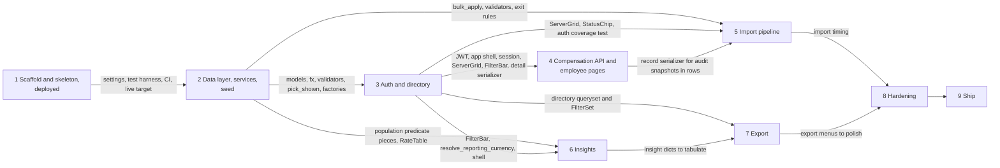

Owner decision: approved

# ACME Salary Management: Plan

What gets built, in what order, from `docs/SPEC.md` v2.1 section 15, the way `docs/DESIGN.md` describes it. Nine steps, each 2 to 6 commits, each closed by `/finish-step` (lint, tests, the four reviewers, DECISIONS and PERFORMANCE updates, one closing commit named after the step). A later step does not start before the earlier one is green and committed. Nothing marked P1 is built before the Ship step. Hours are focused wall-clock hours with Claude Code doing the work and the owner reviewing at each step close; they include the `/finish-step` cycle (two suite runs plus four reviewer agents, 20 to 30 minutes per step).

## Dependency graph

## Step 1. Scaffold and skeleton, deployed

Goal: an empty but real application on `https://acme.nutanprabhat.dev` with CI green, so every later step lands on a working target.

Files to create: `backend/pyproject.toml` (the pins in SPEC section 1, ruff and pytest config, `-m "not slow"` marker), `backend/uv.lock`, `backend/.python-version`, `backend/manage.py`, `backend/acme_salary/{__init__,wsgi,urls,spa}.py`, `backend/acme_salary/settings/{__init__,base,dev,prod,test}.py` (DESIGN 1.0), `backend/apps/__init__.py`, `backend/apps/accounts/{models,apps}.py` and `migrations/0001_initial.py`, `backend/apps/core/{views,apps}.py` (`healthz`), `backend/tests/{conftest.py,factories.py}` (user factory only), `backend/tests/core/test_healthz.py`, `backend/tests/accounts/test_user_model.py`, `backend/.env.example`. Frontend from `npm create vite@latest` (react-ts): `frontend/{.nvmrc,.npmrc,package.json,package-lock.json,vite.config.ts,vitest.config.ts,tsconfig.json,eslint.config.js,.prettierrc,index.html}`, `frontend/src/{main.tsx,App.tsx}` (create-vite 9 declares the Vite client types in `tsconfig.app.json`, so there is no `vite-env.d.ts`), `frontend/src/pages/Login.tsx` (placeholder form, no submit), `frontend/src/test/{setup.ts,handlers.ts,render.tsx}`, `frontend/src/App.test.tsx`. Root: `Dockerfile`, `docker-compose.yml`, `entrypoint.sh`, `.github/workflows/ci.yml`, `fly.toml` (exists; step 1 adds `[http_service.checks.headers] Host = "acme.nutanprabhat.dev"` under the health check, because Fly's checker sends the machine's internal address as `Host` and Django's `ALLOWED_HOSTS` answers 400, D29), `README.md` run section.

Tests: `/healthz` returns `{"status": "ok"}` and 200 unauthenticated; the custom user model logs in by email and has no username; the frontend smoke test renders the login placeholder; CI runs both suites and the Docker build.

Commits:

1. `build(backend): Django 6.1 project with accounts.User, settings split and /healthz`
2. `build(frontend): Vite 8 React 19 app with ESLint, Prettier, Vitest and MSW setup`
3. `build: multi-stage Dockerfile, compose, entrypoint and .env.example`
4. `ci: GitHub Actions for backend, frontend and the Docker build`
5. `build: scaffold deployed with domain and TLS (step 1)` (the finish-step commit: DECISIONS entries for the SQLite version check and the measured first boot, PERFORMANCE note)

Hours: 2.5.

Acceptance closed: SPEC section 8 line 373 (`GET /healthz` unauthenticated, one query); section 14 lines 494 to 502 (empty skeleton deployed with domain and TLS, Dockerfile stages, WhiteNoise serving, gunicorn flags, entrypoint sequence, settings from the environment, compose, CI jobs); section 14 line 499 (measured first boot recorded against the 300 s grace).

Risks: the Fly volume, secrets, certificate (verified on IPv4 and IPv6) and the Cloudflare CNAME were put in place by the owner on 7 October, so the deploy is only the `fly deploy` prompt at the end of the step and the step closes with the custom domain live (D30). Docker Desktop is not running on this machine, so the local image build needs it started; CI's Docker job builds the image regardless. `python:3.14-slim` must carry SQLite 3.37 or later (checked in commit 3). `node:26-slim` and `vite` 8 on Node 26 are new enough that `npm ci` may surface peer warnings; the pins in SPEC section 1 were verified on the registry on 7 Oct.

Plugin skills and connectors: Context7 for Django 6.1 settings and `urls`, DRF 3.18 defaults, SimpleJWT 5.5 settings, Vite 8 and Vitest 5 config, MSW 3 setup. No design skill in this step.

## Step 2. Data layer, services, seed

Goal: every table, rule and service exists and is tested without HTTP, and `seed_data` builds the 10,000-employee demo deterministically in under 60 s.

Files to create: `apps/core/{models,fx,services,money,dates,exceptions,pagination,filters}.py` (and with them the three `REST_FRAMEWORK` keys that name these modules, `DEFAULT_PAGINATION_CLASS`, `DEFAULT_FILTER_BACKENDS` and `EXCEPTION_HANDLER`, which step 1 left out of `settings/base.py` because the modules did not exist), `apps/core/management/commands/set_exchange_rate.py`, `apps/core/migrations/0001_initial.py`; `apps/employees/{models,services,queries}.py` (`pick_shown`, `shown_record_subquery`, `shown_label`; the directory queryset comes in step 3) and migration; `apps/compensation/{models,services,validators,messages}.py` and migration; `apps/imports/models.py` and migration (models only; the pipeline is step 5); `apps/insights/__init__.py`, `apps/exports/__init__.py`; `apps/audit/{models,services}.py` and migration; `seed/{__init__,apps,profiles,lookups,generator}.py`, `seed/management/commands/{seed_data,reset_demo}.py`; `apps/imports/management/commands/make_import_file.py`; `tests/factories.py` (all factories), `tests/conftest.py` (the fixtures in DESIGN 9), `tests/core/{test_fx,test_set_exchange_rate,test_money}.py`, `tests/compensation/{test_totals,test_services,test_validators,test_bulk_apply}.py`, `tests/employees/{test_services,test_queries}.py`, `tests/audit/{test_record,test_snapshots}.py`, `tests/seed/{test_seed.py,golden.txt}`, `tests/imports/test_make_import_file.py`.

Tests: the SPEC section 12 service rows in full: totals, net and cost maths; revision dating (half-open chaining, next-day revision, scheduled revision, cancel and reopen, exit closing the record, the one-open-record invariant, version assignment); FX (rate by date, earliest-rate fallback, routing through USD, `set_exchange_rate` closing the previous row and refusing non-first-of-month, backdated and duplicate months, `convert` precision); every section 7 rule with one passing and one failing case; `bulk_apply` equal to the single path; audit snapshots equal to the serializer output; the determinism hash at 500 employees and again after `--reset`, the shares and invariants, `--if-empty`.

Commits:

1. `feat(core): lookups, exchange rates, read-time fx and set_exchange_rate`
2. `feat(compensation): models, migrations, validators and totals`
3. `feat(compensation): revise, cancel, exit and the bulk entry point with audit`
4. `feat(seed): profiles, generator, seed_data, reset_demo and make_import_file`
5. `feat: data layer, services and seed (step 2)` (finish-step: DECISIONS entries for the lookup-as-data choice, the snapshot functions, the seed rounding; PERFORMANCE seed row)

Hours: 6.5.

Acceptance closed: SPEC F3 lines 261 to 267 at the service level (the API form of the same criteria closes in step 4); F7 line 312 at the service level; section 11 line 433 `[measured]` (seed under 60 s, one transaction, `--if-empty`, `--reset` clearing `sqlite_sequence`) and line 457 (determinism hash, golden file); section 7 lines 331 to 363 (every rule with a passing and a failing test); section 12 line 467 service rows.

Risks: the biggest step and the one everything else stands on; if it runs long the owner sees it first (D23). `bulk_create` returning primary keys on SQLite is a Django-on-SQLite-3.35 behaviour and is asserted by a test on the first commit that needs it. The golden hash changes whenever `profiles.py` changes, which is expected during this step and settles at its close. Seed timing on a laptop is not Fly timing; the Fly number is recorded at the first boot in step 1 and again at step 8.

Plugin skills and connectors: Context7 for Django 6.1 constraints (`condition=`), `Subquery`, `Case`, `bulk_create` and `bulk_update`, Faker's seeding API, factory_boy `post_generation`, freezegun on 3.14. `/add-validation-rule` for every section 7 rule. `/log-decision` for the choices above.

## Step 3. Auth and directory

Goal: the HR Manager can sign in on the live URL and page, sort, filter and search 10,000 employees under 300 ms.

Files to create: `apps/accounts/{views,serializers,urls}.py`; `apps/core/{views,urls}.py` (meta endpoints); `acme_salary/settings/base.py` gains a Content-Security-Policy through Django 6.1's `ContentSecurityPolicyMiddleware` (`script-src 'self'`, `connect-src 'self'`, `img-src 'self' data:`, `font-src 'self'`, `frame-ancestors 'none'`, `object-src 'none'`, and `style-src 'self' 'unsafe-inline'` because MUI's Emotion injects styles), logged with `/log-decision` and asserted by a test on an API response (owner's answer at the step 1 close); `apps/employees/{filters,serializers,views,urls}.py` and `queries.directory_queryset`; `acme_salary/urls.py` wiring; `apps/core/management/commands/timing.py` (directory cases; the rest lands in steps 5, 6 and 8); `tests/accounts/test_api.py`, `tests/test_auth_coverage.py`, `tests/core/test_meta_api.py`, `tests/employees/test_api.py`. Frontend: `src/api/{client,auth,meta,employees,keys,types}.ts`, `src/lib/{auth,money,dates,theme,constants}.ts`, `src/components/layout/{AppShell,RequireAuth,SessionGate,PageHeader,ErrorState,EmptyState,StatusChip}.tsx`, `src/components/grid/{ServerGrid.tsx,serverModel.ts,columns.ts}`, `src/components/filters/{FilterBar.tsx,useUrlFilters.ts}`, `src/pages/{Login,Employees,NotFound}.tsx`, `src/router.tsx`, `src/test/fixtures/{employees,meta}.ts`, handlers; tests `serverModel.test.ts`, `money.test.ts`, `dates.test.ts`, `client.test.ts`, `useUrlFilters.test.ts`, `Login.test.tsx`, `Employees.test.tsx`.

Tests: SPEC F8's three criteria plus rotation; the route-coverage test; directory filters combining with AND and surviving page and sort changes; `currency=local` with two countries 400; ordering on every allowed field including `-gross`; the pinned query count; the frontend list in DESIGN 9 for this step.

Commits:

1. `feat(auth): SimpleJWT login, refresh, logout, me and the login throttle`
2. `feat(directory): employee list and detail API with filters, search and the reporting-currency annotation`
3. `feat(frontend): theme, app shell, session handling and login page`
4. `feat(directory): server-side employee grid with FilterBar state in the URL`
5. `feat: auth and directory (step 3)` (finish-step: `/perf-timing` directory row, DECISIONS entry for `@fontsource/ibm-plex-sans` and any dependency added, deploy)

Hours: 4.

Acceptance closed: SPEC F8 lines 323 to 325; F4 lines 278 `[measured]`, 279 and 280; section 8 rows at lines 371 to 375, 377 and 378 (GET only); section 12 line 470 (FilterBar mapping, formatters, adapter with zero-based pages, session handling, login redirect).

Risks: the annotation query is measured right after commit 2, before any UI work, so a miss is found with the most time left; the fallback if it misses is to narrow the subquery to the two indexed columns and re-measure, not to materialise anything. MUI X 9, TanStack Query 5 and React Router 8 are newer than training data, so every prop and import is checked against Context7 before use. Dependency additions (`@fontsource/ibm-plex-sans`, `@mui/x-data-grid`, `@tanstack/react-query`, `react-hook-form`, `zod`, `recharts` are all in SPEC section 1 except the font package, which gets its DECISIONS line) prompt under rule 9.

Plugin skills and connectors: `/add-endpoint` for each API route, `/frontend-page` for the login and directory pages, `frontend-design` and `ui-ux-pro-max` for the shell, grid density and login layout following DESIGN 7, Context7 for SimpleJWT, DRF throttling, django-filter `OrderingFilter`, MUI 9 `createTheme`, MUI X 9 DataGrid server mode, TanStack Query 5, React Router 8.

## Step 4. Compensation API and employee pages

Goal: an employee can be created, edited, revised, scheduled, cancelled and exited from the browser, with the audit list visible.

Files to create: `apps/compensation/{serializers,views,urls}.py`; `apps/employees/views.py` additions (create, PATCH, exit, audit list) and serializers; `tests/compensation/test_api.py`, `tests/employees/test_api.py` additions, `tests/audit/test_api.py`. Frontend: `src/api/{compensation,audit}.ts`, `src/components/forms/{schemas.ts,EmployeeForm,RecordLinesFields,RevisionDialog,ExitDialog,EditIdentityDialog,applyServerErrors.ts}`, `src/components/employee/{CurrentRecordCard,HistoryList,AuditList}.tsx`, `src/pages/{EmployeeDetail,NewEmployee}.tsx`, fixtures and handlers; tests `EmployeeForm.test.tsx`, `EmployeeDetail.test.tsx`, `NewEmployee.test.tsx`.

Tests: SPEC F3's seven criteria through `APIClient` (400 and 409 cases assert the field and message), `gross_annual` in a body ignored, `version` unique per employee, F7 one entry per entity per write path, the audit list pinned; frontend: zod message shown, server field error mapped, cancelled row greyed, Cancel only on scheduled rows, exit dialog 409 shown inline.

Commits:

1. `feat(compensation): create employee, revise, cancel, exit and audit list endpoints`
2. `feat(frontend): employee detail with current record, history, cancel, exit and audit tab`
3. `feat(frontend): new employee page, edit dialog and revision form`
4. `feat: compensation API and employee pages (step 4)` (finish-step: DECISIONS entries for any choice made in the step; deploy)

Hours: 4.5.

Acceptance closed: SPEC F3 lines 261 to 267 through the API; F7 line 312 through the API; section 8 rows at lines 377 (POST), 378 (PATCH), 379 to 382 and 384.

Risks: the first-record form carries up to six amount inputs that depend on the chosen country, so the component list must load before the lines render; zod 4 changed its API from zod 3 and react-hook-form 7's resolver is checked on Context7; the detail page is the densest page and the first real test of the visual direction.

Plugin skills and connectors: `/add-endpoint`, `/frontend-page`, `frontend-design` for the detail card and history list, `ui-ux-pro-max` for inline validation and the error summary, Context7 for react-hook-form 7, zod 4, MUI 9 Dialog and Tabs.

## Step 5. Import pipeline

Goal: a 10,000-row template file is staged with per-row messages in under 30 s, reviewed, and applied in one transaction in under 15 s.

Files to create: `apps/imports/{parser,services,applier,template,serializers,views,urls}.py`, `tests/imports/{test_parser,test_staging,test_review,test_applier,test_template,test_api}.py`, `apps/core/management/commands/timing.py` import cases, `sample-data/acme-sample-50.xlsx` and `.csv`. Frontend: `src/api/imports.ts`, `src/components/imports/{UploadDropzone,BatchList,BatchSummaryStrip,RowMessagesCell,SkipToggle}.tsx`, `src/pages/{Imports,ImportReview}.tsx`, `columns.importRows`, fixtures and handlers; tests `Imports.test.tsx`, `ImportReview.test.tsx`.

Tests: SPEC F1's eight criteria (the first `[measured]`) and F2's four, the decision table row by row, header aliases, the three number cases, the 10,001st row, the content-type and size rejections, skip and unskip restoring status, re-validation after a UI revision, the simulated failure; frontend: status filter calls the API with `status=`, Approve disabled with the reason, skip toggles a row and refetches the summary.

Commits:

1. `feat(import): template download, parser, header aliases and number and date normalisation`
2. `feat(import): staging with validation, the decision table and batch counts`
3. `feat(import): skip, unskip, discard and atomic approve through bulk_apply`
4. `feat(frontend): imports page with upload, template download and batch list`
5. `feat(frontend): import review grid with cell messages, skip toggle, approve and discard`
6. `feat: import pipeline (step 5)` (finish-step: sample data, `/perf-timing` import row, DECISIONS entries for any choice made in the step; deploy)

Hours: 5.

Acceptance closed: SPEC F1 lines 212 to 219; F2 lines 244 to 247; section 8 rows at lines 385 to 389 and 391; section 7 header rows at lines 333 to 335 through the upload tests.

Risks: the 30 s staging budget is spent in Python validation and the context build, both measured on the first 10,000-row run (commit 2) with `make_import_file --all --raises 1000`; 10,000 `ImportRow` objects before `bulk_create` are the memory peak and are measured there too. openpyxl returns dates as `datetime` and numbers as floats, both covered by the parser tests. The review grid has the most columns of any page.

Plugin skills and connectors: `/add-validation-rule` for any rule wiring, `/add-endpoint`, `/frontend-page`, `ui-ux-pro-max` for the dropzone, summary strip and cell-message pattern, Context7 for openpyxl read-only and write-only modes, DRF `MultiPartParser`, MUI X 9 cell rendering.

## Step 6. Insights

Goal: the dashboard answers the six questions in SPEC section 9 for any country and department filter, in under 500 ms per card.

Files to create: `apps/insights/{queries,views,urls}.py`, `tests/insights/{fixture,test_queries,test_api}.py`, `timing.py` insight cases. Frontend: `src/api/insights.ts`, `src/components/insights/{InsightCard,KpiCard,KpiRow,ByCountryCard,ByDepartmentCard,DistributionCard,ByLevelCard,GenderGapCard,chartTheme.ts}`, `src/components/filters/FilterBar` dashboard variant, `src/pages/Dashboard.tsx`, fixtures and handlers; tests `Dashboard.test.tsx` and one test per card.

Tests: the thirty-row fixture with the hand-computed values in DESIGN 9 for every insight, one test per filter per insight (`country`, `department`, `include_exited`, `on`, `currency=eur`, `currency=local`), the small-group rule, the empty group, the single-band distribution, the 404, pinned query counts; frontend: each card renders the fixture numbers, a filter change refetches every card, the include-exited box changes the headcount by the fixture's exited count, the local currency option appears only with one country.

Commits:

1. `feat(insights): population predicate, summary, by-country and by-department`
2. `feat(insights): distribution, by-level and gender-gap with the small-group rule`
3. `feat(dashboard): FilterBar, rate month label, KPI row and the five charts`
4. `feat: insights dashboard (step 6)` (finish-step: `/perf-timing` insight rows, DECISIONS entries for any choice made in the step; deploy)

Hours: 4.

Acceptance closed: SPEC F5 lines 286 `[measured]` and 287; section 9 lines 400 to 411 (population, maths, every definition); section 8 line 392; section 12 line 467 insight row (the fixture with an exited employee, a scheduled revision, an empty group and a small gender group).

Risks: Recharts 3 changed its API (`ErrorBar` on `Scatter` for the by-level whiskers, `ReferenceLine` for the markers) and is checked on Context7 before the chart commit; medians pull up to 10,000 values into Python per request, which is well inside 500 ms but is measured; the five charts are where the visual direction is most visible and the dataviz mark specs are applied as written.

Plugin skills and connectors: `/add-insight` for every query, `dataviz` for the series hues, mark specs and the no-legend rule on single-series charts, `frontend-design` for the KPI figures and card layout, `ui-ux-pro-max` for the chart accessibility fallbacks, Context7 for Recharts 3.

## Step 7. Export

Goal: any filtered directory view and any insight table downloads as CSV, XLSX or JSON from the page it is shown on.

Files to create: `apps/exports/{writers,tables,views,urls}.py`, `tests/exports/{test_writers,test_api}.py`. Frontend: `src/api/exports.ts` (bearer fetch, blob, programmatic save), `src/components/ExportMenu.tsx` wired into the directory header and every insight card; tests `ExportMenu.test.tsx`.

Tests: a filtered export has exactly the filtered rows across pages; the unfiltered directory export has 10,000 rows (`[measured]`, through the timing command on the seed); a name starting with `=` is escaped in CSV and XLSX; column order and headers; JSON shape; unknown insight 404; the export endpoints need auth (covered by the route-coverage test).

Commits:

1. `feat(export): CSV, XLSX and JSON writers with formula escaping`
2. `feat(export): directory and insight export endpoints sharing the list filters`
3. `feat(frontend): export menus with bearer blob download`
4. `feat: export (step 7)` (finish-step: DECISIONS entries for any choice made in the step; deploy)

Hours: 2.

Acceptance closed: SPEC F6 lines 301, 302 `[measured]` and 303; section 8 lines 393 and 394.

Risks: a 10,000-row XLSX is built in memory (a few megabytes, fine on 1 GB); streaming CSV under gunicorn threads holds a database cursor open for the duration, acceptable with one user. This step shrinks first if time runs short (below).

Plugin skills and connectors: `/add-endpoint`, Context7 for openpyxl write-only mode and `StreamingHttpResponse`.

## Step 8. Hardening

Goal: the measured numbers are in `docs/PERFORMANCE.md`, every page has its error and empty states, keyboard and labels pass, and the README carries demo credentials and how the app was built.

Files to change: `apps/core/management/commands/timing.py` (complete, printing the PERFORMANCE row), `docs/PERFORMANCE.md`, `Dockerfile` and `entrypoint.sh` (an unprivileged user for the app, root kept only to own `/data`, the security reviewer's step 1 note), the pages and components listed in DESIGN 6's state table, `README.md` ("Run", "Test", "Demo credentials", "How this was built"), `.env.example` final, `docs/DECISIONS.md`.

Tests: the empty and error states of each page (fixture handlers returning empty results and 500), a keyboard test on each dialog (focus moves into the dialog and returns on close), labels present on every input (`getByLabelText` for each form field), no new backend tests beyond any fix a missed target forces.

Commits:

1. `perf: timing command complete and the measured numbers recorded`
2. `fix(frontend): error and empty states on every page and the accessibility pass`
3. `docs: README with run instructions, demo credentials and how it was built (step 8)`

Hours: 2.

Acceptance closed: the `[measured]` lines consolidated into one PERFORMANCE row on the final code: SPEC F1 line 212, F4 line 278, F5 line 286, F6 line 302, section 11 line 433, section 14 line 499; section 10 line 429 (error and empty states on every page); section 13 line 489 (accessibility row).

Risks: a missed target discovered here has the least time to fix; that is why the directory, import and insight timings are each measured at the end of their own step and only consolidated here. This step shrinks second (below).

Plugin skills and connectors: `/perf-timing`, `ui-ux-pro-max` for empty states, focus and the error summary, `frontend-design` for the copy of every state.

## Step 9. Ship

Goal: the final build is live, smoke-tested on the live URL, recorded, and the repository is public.

Files to change: `docs/DECISIONS.md` (final entries), `README.md` (live URL confirmed, demo video link), `docs/PERFORMANCE.md` (the Fly first-boot number from the final deploy).

Tests: none new. A manual smoke test on the live URL in the order of the demo: sign in, upload `sample-data/acme-sample-50.xlsx`, skip a flagged row, approve, open one of the imported employees, add a scheduled revision, change dashboard filters, export the directory.

Commits:

1. `docs: final decisions, performance notes and demo video link`
2. `chore: ship (step 9)`

Hours: 1.5, of which the demo recording is the owner's.

Acceptance closed: SPEC section 14 line 503 (demo video); REQUIREMENTS line 27 (live URL, Docker, recorded demo) and lines 52 to 54 (success criteria on the deployed instance).

Risks: a deploy in the last hour; the video takes longer than planned. Nothing in this step is optional.

Plugin skills and connectors: `/log-decision`. No design or library skill.

## Totals, target and shrink order

| Step | Hours | Cumulative | Planned close (IST, from a 12:30 start on 7 Oct) |
| --- | --- | --- | --- |
| 1 Scaffold and skeleton, deployed | 2.5 | 2.5 | 15:00, 7 Oct |
| 2 Data layer, services, seed | 6.5 | 9.0 | 21:30 |
| 3 Auth and directory | 4.0 | 13.0 | 01:30, 8 Oct |
| 4 Compensation API and employee pages | 4.5 | 17.5 | 06:00 |
| 5 Import pipeline | 5.0 | 22.5 | 11:00 |
| 6 Insights | 4.0 | 26.5 | 15:00 |
| 7 Export | 2.0 | 28.5 | 17:00 |
| 8 Hardening | 2.0 | 30.5 | 19:00 |
| 9 Ship | 1.5 | 32.0 | 20:30 |

Total: 32 hours.

Submission target: the morning of 8 October 2026 IST, full scope, per DECISIONS D19 and D23. The owner decides at the end on any overrun. At these estimates and with no breaks from a 12:30 start, steps 1 to 4 close by 06:00 on 8 October, step 5 by 11:00, step 6 by 15:00 and steps 7 to 9 by 20:30; the planned close column is the number D23 asks for, so each step's slip is visible against it at the time, not after. The table assumes continuous work; the owner's own stop time is not in it.

Shrink order if time runs short (SPEC section 15: steps 7 and 8 shrink before anything in 1 to 6 or 9):

1. Step 8 first: the accessibility pass and the per-page state polish drop; `/perf-timing`, the PERFORMANCE row and the README stay, because the `[measured]` criteria and the demo credentials depend on them.
2. Step 7 second: insight exports and the XLSX and JSON writers drop; the directory CSV export stays, because it is the one F6 criterion a reviewer will click.
3. Nothing in steps 1 to 6 or 9 is cut. Step 10 (P1) does not start.

## What the owner does by hand

1. Approve this document and `docs/DESIGN.md` by changing their first lines to `Owner decision: approved`, after answering or deferring the questions at the end of each. `/start-step 1` refuses to run before that.
2. Done on 7 October: the volume, the secrets, `fly certs add acme.nutanprabhat.dev` (verified on IPv4 and IPv6) and the Cloudflare CNAME with the proxy off. What remains is approving the `fly deploy` prompt when Claude Code runs it at the close of each deploying step. `fly` 0.4.113 is installed and logged in on this machine.
3. Copy `backend/.env.example` to `backend/.env` for local runs and choose a local `SEED_ADMIN_PASSWORD`.
4. Start Docker Desktop if a local `docker compose up` check is wanted before the Ship step; CI builds the image on every push either way.
5. Approve the dependency prompts under rule 9 (`uv add`, `npm install`) as they come, each with its DECISIONS line.
6. Answer any `Question for the human` a reviewer raises at a step close; the step waits on it.
7. In step 9: record the demo video on the live URL, give Claude Code the link for the README, and make the GitHub repository public.

## Questions for the owner

Answered on 7 October 2026, recorded as DECISIONS D30.

1. Deploy cadence: every step that adds a page (1, 3, 4, 5, 6, 7 and 9).
2. Step 1 and the by-hand list: moot, the Fly work is done; step 1 closes on the custom domain.
3. The slow seed test stays out of the commit hook.
