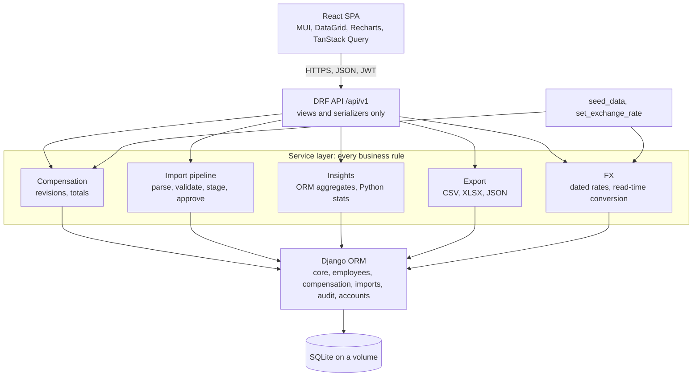
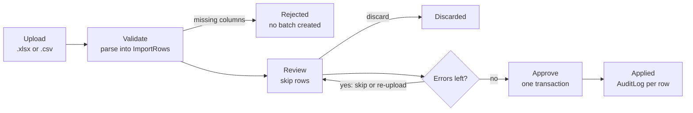

# ACME Salary Management: Engineering Spec

Scope lives in `docs/REQUIREMENTS.md`. Reasoning lives in `docs/DECISIONS.md`. This document says what to build and how. Items marked P1 are specified but not built until the Ship step is committed.

## 1. System overview

One Docker container runs Django, which serves the REST API and the built React bundle. SQLite on a persistent volume is the only state. The browser talks JSON over HTTPS with a JWT. There is no queue, cache or second service.

| Layer | Choice |
| --- | --- |
| Backend | Python 3.12, Django 5, Django REST Framework, djangorestframework-simplejwt, drf-spectacular, django-cors-headers, openpyxl |
| Database | SQLite, WAL mode, `busy_timeout=5000` |
| Frontend | React 18 + TypeScript, Vite, MUI, MUI X DataGrid (community), Recharts, TanStack Query, React Router, react-hook-form + zod |
| Tests | pytest, pytest-django, factory_boy, freezegun. Vitest, React Testing Library, MSW |
| Tooling | ruff (format + lint), eslint + prettier, pre-commit, GitHub Actions |
| Runtime | gunicorn + WhiteNoise, multi-stage Dockerfile, docker compose |



## 2. Layering rule

Views authenticate, parse query parameters and hand off. Every business rule (totals, revision dating, FX conversion, import validation and apply, insight maths) lives in a `services.py` or `queries.py` module that takes plain Python values and is unit-tested without HTTP. Models hold fields, constraints and indexes, not behaviour. Serializers never compute or accept totals.

## 3. Code layout

```
backend/
  manage.py
  pyproject.toml                 # deps, ruff, pytest config
  acme_salary/
    settings/{base,dev,prod,test}.py
    urls.py                      # /api/v1/*, /api/schema, SPA fallback
  apps/
    accounts/                    # login, refresh, me (SimpleJWT)
    core/                        # Country, Department, ExchangeRate, SalaryComponent, fx.py (rates, conversion), lookup API
    employees/                   # Employee, directory API (filters, search, ordering)
    compensation/                # CompensationRecord, CompensationLine, services.py, validators.py
    imports/                     # ImportBatch, ImportRow, parser.py, applier.py, API
    insights/                    # queries.py (one function per insight), API
    exports/                     # csv/xlsx/json writers, API
    audit/                       # AuditLog + record() helper
  seed/
    management/commands/seed_data.py
    profiles.py                  # per-country component sets and pay bands
  tests/                         # mirrors apps/, factories.py, conftest.py

frontend/
  src/
    api/           # fetch client, hand-written types, TanStack Query hooks
    pages/         # Login, Dashboard, Employees, EmployeeDetail, Imports, ImportReview
    components/    # grid wrappers, FilterBar, KpiCard, charts, forms
    lib/           # auth store, money and date formatters, constants
    test/          # Vitest + Testing Library + MSW handlers
```

## 4. Product rules

1. **Amounts are annual, in local currency, stored as Decimal.** Monthly figures are shown as annual divided by 12 in the UI, never stored.
2. **Components are data, not columns.** `SalaryComponent` defines each component as global or per country, with a kind of earning, deduction or employer contribution. A compensation record holds one line per component. Bonus is not a component: `bonus_annual` is a column on the record, since a signing or yearly bonus can go to anyone in any country and is one amount. Header totals are denormalised: gross = sum of earning lines + bonus, net = gross minus employee deductions, total cost = gross plus employer contributions. v1 ships ten components: `BASE`, `TAX` and `EMPLOYER_CONTRIBUTION` are global, plus `HRA` and `ALLOWANCES` (IN), `NATIONAL_INSURANCE` (GB), `SOCIAL_INSURANCE` (DE), `HOLIDAY_ALLOWANCE` (NL), `AWS` and `CPF` (SG). Employer cost is one undifferentiated line per record, so total cost stays distinct from gross without modelling each statutory scheme.
3. **Compensation is effective-dated.** A pay change creates a new record with `effective_from`. The previous record gets `effective_to` = new `effective_from` minus one day. Current pay is the record with `effective_to = null`. Records are never edited in place in v1. A mistake is fixed by a corrected revision with a note.
4. **Converted amounts are never stored.** Records hold local-currency amounts only. `ExchangeRate` is effective-dated: setting a rate inserts a new row and closes the previous one, so the table is the single source of truth and nothing in the salary tables can drift. Conversion happens at read time in `core/fx.py` at the rate effective on the reporting date (today by default). Reporting currency is USD by default, EUR selectable. A pair without a direct rate routes through USD. Local currency is always shown alongside, and the dashboard shows the rate's effective date.
5. **Import is staged.** Upload parses into `ImportBatch` + `ImportRow`. Review happens on the staged rows. Approve applies all accepted rows in one transaction. Live tables are never touched before approval.
6. **No hard deletes of pay data.** Employees are marked exited with `last_date` and `status`. Compensation records are superseded, never removed.
7. **Every write is audited.** Create, update, exit, revise and import apply all write `AuditLog` with actor, before and after JSON, and the batch id where relevant.
8. **Insights are computed on demand.** ORM aggregates for sums and counts, Python `statistics` over the filtered values for medians and percentiles. No precomputed tables.
9. **One import template.** One row per employee: identity columns, then one column per component code. A matched employee with changed amounts gets a new revision, unchanged amounts are a no-op, an unmatched code creates the employee.

## 5. Data model

Ten tables plus Django `auth_user`. Money is `Decimal(14,2)`, FX rates `Decimal(18,8)`, dates `DateField`.

Relationships: Employee to Country and Department. Employee 1:N CompensationRecord 1:N CompensationLine to SalaryComponent. ImportBatch 1:N ImportRow, each optionally matched to an Employee.

### Lookups

| Table | Columns | Notes |
| --- | --- | --- |
| `Country` | `code` CHAR(2) PK, `name`, `currency_code` CHAR(3) | Seeded: IN, US, GB, DE, NL, SG |
| `Department` | `id`, `code` unique, `name` | 12 seeded |
| `ExchangeRate` | `from_currency` CHAR(3), `to_currency` CHAR(3), `rate` Decimal(18,8), `effective_from` DATE, `effective_to` DATE nullable, `created_by` FK nullable, `created_at` | 1 `from_currency` = `rate` `to_currency`. Unique (`from_currency`, `to_currency`, `effective_from`). Partial unique: one row with `effective_to = null` per pair. Check `effective_to > effective_from`. `set_exchange_rate` inserts a row and closes the previous one in one transaction |
| `SalaryComponent` | `id`, `code` unique (e.g. `HRA`), `name`, `kind` enum(`earning`, `deduction`, `employer_contribution`), `country` FK nullable, `sort_order`, `is_active` | `country = null` means global (`BASE`, `TAX`, `EMPLOYER_CONTRIBUTION`) |

### Employee

| Column | Type | Notes |
| --- | --- | --- |
| `id` | PK | |
| `employee_code` | VARCHAR(16) unique | `ACME-000001`, immutable after create |
| `full_name` | VARCHAR(120) | indexed |
| `email` | VARCHAR(254) unique | work email, synthetic in seed |
| `gender` | enum(`female`, `male`, `other`, `undisclosed`) | drives the pay-gap insight |
| `department` | FK Department | indexed together with `country` |
| `designation` | VARCHAR(80) | e.g. Senior Engineer |
| `level` | SMALLINT 1 to 6 | pay-band axis |
| `country` | FK Country | sets currency and applicable components |
| `joining_date` | DATE | tenure axis |
| `last_date` | DATE nullable | set on exit |
| `status` | enum(`active`, `exited`) | kept in step with `last_date` by the service |
| `created_at`, `updated_at` | DATETIME | |

### CompensationRecord

| Column | Type | Notes |
| --- | --- | --- |
| `id` | PK | |
| `employee` | FK Employee | indexed together with `effective_to` |
| `currency_code` | CHAR(3) | copied from country at write time |
| `bonus_annual` | Decimal(14,2), default 0, non-negative | signing or yearly bonus, any country, included in gross |
| `effective_from` | DATE | unique together with `employee` |
| `effective_to` | DATE nullable | `null` = current. Partial unique constraint: one current record per employee |
| `gross_annual`, `net_annual`, `total_cost_annual` | Decimal(14,2) | computed from lines by the service, local currency, `gross_annual` indexed. No converted amount is stored |
| `source` | enum(`ui`, `import`, `seed`) | |
| `import_batch` | FK ImportBatch nullable | traceability |
| `note` | TEXT | reason for the revision |
| `created_by`, `created_at` | FK user nullable, DATETIME | |

Check constraint: `effective_to IS NULL OR effective_to > effective_from`.

### CompensationLine

| Column | Type | Notes |
| --- | --- | --- |
| `record` | FK CompensationRecord | cascade delete with record |
| `component` | FK SalaryComponent | unique together with `record` |
| `annual_amount` | Decimal(14,2), non-negative | |

### ImportBatch and ImportRow

| Table | Columns | Notes |
| --- | --- | --- |
| `ImportBatch` | `id`, `file_name`, `file_size`, `uploaded_by` FK, `uploaded_at`, `status` enum(`validating`, `review`, `approved`, `discarded`, `failed`), `total_rows`, `valid_rows`, `warning_rows`, `error_rows`, `skipped_rows`, `applied_rows`, `approved_at`, `error_summary` TEXT | Counts recomputed after every skip or unskip |
| `ImportRow` | `id`, `batch` FK, `row_number`, `raw` JSON (header to cell text), `normalized` JSON (typed values), `status` enum(`valid`, `warning`, `error`, `skipped`), `messages` JSON list of `{field, severity, message}`, `action` enum(`create`, `update`, `noop`), `matched_employee` FK nullable | unique (`batch`, `row_number`), index (`batch`, `status`) |

### AuditLog

| Column | Type | Notes |
| --- | --- | --- |
| `actor` | FK user nullable | null for seed |
| `timestamp` | DATETIME | indexed |
| `action` | enum(`create`, `update`, `exit`, `revise`, `import_apply`, `set_rate`) | |
| `entity_type`, `entity_id` | VARCHAR, INT | indexed together |
| `before`, `after` | JSON nullable | serialized snapshots |
| `import_batch` | FK nullable | groups one approval's writes |

## 6. Functional requirements

Acceptance criteria are the tests to write.

### F1. Spreadsheet import

- Accepts `.xlsx` and `.csv`, up to 10,000 data rows and 10 MB.
- Template columns: `employee_code, full_name, email, department, designation, level, country_code, gender, joining_date, last_date, effective_from, bonus_annual`, then one column per component code (for example `BASE, HRA, ALLOWANCES, TAX, EMPLOYER_CONTRIBUTION` for India). Blank component cells mean not applicable, blank `bonus_annual` means zero.
- Header matching is case-, space- and underscore-insensitive with an alias list (`Emp ID` maps to `employee_code`). Unknown columns are reported and ignored. Missing required columns reject the batch.
- Each row is validated against section 7 and gets a status of valid, warning or error.
- Rows match existing employees by `employee_code`. Matched and amounts changed: update, new revision. Matched and unchanged: no-op. Unmatched: create.

Acceptance:

- [ ] Given the 10,000-row seed export, when uploaded, then parsing and validation finish in under 30 s and the batch summary shows total, valid, warning and error counts.
- [ ] Given a row with `BASE = -5000`, then that row is `error` with a message naming the field and value, and other rows are unaffected.
- [ ] Given a file missing `country_code`, then the upload is rejected with the missing column named and no batch is created.
- [ ] Given any upload, then `Employee` and `CompensationRecord` row counts are unchanged until approval.

### F2. Review and approve



- Grid of staged rows filterable by status and searchable by code or name, messages shown per cell.
- Row actions: skip, unskip. Batch actions: approve, discard. A wrong value is fixed in the spreadsheet and re-uploaded. Inline cell editing is P1.
- Approve applies valid and warning rows that are not skipped. If any error row remains unskipped, approve is blocked and says how many.
- Approve is one database transaction: all accepted rows apply or none do. Each applied row writes an `AuditLog` entry carrying the batch id.

Acceptance:

- [ ] Given a batch with 3 error rows, when approve is called, then the request is refused with `3 rows have errors`.
- [ ] Given those 3 rows are skipped, when approved, then the batch status is `approved`, `applied_rows` = total minus 3, and audit entries equal `applied_rows`.
- [ ] Given an apply fails mid-way (simulated), then no partial employees or revisions exist.

### F3. Employees and compensation

- Employee: create, view, edit, mark exited. `employee_code` is unique and immutable after creation.
- Compensation: view the current record and a dated history. Add a revision whose `effective_from` is after the current record's. Records are never edited in place. In-place correction of the current record is P1.
- The same validators run for UI edits and imports.

Acceptance:

- [ ] Given an employee with a current record from 2025-04-01, when a revision dated 2025-03-01 is submitted, then it is rejected.
- [ ] Given a revision is added, then the previous record's `effective_to` equals the new `effective_from` minus 1 day and exactly one record has `effective_to = null`.
- [ ] Given a revision body that includes `gross_annual`, then the value is ignored, header totals are recomputed from the lines, and an audit entry records the new record.

### F4. Directory

- Server-side pagination (25, 50, 100). Sorting on name, code, department, country, designation, gross in the reporting currency, joining date.
- Filters: country, department, designation, level, status, gross range in the reporting currency, joining-date range. Search on name, code, email (contains, case-insensitive).
- Columns show local gross with its currency and the reporting-currency gross side by side, converted at read time. Reporting-currency sort and filter are an annotation (`gross_annual * rate`), not an indexed column, and are measured in `docs/PERFORMANCE.md`.

Acceptance:

- [ ] Given 10,000 employees, then any directory request returns in under 300 ms at p95 locally.
- [ ] Filters combine with AND and survive page changes and sorting.

### F5. Insights dashboard

The six questions in section 9, each a card or chart, all honouring country and department filters. Reporting currency is USD by default, EUR selectable, and local currency when a single country is selected. Every converted figure uses the rate effective on the reporting date, shown on the dashboard.

- [ ] Every insight endpoint responds in under 500 ms on the seed data.
- [ ] Changing a filter updates every card without a page reload.

### F6. Export

- The directory (current filters applied) and any insight table export to CSV, XLSX and JSON.
- Full-directory exports stream (CSV) or build server-side (XLSX) and download as `acme-employees-YYYYMMDD-HHMM.<ext>`.
- [ ] A filtered export has exactly the rows the grid shows. An unfiltered export has 10,000.

### F7. Audit trail

- Every create, update, exit and revise on employees and compensation, and every import apply, writes actor, timestamp, action, entity, before and after JSON, and batch id.
- Shown on the employee page as a plain list (who, when, what changed). A global audit page is P1.

### F8. Authentication

- Login page. One seeded HR Manager account. JWT access and refresh via SimpleJWT. Every `/api/` route requires auth except login and refresh. Logout clears tokens.

## 7. Import validation rules

One validator module, `compensation/validators.py`, used by the import pipeline, the API and the seed. Rules run per row and produce `{field, severity, message}` entries. The worst severity becomes the row status.

| Check | Severity | Message pattern |
| --- | --- | --- |
| Required column missing from the file header | rejects batch | `Missing required column: country_code` |
| Unknown column in header | batch warning | `Ignored unknown column: Remarks` |
| `employee_code` blank or malformed | error | `employee_code is required and must match ACME-NNNNNN` |
| `employee_code` repeated within the file | error on both rows | `Duplicate employee_code in rows 41 and 388` |
| `email` malformed, or in use by a different employee | error | `email already belongs to ACME-000217` |
| `country_code` not in Country table | error | `Unknown country_code: XX` |
| `department` not found | error | `Unknown department: Growth` (no auto-create) |
| `level` outside 1 to 6, or `gender` outside the enum | error | `level must be between 1 and 6` |
| `joining_date`, `last_date` or `effective_from` unparseable (ISO and Excel date cells accepted) | error | `joining_date is not a valid date: 31/02/2024` |
| `last_date` before `joining_date` | error | `last_date precedes joining_date` |
| `effective_from` not after the employee's current `effective_from` | error | `effective_from must be after 2025-04-01 (current record)` |
| Component column not applicable to the row's country | error | `HRA is not a component for US` |
| Component amount negative or non-numeric | error | `BASE must be a non-negative number, got -5000` |
| `BASE` missing or zero | error | `BASE is required` |
| `bonus_annual` negative or non-numeric | error | `bonus_annual must be a non-negative number, got -1` |
| Gross below the country's seeded minimum or above 10x the country median | warning | `gross 1,200,000 USD is above 10x the US median` |
| Row identical to the employee's current record | info, action `noop` | `No changes, row will be skipped on apply` |
| New employee row with blank `effective_from` | info | defaults `effective_from` to `joining_date` |

Numbers accept thousands separators and currency symbols (`₹12,00,000`, `$85,000.00`) and are normalised before validation. The normalised value is what the review grid shows and what gets applied.

## 8. API

REST under `/api/v1/`, JSON, JWT bearer on every route except login and refresh. List endpoints share one convention: `?page=&page_size=&ordering=&search=` plus named filters. Responses are `{count, next, previous, results}`. Schema from `drf-spectacular` at `/api/schema`. Frontend types are hand-written in v1.

| Method | Path | Purpose |
| --- | --- | --- |
| POST | `/auth/login`, `/auth/refresh` | SimpleJWT token pair and refresh |
| GET | `/auth/me` | current user |
| GET | `/meta/countries`, `/meta/departments`, `/meta/components?country=` | lookups for filters and forms |
| GET | `/meta/exchange-rates?on=` | rates effective on a date (today by default) with their effective dates, used for the dashboard rate label |
| POST | `/meta/exchange-rates` | P1. Set a rate, inserting a new row and closing the previous one. v1 uses the `set_exchange_rate` management command |
| GET, POST | `/employees` | directory list with filters `country, department, designation, level, status, currency, gross_min, gross_max, joined_after, joined_before`. `gross_min`, `gross_max` and ordering by `gross` are in the reporting `currency` (`usd` default, `eur`). Create |
| GET, PATCH | `/employees/{id}` | detail with current compensation embedded. Edit identity fields |
| POST | `/employees/{id}/exit` | body `{last_date}`, sets status |
| GET | `/employees/{id}/compensation` | full history, newest first, lines included |
| POST | `/employees/{id}/compensation` | new revision `{effective_from, note, lines:[{component, annual_amount}]}` |
| PATCH | `/compensation/{id}` | P1. Correct lines or note on the current record |
| GET | `/employees/{id}/audit` | audit list for one employee |
| GET | `/imports/template?country=` | XLSX template with that country's component columns, all countries when omitted |
| GET, POST | `/imports` | list batches. Upload multipart file, returns a batch in `review` or `failed` |
| GET | `/imports/{id}` | batch summary and counts |
| GET | `/imports/{id}/rows?status=&search=` | paginated staged rows |
| PATCH | `/imports/{id}/rows/{rowId}` | P1. Edit cells and re-validate that row |
| POST | `/imports/{id}/rows/{rowId}/skip`, `/unskip` | toggle skip |
| POST | `/imports/{id}/approve`, `/discard` | approve refused with 409 while unskipped error rows remain |
| GET | `/insights/{name}?country=&department=&currency=` | one endpoint per insight in section 9. `currency` is `usd` (default), `eur`, or `local` when a single country is selected |
| GET | `/exports/employees?format=&...filters` | same filters as the directory. `format` is `csv`, `xlsx` or `json` |
| GET | `/exports/insights/{name}?format=&...filters` | the insight's table |

Errors follow DRF's shape: `400` with per-field messages, `401` unauthenticated, `404`, `409` for state conflicts (approving with errors, revising with a past date). Upload rejections return `400` with `{missing_columns: [...], unknown_columns: [...]}`.

## 9. Insights

Each row is one endpoint and one card. All honour `country` and `department` filters and read current records (`effective_to = null`). Converted figures are computed at read time, never stored: sums are aggregated per (group, currency) in SQL, multiplied by the Decimal rate in Python and quantised to 2 dp. Medians and percentiles convert each value in Python, then compute. The rate used is the one effective on the reporting date.

| # | Question | Endpoint | Definition | Shown as |
| --- | --- | --- | --- | --- |
| 1 | How much do we spend and on how many people? | `summary` | active headcount, sum of total cost, mean and median gross, in the reporting currency, count of countries and departments | four KPI cards |
| 2 | Where does payroll go, by country? | `by-country` | per country: headcount, total cost, median gross, share of total (reporting currency) | bar chart |
| 3 | Which departments cost most and pay most? | `by-department` | per department: headcount, total cost, mean and median gross (reporting currency) | horizontal bar chart |
| 4 | How are salaries distributed? | `distribution` | histogram of gross (reporting currency) in 12 equal-width bands between p1 and p99, with p10, p25, p50, p75, p90 markers | histogram |
| 5 | What does each level pay? | `by-level` | per level 1 to 6: min, p25, median, p75, max gross (reporting currency) | median dot with p25 to p75 whisker |
| 6 | Is there a gender pay gap? | `gender-gap` | per country and overall: median gross (reporting currency) by gender. Gap % = (median male minus median female) divided by median male | grouped bars with gap label |

Deferred to P1, each one query and one card on the same pattern:

- `by-tenure`: tenure bands `<1, 1-3, 3-5, 5-10, 10+` years from `joining_date`, headcount and median gross (reporting currency) per band. Bar chart.
- `trend`: sum of total cost (reporting currency, at today's rate) and headcount of records effective at each month-end for 24 months (point-in-time over `effective_from` and `effective_to`). Line chart. The only non-trivial query, so it goes first if time allows.
- `top-earners?n=20`: top N by gross (reporting currency) with code, name, department, country, level. Table.
- `component-mix`: per country, sum per component as share of gross, split by kind. Stacked bar.
- `recent-changes?days=90`: revisions in the window, median % change, largest moves. Table.

## 10. Frontend pages

Seven routes behind one authenticated layout (left nav, top bar with user and logout). MUI X DataGrid for every grid, with server-side pagination, sorting and filtering mapped onto the DRF query params. Recharts for charts. TanStack Query owns server state and cache invalidation. react-hook-form + zod own forms.

| Route | Page | What is on it |
| --- | --- | --- |
| `/login` | Login | email + password. Access token in memory, refresh token in `localStorage`. Redirects to the last route |
| `/` | Dashboard | FilterBar (country, department, reporting currency USD or EUR, local when one country is selected) and the rate effective date. KPI row (insight 1). Charts for insights 2 to 6. Each card has an export menu |
| `/employees` | Directory | DataGrid with server-side everything. FilterBar, search box, column chooser. Row click opens detail. "Add employee" and "Export" buttons |
| `/employees/new` | New employee | identity form, bonus, and first compensation lines with components loaded for the chosen country |
| `/employees/:id` | Employee detail | header card. Current compensation with lines, local and reporting currency. Revision history list, newest first, with the note per revision. "Add revision" dialog. "Mark exited". Audit list tab |
| `/imports` | Imports | upload dropzone with template download. Batch list with status chips and counts |
| `/imports/:id` | Import review | summary strip (total, valid, warning, error, skipped). Status filter. DataGrid of rows with cell-level error tooltips. Skip toggle. Approve (disabled with reason while errors remain) and Discard. Template download link for fixing the sheet and re-uploading |

## 11. Seed data

`python manage.py seed_data --employees 10000 --seed 42` builds the dataset in under 60 s and produces byte-identical data on every run (fixed `random.Random(42)` and Faker seed, `created_at` frozen to the seed date). It goes through `compensation.services`, so seeded totals, FX and audit rows obey the real rules. Writes use `bulk_create` in chunks of 1,000. `--reset` truncates and rebuilds. Without it the command refuses to run on a non-empty database.

### Countries and component sets

Design parameters for a believable demo, not sourced statistics. `seed/profiles.py` holds them all.

Global components, present for every country: `BASE` (earning), `TAX` (deduction, a recorded projection, never computed), `EMPLOYER_CONTRIBUTION` (one undifferentiated employer line). Bonus is the `bonus_annual` column on the record, not a component.

| Country | Currency | Headcount share | Country-specific components | Level-3 median gross (local, annual) |
| --- | --- | --- | --- | --- |
| India (IN) | INR | 45% | `HRA`, `ALLOWANCES` (earnings) | 2,400,000 |
| United States (US) | USD | 20% | none beyond the global four | 150,000 |
| United Kingdom (GB) | GBP | 12% | `NATIONAL_INSURANCE` (deduction) | 75,000 |
| Germany (DE) | EUR | 10% | `SOCIAL_INSURANCE` (deduction) | 82,000 |
| Netherlands (NL) | EUR | 8% | `HOLIDAY_ALLOWANCE` (earning) | 78,000 |
| Singapore (SG) | SGD | 5% | `AWS` (earning, 13th month), `CPF` (deduction) | 110,000 |

### Generation rules

1. 12 departments with uneven shares (Engineering about 30%, Sales 15%, Support 12%, the rest split) and 6 levels in a pyramid (L1 25%, L2 25%, L3 20%, L4 15%, L5 10%, L6 5%). Designation derives from department and level (`Engineer`, `Senior Engineer`, `Staff Engineer`, and so on).
2. Base salary = country level anchor x lognormal noise (sigma 0.18) x department multiplier (Engineering 1.15, Support 0.8). Components are percentages of base per country profile with small per-employee jitter: IN `HRA` 40% and `ALLOWANCES` 25%, NL `HOLIDAY_ALLOWANCE` 8%, SG `AWS` one month of base, deductions `NATIONAL_INSURANCE` 10%, `SOCIAL_INSURANCE` 20%, `CPF` 20%, and `EMPLOYER_CONTRIBUTION` 8 to 20% by country. `bonus_annual` is 5 to 15% of base for about a third of employees, weighted toward US, GB and DE, and zero for the rest. `TAX` is a flat recorded projection by country band.
3. Gender 48% female, 50% male, 2% other or undisclosed, with a deliberate 3 to 6% median gap in two countries and about 0% in one country as a control.
4. `joining_date` uniform between 2015-01 and 2026-09. 8% of employees exited with `last_date` after joining. Exited employees keep their records.
5. Each employee gets 1 to 4 compensation revisions: one at joining, then one per completed April anniversary with a 4 to 12% raise, `effective_to` chained correctly.
6. Exchange rates seeded with `effective_from` 2026-10-01 and open `effective_to`: INR, GBP, EUR, SGD to USD, and INR, GBP, USD, SGD to EUR. Any other pair routes through USD.
7. An HR Manager user `hr@acme.example` with the password from `SEED_ADMIN_PASSWORD`.

## 12. Testing

Service layer first, API second, UI third. Backend suite on in-memory SQLite with small factories in under 60 s. Frontend unit suite in under 30 s. Both run in GitHub Actions on every push.

| Layer | Tooling | Covers |
| --- | --- | --- |
| Service unit tests | pytest, pytest-django, factory_boy, freezegun | totals and net and cost maths. Revision dating (chaining `effective_to`, rejecting past dates, one-current invariant). FX: rate lookup by date, routing through USD for pairs without a direct row, `set_exchange_rate` closing the previous row, Decimal precision of `convert`. Every rule in section 7 with one passing and one failing case. Parser header matching and number and date normalisation. Applier atomicity (forced failure leaves zero partial rows). Each insight query against a 30-row fixture with hand-computed expected values |
| API tests | DRF `APIClient` | auth required on every route. Directory filters, ordering, pagination. Create, revise, exit flows. Upload, review, skip, approve happy path and the 409 cases. Export row counts and headers. `django_assert_num_queries` on list and insight endpoints |
| Seed test | pytest, marked `slow` | `seed_data --employees 500` is deterministic (hash of a stable export matches) and respects shares and invariants |
| Frontend unit | Vitest, React Testing Library, MSW | FilterBar to query-param mapping. Money and date formatters. DataGrid server-model adapter. Import review status filter and approve-disabled reasoning. Login redirect |
| End-to-end (P1) | Playwright, 3 scripts | login, import 50 rows, skip 2, approve, see them in the directory. Add a revision. Dashboard filter changes a KPI |

Coverage target 85% on `apps/compensation`, `apps/imports` and `apps/insights`. Reported, not gated, elsewhere.

## 13. Non-functional requirements

| Area | Requirement | How |
| --- | --- | --- |
| Performance | Directory under 300 ms and insights under 500 ms at p95 on 10k employees, measured and recorded in `docs/PERFORMANCE.md` | indexes on filter and sort columns, denormalised totals, `select_related`, query counts pinned in tests |
| Import throughput | 10,000 rows parsed, validated and staged in under 30 s, approved in under 15 s | openpyxl read-only mode, pure Python validation, `bulk_create` in chunks of 1,000, one transaction on approve |
| Correctness | Decimal money, server-side totals only | single `compensation/services.py`, serializers reject client totals |
| Determinism | seed, tests and demo produce the same data every run | fixed seed, frozen dates in tests, no network in tests |
| Security | every API route authenticated, CORS limited to the frontend origin, secrets from environment | DRF default permission `IsAuthenticated`, `django-cors-headers`, `.env.example` committed |
| Data safety | no partial imports, no hard deletes, every change attributable | transactions, soft exit, `AuditLog` |
| Code quality | formatted and linted, CI green on every commit | ruff, eslint + prettier, pre-commit, GitHub Actions |
| Portability | one command locally, one container in production | `docker compose up`, multi-stage Dockerfile |
| Accessibility | keyboard-navigable forms and grids, labelled inputs, visible focus | MUI defaults, no custom controls that bypass them |

## 14. Deployment

- Node version is pinned once in `frontend/.nvmrc` as `24` (Active LTS). `package.json` mirrors it with `"engines": {"node": "24.x"}` and `frontend/.npmrc` sets `engine-strict=true`, so a wrong local Node fails `npm ci` immediately. The Dockerfile and CI read the same number, never a different one.
- Multi-stage `Dockerfile`: stage 1 `node:24-slim` runs `npm ci && npm run build`. Stage 2 `python:3.12-slim` installs backend deps, copies `frontend/dist` into Django's static root, runs `collectstatic`.
- Runtime: `gunicorn acme_salary.wsgi --workers 2 --threads 4`. WhiteNoise serves hashed static files and `index.html` for any non-`/api` path.
- `entrypoint.sh`: `migrate`, then `seed_data` if the employee table is empty, then gunicorn. The seed is deterministic, so an ephemeral disk rebuilds identical data on each cold start.
- Config from environment: `SECRET_KEY`, `DEBUG=0`, `ALLOWED_HOSTS`, `CORS_ALLOWED_ORIGINS`, `CSRF_TRUSTED_ORIGINS`, `DATABASE_PATH=/data/db.sqlite3`, `SEED_ADMIN_PASSWORD`.
- `docker compose up` for local parity.
- GitHub Actions workflow `.github/workflows/ci.yml` on every push and pull request, two jobs. Backend: `actions/setup-python` with `python-version: "3.12"` and `cache: pip`, then `ruff format --check`, `ruff check`, `pytest -q`. Frontend: `actions/setup-node` with `node-version-file: frontend/.nvmrc` and `cache: npm` with `cache-dependency-path: frontend/package-lock.json`, then `npm ci`, `npm run lint`, `npm test -- --run`, `npm run build`. A third job builds the Docker image after both pass. `package-lock.json` is committed, `npm install` never runs in CI.
- Hosting is required: a live public URL on one container host (Fly.io, Railway or Render) with a persistent volume for the SQLite file so the 10k seed runs once, not on every cold start. Served from a subdomain of nutanprabhat.dev: a CNAME to the host, which issues the TLS certificate. `ALLOWED_HOSTS`, `CORS_ALLOWED_ORIGINS` and `CSRF_TRUSTED_ORIGINS` carry the subdomain from the environment. The URL goes in the README.
- Demo video: screen recording of the hosted URL. Login, import the sample file, skip a flagged row, approve, open the employee, dashboard filters, export.

## 15. Build order

This is the proposed order. `docs/PLAN.md`, written after the spec review and approved by the owner, turns it into the operative plan with files, tests, commits and estimates per step, and may reorder or split steps with a recorded reason. Each step is 2 to 6 commits. Each commit is one coherent change with its tests. A later step does not start before the earlier one is green and committed.

1. **Scaffold.** Repo, `README`, `docs/`, `CLAUDE.md`, CI skeleton, Django and Vite projects that start empty.
2. **Data layer.** Models, migrations, constraints, admin registration, factories, `core/fx.py` (rate lookup by date, routing through USD, `set_exchange_rate`) with tests, `seed/profiles.py`, `seed_data` with determinism and invariant tests.
3. **Auth and directory.** SimpleJWT, employee list and detail API with filters and ordering, query-count tests. React shell, login, directory DataGrid.
4. **Compensation.** Services (totals, revisions), validators with full rule tests, compensation API, employee detail page with history, audit writes and list.
5. **Import pipeline.** Template endpoint, parser, staging, skip and unskip, approve with atomicity tests, imports pages, 50-row sample file with deliberate errors in `sample-data/`.
6. **Insights.** Six queries with fixture tests, endpoints, dashboard with FilterBar and charts.
7. **Export.** Writers, endpoints, export menus, row-count tests.
8. **Hardening.** `docs/PERFORMANCE.md` timings, index tuning if needed, error and empty states in the UI, accessibility pass.
9. **Ship.** Dockerfile and compose, deploy to the host, smoke test on the live URL, demo video, `docs/DECISIONS.md` finalised, README links to URL and video.
10. **P1.** Only after step 9 is committed, in this order: inline review edits, in-place corrections, deferred insights.

If time runs short, steps 7 and 8 shrink before anything in 1 to 6 or 9 does, and step 10 does not start.

## 16. P1 (after step 9)

- Inline cell editing in the import review grid with per-row re-validation (`PATCH /imports/{id}/rows/{rowId}`).
- In-place correction of the current compensation record (`PATCH /compensation/{id}`).
- The five deferred insights in section 9.
- TypeScript types generated from the OpenAPI schema.
- Column-mapping step for non-template spreadsheets.
- Pay bands per level with compa-ratio flagging, saved filter presets, global audit page, exchange-rate edit screen (`POST /meta/exchange-rates`).
- Playwright end-to-end scripts.

## 17. Repository layout

```
acme-salary/
  README.md                 # what, how to run, live URL if hosted, demo link, test commands
  CLAUDE.md                 # conventions for the agent
  docs/
    REQUIREMENTS.md         # the one-pager
    SPEC.md                 # this document
    DECISIONS.md            # why, ADR-style
    PERFORMANCE.md          # measured timings
    PLAN.md                 # what and in what order, written after the spec review is approved
    DESIGN.md               # how: modules, contracts, flows, UI structure, visual direction
    reviews/                # spec review reports, owner approves the latest before step 1
  backend/
  frontend/
  sample-data/              # 50-row demo import with deliberate errors
  Dockerfile, docker-compose.yml, entrypoint.sh
  fly.toml                  # or the host's equivalent config
  .github/workflows/ci.yml
```
