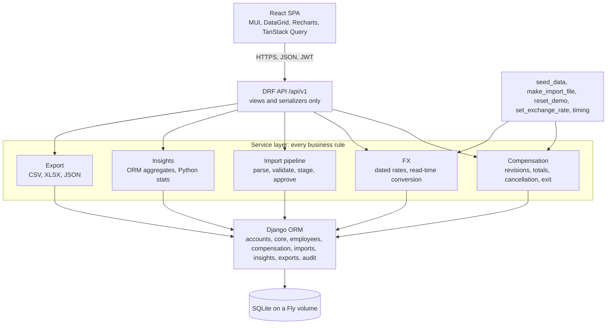
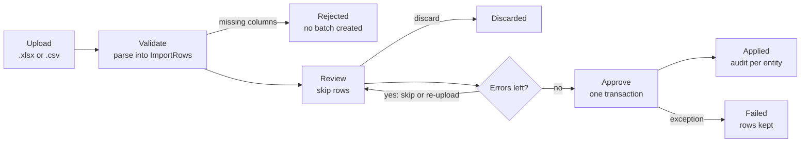

# ACME Salary Management: Engineering Spec, v2.3

Scope lives in `docs/REQUIREMENTS.md`. Reasoning lives in `docs/DECISIONS.md` (D1 to D37). This document says what to build and how. v2 folded in the 6 October spec review, v2.1 folds in the 7 October review (`docs/reviews/`) and the owner's decisions of 7 October, v2.2 applies the owner's answers to the plan-and-design questions (D24 to D30) to the by-level row in section 9 and the DNS and health-check wording in section 14, and, after the step 1 deploy, the health-check grace in section 14 (D31). v2.3 records the owner's step 2 answers (D36): revisions against an exit in F3, section 7 and section 8, the cancel rule in F3, and the import audit entries and count in F2. Items marked P1 are specified but not built until the Ship step is committed. Acceptance criteria are tagged `[test]` (a unit or API test) or `[measured]` (recorded by `/perf-timing` on the 10,000-row seed).

## 1. System overview

One Docker container runs Django, which serves the REST API and the built React bundle. SQLite on a persistent volume is the only state. The browser talks JSON over HTTPS with a JWT. There is no queue, cache or second service. The container is deployed on Fly.io from step 1.

| Layer | Pin | Note |
| --- | --- | --- |
| Python | 3.14, `backend/.python-version`, image `python:3.14-slim` | |
| Django | 6.1.x | current mainstream line. 5.2 LTS also supports 3.14, see D16 |
| Django REST Framework | 3.18.x | |
| djangorestframework-simplejwt | 5.5.x with `rest_framework_simplejwt.token_blacklist` | pure Python, CI on 3.14 verifies |
| django-filter, django-cors-headers, whitenoise | latest | |
| gunicorn | 26.x | |
| openpyxl 3.1.5, defusedxml | | upload parsing and XML hardening |
| Faker (pinned to the patch) | latest | main dependency group: the seed runs in production on first boot |
| factory_boy, freezegun, pytest, pytest-django, pytest-cov, ruff, pre-commit | latest | dev group, excluded by `uv sync --no-dev` |
| uv | `uv.lock` committed, `uv sync` locally, in CI and in Docker | |
| Node | 26, `frontend/.nvmrc`, `engines` `26.x`, `engine-strict=true`, image `node:26-slim` | |
| React 19.x, react-router 8.x, TypeScript 6.0.x, Vite 8.x, Vitest 5.x, MUI 9.x, MUI X 9.x (community), Recharts 3.x, TanStack Query 5.x, react-hook-form 7.x, zod 4.x, MSW 3.0.x, Testing Library | latest majors | MSW handlers use the 3.x imports (`msw/http`) |

Every runtime dependency is listed in DECISIONS D16 with its reason. If a pure-Python library fails on 3.14, the fallback is Python 3.13 in `.python-version` and the Dockerfile.



## 2. Layering rule

Views authenticate, parse query parameters and hand off. Serializers check shape and types only. Every business rule (totals, revision dating, cancellation, exit, FX conversion, import validation and apply, insight maths) lives in a `services.py` or `queries.py` module that takes plain Python values and is unit-tested without HTTP. Services call the validators. Models hold fields, constraints and indexes, not behaviour. Serializers never compute or accept totals, and undeclared fields are dropped.

## 3. Code layout

```
backend/
  manage.py
  pyproject.toml                 # deps, ruff, pytest config
  uv.lock
  .python-version                # 3.14
  acme_salary/
    settings/{base,dev,prod,test}.py
    urls.py                      # /api/v1/*, /healthz, SPA catch-all
    spa.py                       # catch-all view serving index.html
  apps/
    accounts/                    # User (email login), login, refresh, logout, me
    core/                        # Country, Department, ExchangeRate, SalaryComponent, fx.py, lookup API,
                                 # management/commands: set_exchange_rate, timing
    employees/                   # Employee, directory API, exit
    compensation/                # CompensationRecord, CompensationLine, services.py, validators.py
    imports/                     # ImportBatch, ImportRow, parser.py, applier.py, API,
                                 # management/commands: make_import_file
    insights/                    # queries.py (one function per insight), API
    exports/                     # csv/xlsx/json writers, API
    audit/                       # AuditLog + record() helper
  seed/
    management/commands/seed_data.py, reset_demo.py
    profiles.py                  # per-country component sets, base anchors, level multipliers
  tests/                         # mirrors apps/, factories.py, conftest.py

frontend/
  .nvmrc                         # 26
  .npmrc                         # engine-strict=true
  src/
    api/           # fetch client, hand-written types, TanStack Query hooks, session handling
    pages/         # Login, Dashboard, Employees, EmployeeDetail, NewEmployee, Imports, ImportReview
    components/    # grid wrappers and server-model adapter, FilterBar, KpiCard, charts, forms
    lib/           # auth store, money and date formatters, constants
    test/          # Vitest + Testing Library + MSW handlers
```

## 4. Product rules

1. **Amounts are annual, in local currency, stored as Decimal.** Monthly figures are shown as annual divided by 12 in the UI, never stored. In Python every amount is a `Decimal`. SQLite stores them as REAL, so SQL arithmetic is used only to order and filter. Every value sent to a client is quantised in Python, half-up to 2 decimal places.
2. **Components are data, not columns.** `SalaryComponent` defines each component as global or per country, with a kind of earning, deduction or employer contribution. A compensation record holds one line per component. Ten components ship in v1: `BASE`, `TAX` and `EMPLOYER_CONTRIBUTION` are global, plus `HRA` and `ALLOWANCES` (IN), `NATIONAL_INSURANCE` (GB), `SOCIAL_INSURANCE` (DE), `HOLIDAY_ALLOWANCE` (NL), `AWS` and `CPF` (SG). Bonus is not a component: `bonus_annual` is a column on the record, as a signing or yearly bonus can go to anyone in any country. Header totals are denormalised: gross = sum of earning lines + bonus, net = gross minus employee deductions, total cost = gross plus employer contributions.
3. **Compensation is effective-dated with half-open intervals.** Each record has `effective_from` (inclusive) and `effective_to` (exclusive, equal to the next record's `effective_from`, `null` when open-ended). A record is current on date `d` when `effective_from <= d` and (`effective_to` is null or `effective_to > d`). The reporting date defaults to today in UTC and may be passed as `on=`. A record with `effective_from` after today is scheduled. A new revision's `effective_from` must be after the latest record's. Several scheduled revisions may exist. A scheduled record may be cancelled until it takes effect: cancellation sets `cancelled_at` and `cancelled_by`, the row stays, and every query that means "the records that count" excludes cancelled rows. On a record that has ever been current, amounts, lines, `effective_from`, `bonus_annual` and `note` are immutable; `effective_to` is owned by the service and is set by revise and exit. Each record carries a per-employee `version` number.
4. **Converted amounts are never stored.** Records hold local-currency amounts only. `ExchangeRate` is effective-dated by currency pair. Setting a rate inserts a new row and closes the previous one, so the table is the single source of truth. Conversion happens at read time in `core/fx.py` at the rate effective on the reporting date. Rates change only on the first day of a month, so each rate row is a month, and a date before the earliest rate uses the earliest rate. Reporting currency is USD by default, EUR selectable. A pair without a direct rate routes through USD. Local currency is always shown alongside, and the dashboard shows the rate's effective date.
5. **Import is staged.** Upload parses into `ImportBatch` and `ImportRow`. Review happens on the staged rows. Approve applies all accepted rows in one transaction. Live tables are never touched before approval.
6. **No row of pay data is ever deleted.** Employees are exited, never deleted: exit sets `last_date` and closes the open-ended record at `last_date + 1 day`. A `last_date` before the open record's `effective_from` is a `400`. A future `last_date` is a scheduled exit. Active on date `d` means `joining_date <= d` and (`last_date` is null or `last_date >= d`). A scheduled revision is cancelled by marking it, never by deleting it. The only operations that remove rows are `seed_data --reset` and `reset_demo`, which rebuild the demo database on the owner's command.
7. **Every write is audited.** Create, update, exit, revise, cancel, import apply and rate changes all write `AuditLog` with actor, before and after JSON, the employee where relevant, and the batch id where relevant.
8. **Insights are computed on demand.** ORM aggregates for sums and counts, Python `statistics` over the filtered values for medians and percentiles. No precomputed tables.
9. **One import template.** One row per employee: identity columns, `bonus_annual`, then one column per component code. Matched rows are classified by the decision table in F1.
10. **No Django admin.** `django.contrib.admin` is not installed. Nothing edits data outside the services.

## 5. Data model

Thirteen model tables: the custom user, two blacklist tables from SimpleJWT, four lookups, Employee, two compensation tables, two import tables, AuditLog. Django's own auth, content-type and migration tables come on top. Money is `Decimal(14,2)`, FX rates `Decimal(18,8)`, dates `DateField`. Timestamps use `default=timezone.now` rather than `auto_now_add` so the seed can set them.

Relationships: Employee to Country and Department. Employee 1:N CompensationRecord 1:N CompensationLine to SalaryComponent. ImportBatch 1:N ImportRow, each optionally matched to an Employee. AuditLog to Employee (nullable), User (nullable), ImportBatch (nullable).

`on_delete`: `PROTECT` for Country, Department and SalaryComponent. `CASCADE` for lines under a record and rows under a batch. `SET_NULL` for users and `import_batch`.

### Users

`accounts.User` extends `AbstractUser` with `username = None`, `email` unique and `USERNAME_FIELD = "email"`. Created in the first migration, before any other app. The blacklist app adds `OutstandingToken` and `BlacklistedToken`.

### Lookups

| Table | Columns | Notes |
| --- | --- | --- |
| `Country` | `code` CHAR(2) PK, `name`, `currency_code` CHAR(3), `min_gross_annual` Decimal(14,2) | Seeded IN, US, GB, DE, NL, SG. The minimum drives the below-minimum warning |
| `Department` | `id`, `code` unique, `name` | 12 seeded, section 11 |
| `ExchangeRate` | `from_currency` CHAR(3), `to_currency` CHAR(3), `rate` Decimal(18,8), `effective_from` DATE, `effective_to` DATE nullable, `created_by` FK nullable, `created_at` | 1 `from_currency` = `rate` `to_currency`. Unique (`from_currency`, `to_currency`, `effective_from`). Partial unique: one row with `effective_to = null` per pair. Checks `effective_to > effective_from`, `rate > 0`, `from_currency <> to_currency` |
| `SalaryComponent` | `id`, `code` unique, `name`, `kind` enum(`earning`, `deduction`, `employer_contribution`), `country` FK nullable, `sort_order`, `is_active` | `country = null` means global (`BASE`, `TAX`, `EMPLOYER_CONTRIBUTION`) |

### Employee

| Column | Type | Notes |
| --- | --- | --- |
| `id` | PK | |
| `employee_code` | VARCHAR(16) unique | `ACME-NNNNNN`, immutable after create, required on import, server-assigned on UI create |
| `full_name` | VARCHAR(120) | indexed |
| `email` | VARCHAR(254) unique | stored lowercase |
| `gender` | enum(`female`, `male`, `other`, `undisclosed`) | |
| `department` | FK Department | indexed with `country` |
| `designation` | VARCHAR(80) | indexed |
| `level` | SMALLINT | check `BETWEEN 1 AND 6`, indexed |
| `country` | FK Country | sets currency and applicable components |
| `joining_date` | DATE | indexed. May be in the future |
| `last_date` | DATE nullable | indexed. Check `last_date IS NULL OR last_date >= joining_date` |
| `updated_at` | DATETIME | set by the service on every write, `default=timezone.now`, not `auto_now`, so the seed controls it |
| `created_at` | DATETIME | `default=timezone.now` |

There is no `status` column. Active is derived from `joining_date` and `last_date` against the reporting date.

### CompensationRecord

| Column | Type | Notes |
| --- | --- | --- |
| `id` | PK | |
| `employee` | FK Employee | indexed with `effective_to`, and with `effective_from` |
| `version` | SMALLINT | unique with `employee`, assigned by the service as previous maximum plus one |
| `currency_code` | CHAR(3) | copied from country at write time |
| `bonus_annual` | Decimal(14,2), default 0, check `>= 0` | included in gross |
| `effective_from` | DATE | unique with `employee` |
| `effective_to` | DATE nullable | exclusive. `null` = open-ended. Partial unique: one open-ended, non-cancelled record per employee (`WHERE effective_to IS NULL AND cancelled_at IS NULL`). Check `effective_to > effective_from` |
| `cancelled_at`, `cancelled_by` | DATETIME nullable, FK User nullable | set by the cancel service on a scheduled record. Cancelled rows are excluded from every current-or-latest query and shown greyed in history |
| `gross_annual`, `net_annual`, `total_cost_annual` | Decimal(14,2) | computed from lines and bonus by the service, local currency. `gross_annual` indexed |
| `source` | enum(`ui`, `import`, `seed`) | |
| `import_batch` | FK ImportBatch nullable | |
| `note` | TEXT | reason for the revision |
| `created_by`, `created_at` | FK User nullable, DATETIME | |

### CompensationLine

| Column | Type | Notes |
| --- | --- | --- |
| `record` | FK CompensationRecord | cascade |
| `component` | FK SalaryComponent | unique with `record` |
| `annual_amount` | Decimal(14,2), check `>= 0` | |

### ImportBatch and ImportRow

| Table | Columns | Notes |
| --- | --- | --- |
| `ImportBatch` | `id`, `file_name`, `file_size`, `uploaded_by` FK, `uploaded_at`, `status` enum(`review`, `approved`, `discarded`, `failed`), `warnings` JSON, `total_rows`, `valid_rows`, `warning_rows`, `error_rows`, `skipped_rows`, `noop_rows`, `created_rows`, `updated_rows`, `revised_rows`, `applied_rows`, `approved_at`, `error_summary` TEXT | counts recomputed after every skip or unskip. `updated_rows` counts identity-only rows, `revised_rows` counts rows that produced a new record (with or without identity changes). `applied_rows` = created + updated + revised |
| `ImportRow` | `id`, `batch` FK, `row_number`, `employee_code`, `full_name`, `raw` JSON, `normalized` JSON, `status` enum(`valid`, `warning`, `error`, `skipped`), `validation_status` enum(`valid`, `warning`, `error`), `messages` JSON list of `{field, severity, message}`, `action` enum(`create`, `update`, `revise`, `noop`) nullable, `matched_employee` FK nullable | unique (`batch`, `row_number`), index (`batch`, `status`). `employee_code` and `full_name` denormalised for search. `validation_status` is what the rules produced, `status` adds `skipped`; unskip restores `status` from `validation_status`. `action` null when the row has no usable code |

### AuditLog

| Column | Type | Notes |
| --- | --- | --- |
| `actor` | FK User nullable | null for seed |
| `timestamp` | DATETIME | indexed |
| `action` | enum(`create`, `update`, `exit`, `revise`, `cancel`, `import_apply`, `set_rate`) | `import_apply` is written once per approved batch on the batch itself; the rows it applied carry `create`, `update` and `revise` with `import_batch` set |
| `entity_type`, `entity_id` | VARCHAR, INT | indexed together |
| `employee` | FK Employee nullable | set on every employee and record write, indexed |
| `before`, `after` | JSON nullable | the detail serializer output |
| `import_batch` | FK nullable | groups one approval's writes |

## 6. Functional requirements

### F1. Spreadsheet import

- Accepts `.xlsx` and `.csv`, up to 10,000 data rows and 10 MB. Extension and content type are checked. XLSX is opened with `read_only=True`, `data_only=True`, with defusedxml installed. CSV must be UTF-8, BOM accepted.
- Template columns, in order: `EmployeeID, full_name, email, department, designation, level, country_code, gender, joining_date, last_date, effective_from, bonus_annual`, then one column per component code (for India: `BASE, HRA, ALLOWANCES, TAX, EMPLOYER_CONTRIBUTION`). Required: `EmployeeID, full_name, email, department, designation, level, country_code, gender, joining_date, BASE`. Blank component cells mean not applicable. Blank `bonus_annual` means zero.
- Header matching is case-, space- and underscore-insensitive with an alias list (`employee_code`, `Emp ID`, `Employee Code` map to `EmployeeID`). Unknown columns are recorded in `ImportBatch.warnings` and ignored. Missing required columns reject the upload with `400 {missing_columns, unknown_columns}` and no batch is created.
- Numbers: currency symbols and spaces stripped. A comma followed by exactly three digits with no dot anywhere is a thousands separator and is removed (`1,200` is 1200, `12,00,000` is 1200000). Any other comma is a decimal-separator error with a hint. Dot is the only decimal separator. More than two decimals is an error.
- Each row is validated against section 7 in this order: structure and types, identity references, duplicate code and email within the file, amounts changed, no-op, date rules. The worst severity becomes the row status.
- Unmatched `EmployeeID` creates the employee and the first record. `effective_from` defaults to `joining_date` with an info message.
- Matched rows follow this table. Identity fields are `full_name, email, department, designation, level, gender, joining_date, last_date`. Amounts are `bonus_annual` and every component column. A `last_date` that appears or changes runs the exit service with its rules (F3), so the open record is closed and the `409` cases become row errors. A blank `last_date` on an exited employee is an error, `clearing last_date is not supported by import` (undo exit is P1).

| Identity changed | Amounts changed | `effective_from` | Action |
| --- | --- | --- | --- |
| no | no | any | `noop` |
| yes | no | any | `update`, identity fields only |
| any | yes | given and after the latest record | `revise`: a new record, identity fields updated in the same transaction if they changed |
| any | yes | blank | error `effective_from is required when amounts change` |
| any | yes | not after the latest record | error from section 7 |
| `country_code` differs | any | any | error `country change is not supported by import` |

Acceptance:

- [ ] `[measured]` A 10,000-row file from `make_import_file --all --raises 1000` is parsed, validated and staged in under 30 s and the batch summary shows total, valid, warning, error counts.
- [ ] `[test]` A row with `BASE = -5000` is `error` with a message naming the field and value, and other rows are unaffected.
- [ ] `[test]` A file missing `country_code` is rejected with the missing column named and no batch is created.
- [ ] `[test]` A matched row identical to the current record is `noop`, and the date rule is not evaluated for it.
- [ ] `[test]` A matched row with a changed department and unchanged amounts is `update` and produces no new record on apply.
- [ ] `[test]` `1,200` normalises to 1200, `1.200.000,50` is an error with the separator hint, `12,00,000` normalises to 1200000.
- [ ] `[test]` A matched row with a new `last_date` closes the open record at `last_date + 1` on apply.
- [ ] `[test]` Any upload leaves `Employee` and `CompensationRecord` row counts unchanged until approval.

### F2. Review and approve



- Grid of staged rows filterable by status and searchable by `employee_code` or `full_name`, messages shown per cell.
- Row actions: skip, unskip. Batch actions: approve, discard. A wrong value is fixed in the spreadsheet and re-uploaded. Inline cell editing is P1.
- Approve applies valid and warning rows that are not skipped and not `noop`. If any error row remains unskipped, approve is refused with `409` and the count. Approve, skip, unskip and discard on a batch not in `review` are `409`.
- Approve is one database transaction. The date and duplicate rules are re-run against the database inside it. All accepted rows apply or none do. On exception the batch becomes `failed` with `error_summary` and the rows are kept.
- Audit: one entry per entity written with `import_batch` set, so a create row writes a `create` entry on the employee and a `revise` entry on the record, an identity-only row writes one `update` entry, a revise row writes one `revise` entry on the new record (its `before` is the previous record's snapshot), and a row that changes identity fields or sets `last_date` as well as amounts writes its `update` or `exit` entry on the employee first and then the `revise` entry on the record, the same order as the API path. One `import_apply` entry is written on the batch itself with the counts in `after`.

Acceptance:

- [ ] `[test]` A batch with 3 error rows is refused on approve with `3 rows have errors`.
- [ ] `[test]` With those 3 rows skipped, approve sets `approved`, `applied_rows` = total minus skipped minus no-ops, and audit entries equal 2 x created + updated + revised + (revised rows that also changed identity or set `last_date`) + 1 for the batch.
- [ ] `[test]` A simulated failure mid-apply leaves zero partial employees or records and the batch is `failed`.
- [ ] `[test]` Approving an approved batch returns `409`.

### F3. Employees and compensation

- Create an employee with identity fields, `bonus_annual` and the first record's lines, in one transaction. `employee_code` is assigned as the next `ACME-NNNNNN` when omitted. `effective_from` defaults to `joining_date`.
- Edit identity fields. `employee_code` and `country_code` cannot change through the API (`400`).
- Add a revision: `effective_from` after the latest record's, lines, `bonus_annual`, note. The service closes the previous open-ended record at the new `effective_from`, assigns the next `version`, recomputes totals.
- Cancel a scheduled revision: allowed only while `effective_from > today`, else `409`. The service sets `cancelled_at` and `cancelled_by`, and the previous non-cancelled record's `effective_to` becomes the next non-cancelled scheduled record's `effective_from`, else `last_date + 1 day` when the employee has a `last_date`, else `null`. Audit action `cancel` with the full record in `before` and the cancelled row in `after`.
- Exit: `last_date >= joining_date` and `last_date + 1 > effective_from` of the open record, else `400`. Already exited, or non-cancelled scheduled revisions after `last_date`, is `409` (cancel them first). Closes the open-ended record at `last_date + 1 day`. Undo exit is P1.
- Revisions and exits: for an employee with a `last_date`, a revision dated after it is a `409`, and a revision dated on or before it is accepted and ends at `last_date + 1 day`. The same rule applies through the API, the import and the seed.
- Detail shows the record current on the reporting date, or the latest record labelled "from <date>" or "exited <date>", the revision history newest first with version and note, and the audit list.
- The same validators run for UI edits and imports.

Acceptance:

- [ ] `[test]` A revision dated before or on the latest record's `effective_from` returns `400` with the field message.
- [ ] `[test]` A revision dated the day after the current record is accepted, the previous record's `effective_to` equals the new `effective_from`, and exactly one record has `effective_to = null`.
- [ ] `[test]` A revision dated next year is scheduled: the directory and insights still show the current record today, and show the new one when `on=` is that date.
- [ ] `[test]` Cancelling the scheduled revision sets `cancelled_at`, keeps the row, reopens the previous record, and the row appears in history as cancelled. Cancelling a current record returns `409`.
- [ ] `[test]` Exit closes the open record at `last_date + 1`, the employee is excluded from insights on the day after, and a second exit returns `409`. A `last_date` before the open record's `effective_from` returns `400`.
- [ ] `[test]` A body that includes `gross_annual` has it ignored and totals recomputed from lines and bonus.
- [ ] `[test]` `version` increments per employee and is unique with it.

### F4. Directory

- Server-side pagination (25, 50, 100). Ordering on `full_name, employee_code, department, country, designation, level, gross, joining_date`, `-` prefix for descending. `gross` is the reporting-currency annotation.
- Filters: `country`, `department`, `designation`, `level`, `status` (`active`, `exited` or `upcoming` for a future joiner, judged on the reporting date), `gross_min`, `gross_max` in the reporting currency, `joined_after`, `joined_before`, `on`, `currency`. Multi-value filters are comma-separated. Search on name, code, email.
- Columns show local gross with its currency and the reporting-currency gross side by side, both from the record current on the reporting date, else the latest record with its label.
- Reporting-currency sort and filter are an annotation, not an indexed column: a `CASE WHEN currency_code = ... THEN rate` expression built in Python from the rate lookup for `on`, multiplied by `gross_annual` of the per-employee record that is current on `on`, else the latest non-cancelled record, selected with a correlated subquery. Range filters compare with a tolerance of 0.005. This is the one query the 300 ms target depends on and DESIGN.md specifies it.

Acceptance:

- [ ] `[measured]` Any directory request returns in under 300 ms at p95 on the 10k seed.
- [ ] `[test]` Filters combine with AND and survive page changes and sorting.
- [ ] `[test]` `currency=local` with two countries in the filter returns `400`.

### F5. Insights dashboard

The six questions in section 9, each a card or chart, honouring `country`, `department`, `include_exited` (default false) and `on`. `currency` is a parameter: `usd` by default, `eur`, or `local`. The dashboard offers `local` in the toggle only while exactly one country is selected and switches back to `usd` if the country filter changes. The rate month in use is shown ("October 2026 rates").

- [ ] `[measured]` Every insight endpoint responds in under 500 ms on the seed.
- [ ] `[test]` Changing a filter refetches every card. The include-exited checkbox changes headcount by the number of exited employees in the filter.

### F6. Export

- The directory (current filters and `on` applied) and any insight table export as CSV, XLSX or JSON through `?file=`.
- Directory columns: EmployeeID, full name, email, department, designation, level, country, currency, gross (local), bonus (local), gross (reporting currency), status, joining date, last date, effective from, version.
- Insight tables: `summary` one row, `by-country` and `by-department` one row per group, `distribution` one row per band, `by-level` one row per level, `gender-gap` one row per group and gender.
- The export is the whole filtered set, not the visible page. CSV streams. XLSX builds server-side. File name `acme-<what>-YYYYMMDD-HHMM.<ext>`.
- Cells starting with `=`, `+`, `-`, `@`, tab or carriage return are prefixed with a single quote.
- The frontend fetches with the bearer token, receives a blob and triggers the save.
- `/exports/insights/{name}/` with an unknown name is `404`, as is `/insights/{name}/`.

Acceptance:

- [ ] `[test]` A filtered export has exactly the filtered rows across all pages.
- [ ] `[measured]` An unfiltered directory export has 10,000 rows.
- [ ] `[test]` A name starting with `=` is escaped in both CSV and XLSX.

### F7. Audit trail

- Every create, update, exit, revise and cancel on employees and compensation, every import apply and every rate change writes actor, timestamp, action, entity, employee, before and after JSON, batch id.
- Shown on the employee page as a plain list (who, when, what changed), one query through `AuditLog.employee`. A global audit page is P1.

Acceptance:

- [ ] `[test]` Each write path produces exactly one entry per entity with `before` and `after` matching the detail serializer.

### F8. Authentication

- Email and password login for one seeded HR Manager. Access token 30 minutes, refresh token 12 hours, rotation on, blacklist on. `POST /auth/logout {refresh}` blacklists the token. Login throttled to 5 attempts per minute per IP with `NUM_PROXIES = 1`, so Fly's `X-Forwarded-For` is trusted one hop and a client cannot mint buckets. The throttle cache is Django's `LocMemCache`, which is per process and correct with one worker.
- Every `/api/` route requires auth except login and refresh. `GET /healthz` is unauthenticated.
- Frontend: access token in memory, refresh in `localStorage` (D21 records why not an httpOnly cookie). On load, refresh once. On `401`, one in-flight refresh and one retry, then redirect to login.
- Demo credentials in the README. `python manage.py reset_demo` restores the seed and keeps users.

Acceptance:

- [ ] `[test]` Unauthenticated requests to every route except login, refresh and healthz return `401`.
- [ ] `[test]` A rotated-out refresh token is rejected. After logout the refresh token is rejected.
- [ ] `[test]` The sixth login attempt within a minute returns `429`.

## 7. Validation rules

One validator module, `compensation/validators.py`, called by the services for import, API and seed. Rules produce `{field, severity, message}`. The worst severity becomes the row status.

| Check | Severity | Message pattern |
| --- | --- | --- |
| Required column missing from the header | rejects upload | `Missing required column: country_code` |
| Unknown column in header | batch warning | `Ignored unknown column: Remarks` |
| File not UTF-8 | rejects upload | `file is not UTF-8` |
| `EmployeeID` blank or malformed | error | `EmployeeID is required and must match ACME-NNNNNN` |
| `EmployeeID` repeated within the file | error on both rows | `Duplicate EmployeeID in rows 41 and 388` |
| `email` malformed | error | `email is not a valid address` |
| `email` repeated within the file | error on both rows | `Duplicate email in rows 12 and 90` |
| `email` in use by a different employee | error | `email already belongs to ACME-000217` |
| `country_code` not in Country | error | `Unknown country_code: XX` |
| `country_code` differs from the matched employee | error | `country change is not supported by import` |
| `department` not found | error | `Unknown department: Growth` (no auto-create) |
| `level` outside 1 to 6 | error | `level must be between 1 and 6` |
| `gender` outside the enum | error | `gender must be one of female, male, other, undisclosed` |
| A date unparseable (ISO and Excel date cells accepted) | error | `joining_date is not a valid date: 31/02/2024` |
| `last_date` before `joining_date` | error | `last_date precedes joining_date` |
| `last_date` not after the open record's `effective_from` | error | `last_date precedes the current record (effective 2026-04-01)` |
| `last_date` blank for an employee already exited | error | `clearing last_date is not supported by import` |
| `last_date` set but non-cancelled scheduled revisions follow it | error | `scheduled revision on 2027-04-01 must be cancelled before exit` |
| `effective_from` before `joining_date` | error | `effective_from precedes joining_date` |
| `effective_from` not after the latest record | error | `effective_from must be after 2025-04-01 (latest record)` |
| `effective_from` after the employee's `last_date` | error | `no revision after the exit on 2026-06-30` |
| Amounts changed and `effective_from` blank (matched row) | error | `effective_from is required when amounts change` |
| Component column not applicable to the country, non-blank (zero included) | error | `HRA is not a component for US` |
| Amount negative or non-numeric | error | `BASE must be a non-negative number, got -5000` |
| Comma used as decimal separator | error | `use a dot as the decimal separator, got 1.200.000,50` |
| More than two decimal places | error | `BASE has more than 2 decimal places` |
| `BASE` missing or zero | error | `BASE is required` |
| `bonus_annual` negative or non-numeric | error | `bonus_annual must be a non-negative number, got -1` |
| Deductions exceed gross | warning | `deductions exceed gross` |
| Gross below `Country.min_gross_annual` or above 10x the country median | warning | `gross 300,000 INR is below the India minimum 400,000` |
| Row identical to the current record | info, action `noop` | `No changes, row will be skipped on apply` |
| New employee with blank `effective_from` | info | `effective_from defaulted to joining_date 2024-03-01` |

## 8. API

REST under `/api/v1/`, paths with a trailing slash, JSON, JWT bearer on every route except login and refresh. `/healthz` is the one route at the site root, outside `/api/v1/`. List endpoints share one convention: `?page=&page_size=&ordering=&search=` plus named filters, `page_size` default 25 and maximum 100, responses `{count, next, previous, results}`. Multi-value filters are comma-separated. Department is referenced by `code`. `on=` is the reporting date, today by default. `currency` is `usd` (default), `eur`, or `local` when exactly one country is in the filter.

| Method | Path | Purpose |
| --- | --- | --- |
| POST | `/auth/login/`, `/auth/refresh/`, `/auth/logout/` | SimpleJWT login `{email, password}`, refresh, logout blacklists the refresh token |
| GET | `/auth/me/` | current user |
| GET | `/healthz` (site root) | unauthenticated, `{"status": "ok"}` after one database query |
| GET | `/meta/countries/`, `/meta/departments/`, `/meta/components/?country=` | lookups for filters and forms |
| GET | `/meta/exchange-rates/?on=` | one row per pair with `rate` and `effective_from`, plus `month_label` for the dashboard |
| POST | `/meta/exchange-rates/` | P1. v1 uses the `set_exchange_rate` management command |
| GET, POST | `/employees/` | directory with the filters in F4. Create with `{employee_code?, full_name, email, department, designation, level, country_code, gender, joining_date, bonus_annual, effective_from?, note?, lines: [{component, annual_amount}]}` |
| GET, PATCH | `/employees/{id}/` | detail with the record current on `on`, accepts `currency`. Edit identity fields |
| POST | `/employees/{id}/exit/` | `{last_date}` |
| GET | `/employees/{id}/compensation/` | full history newest first, lines included, accepts `currency` and `on` |
| POST | `/employees/{id}/compensation/` | new revision `{effective_from, bonus_annual, note, lines}` |
| DELETE | `/compensation/{id}/` | cancel a scheduled revision. The verb is DELETE, the service marks the row cancelled and removes nothing |
| PATCH | `/compensation/{id}/` | P1. In-place correction |
| GET | `/employees/{id}/audit/` | audit list for one employee |
| GET | `/imports/template/?country=` | XLSX template with that country's component columns, all countries when omitted. Unknown country is `404` |
| GET, POST | `/imports/` | list batches. Upload multipart, returns a batch in `review` |
| GET | `/imports/{id}/` | batch summary and counts |
| GET | `/imports/{id}/rows/?status=&search=` | paginated staged rows |
| POST | `/imports/{id}/rows/{rowId}/skip/`, `/unskip/` | toggle skip |
| PATCH | `/imports/{id}/rows/{rowId}/` | P1. Edit cells |
| POST | `/imports/{id}/approve/`, `/discard/` | approve refused with `409` while unskipped error rows remain or the batch is not in `review` |
| GET | `/insights/{name}/?country=&department=&include_exited=&on=&currency=` | one endpoint per insight in section 9 |
| GET | `/exports/employees/?file=csv&...filters` | same filters as the directory, `file` is `csv`, `xlsx` or `json` |
| GET | `/exports/insights/{name}/?file=&...filters` | the insight's table |

Errors: `400` with per-field messages, including a past-dated revision, a wrong upload extension or content type, and more than 10,000 data rows (`{"rows": "file has 10,450 data rows, limit 10,000"}`, counted while streaming since the sheet's dimension header cannot be trusted). `401` unauthenticated. `404` for unknown ids, insight names and template countries. `409` for batch state, double exit, cancelling a non-scheduled record, a revision dated after an exit. `413` upload over 10 MB. `429` login throttle. There is no `422`: a date before the first seeded rate uses the earliest rate (section 4 rule 4).

## 9. Insights

Population: employees active on the reporting date with a non-cancelled record current on that date. `include_exited=true` adds employees with `last_date` before the reporting date, using their last non-cancelled record by `effective_from`. Future joiners are never included.

Maths: sums are aggregated per (group, currency) in SQL, multiplied by the Decimal rate in Python and quantised to 2 dp. Medians and percentiles convert each value in Python, then use `statistics.median` and `statistics.quantiles(n=100, method="inclusive")`, guarded: zero values gives `null`, one value gives that value for every percentile. Empty groups return count 0 and `null` for means and medians. Any group with fewer than 5 people publishes count and total cost only, with `null` for mean, median and percentiles, so a filter that isolates one person never shows that person's pay. `distribution` with p1 equal to p99 returns one band.

| # | Question | Endpoint | Definition | Shown as |
| --- | --- | --- | --- | --- |
| 1 | How much do we spend and on how many people? | `summary` | headcount, total cost, mean gross, median gross, in the reporting currency. Country and department counts as subtitles | four KPI cards |
| 2 | Where does payroll go, by country? | `by-country` | per country: headcount, total cost, median gross, share of total | bar chart |
| 3 | Which departments cost most and pay most? | `by-department` | per department: headcount, total cost, mean and median gross | horizontal bar chart |
| 4 | How are salaries distributed? | `distribution` | histogram of gross in 12 equal-width bands between p1 and p99, values outside clipped into the end bands, p10 to p90 markers | histogram |
| 5 | What does each level pay? | `by-level` | per level 1 to 6: min, p25, median, p75, max gross. All five are `null` when the level has fewer than 5 people, the general rule above | median dot with p25 to p75 whisker |
| 6 | Is there a gender pay gap? | `gender-gap` | per country and overall: median gross for `female` and `male`, unadjusted. `other` and `undisclosed` are counted in headcount and shown as a count, not a median. Gap % = (median male minus median female) divided by median male. `null` with `reason: "group too small"` when either gender has fewer than 5 people | grouped bars with gap label |

Deferred to P1, each one query and one card on the same pattern: `by-tenure` (tenure bands, median gross), `trend` (total cost and headcount at each month-end for 24 months, point-in-time), `top-earners?n=20`, `component-mix` (share of gross per component by kind), `recent-changes?days=90`.

## 10. Frontend pages

Seven pages. `/login` is outside the authenticated layout, the other six are behind it (left nav, top bar with user and logout). MUI X DataGrid community for every grid: server-side pagination, single-column sort, the grid's own filter panel disabled, FilterBar only, page index mapped zero-based to DRF's one-based pages. Recharts for charts. TanStack Query owns server state, query keys include every filter and `on`. react-hook-form + zod own forms, server field errors map back onto fields.

| Route | Page | What is on it |
| --- | --- | --- |
| `/login` | Login | email + password. Access token in memory, refresh in `localStorage`, redirect to the last route |
| `/` | Dashboard | FilterBar (country, department, reporting currency with `local` offered only for a single country, include exited checkbox). Rate month label. KPI row (insight 1). Charts for insights 2 to 6. Export menu on each card |
| `/employees` | Directory | DataGrid with server-side everything. FilterBar with status. Search. Column chooser. Row click opens detail. Add employee, Export |
| `/employees/new` | New employee | identity form, bonus, first record lines with components loaded for the chosen country |
| `/employees/:id` | Employee detail | header card. Current record with lines, local and reporting currency, or the latest record with its label. Edit dialog. Revision history newest first with version and note, cancelled rows greyed with a "cancelled" label. Add revision. Cancel on scheduled rows. Mark exited. Audit tab |
| `/imports` | Imports | upload dropzone with template download. Batch list with status chips, counts and warnings |
| `/imports/:id` | Import review | summary strip (total, valid, warning, error, skipped, no-op). Status filter. DataGrid of rows with cell-level messages. Skip toggle. Approve (disabled with reason) and Discard. Template download link |

Error and empty states on every page, written as a sentence that says what to do next.

## 11. Seed data

`python manage.py seed_data --employees 10000 --seed 42 [--reset | --if-empty]` builds the dataset in under 60 s inside one transaction, so a machine killed mid-seed leaves an empty database and the next boot seeds again. It goes through `compensation.services` bulk entry points, so seeded totals and audit rows obey the real rules. Writes use `bulk_create` in chunks of 1,000. `--if-empty` exits 0 without writing when the Employee table has rows. Without a flag, a non-empty database is an error. `--reset` and `reset_demo` truncate the business tables and clear their `sqlite_sequence` entries, so ids restart at 1 and a reseed is byte-identical to a fresh seed. `SEED_ADMIN_PASSWORD` is required when `DEBUG` is off and defaults to `change-me` in development. `reset_demo` keeps users. Employee codes are `ACME-000001` to `ACME-010000`, and UI creation continues from the maximum existing code, imported codes included.

### Countries, components and anchors

Design parameters for a believable demo, not sourced statistics, all in `seed/profiles.py`. Global components for every country: `BASE` (earning), `TAX` (deduction, a recorded projection, never computed), `EMPLOYER_CONTRIBUTION` (one undifferentiated employer line). Bonus is the `bonus_annual` column.

| Country | Currency | Headcount share | Country-specific components | Level-3 base anchor (local, annual) | Minimum gross (local) |
| --- | --- | --- | --- | --- | --- |
| India (IN) | INR | 45% | `HRA`, `ALLOWANCES` (earnings) | 1,450,000 | 400,000 |
| United States (US) | USD | 20% | none beyond the global three | 135,000 | 35,000 |
| United Kingdom (GB) | GBP | 12% | `NATIONAL_INSURANCE` (deduction) | 68,000 | 24,000 |
| Germany (DE) | EUR | 10% | `SOCIAL_INSURANCE` (deduction) | 75,000 | 26,000 |
| Netherlands (NL) | EUR | 8% | `HOLIDAY_ALLOWANCE` (earning) | 72,000 | 26,000 |
| Singapore (SG) | SGD | 5% | `AWS` (earning, 13th month), `CPF` (deduction) | 100,000 | 30,000 |

### Generation rules

1. Departments: Engineering, Product, Design, Data, Sales, Marketing, Customer Support, Finance, HR, Legal, IT, Operations, with uneven shares (Engineering about 30%, Sales 15%, Support 12%, the rest split). Levels in a pyramid (L1 25%, L2 25%, L3 20%, L4 15%, L5 10%, L6 5%). Designation derives from department and level.
2. Base = country level-3 anchor x level multiplier (L1 0.55, L2 0.75, L3 1.0, L4 1.4, L5 2.0, L6 3.0) x lognormal noise (sigma 0.18) x department multiplier (Engineering 1.15, Support 0.8). Components are percentages of base with small jitter: IN `HRA` 40% and `ALLOWANCES` 25%, NL `HOLIDAY_ALLOWANCE` 8%, SG `AWS` one month of base, deductions `NATIONAL_INSURANCE` 10%, `SOCIAL_INSURANCE` 20%, `CPF` 20%. `EMPLOYER_CONTRIBUTION` as a share of base: IN 12%, US 8%, GB 14%, DE 20%, NL 18%, SG 17%. `TAX` as a share of gross by level band: L1 to L2 10%, L3 to L4 20%, L5 to L6 30%. `bonus_annual` is 5 to 15% of base for about a third of employees, weighted toward US, GB and DE, zero for the rest. Tests do not assert medians.
3. Gender 48% female, 50% male, 2% other or undisclosed, drawn independently of pay. No planted gap.
4. `joining_date` uniform between 2015-01 and 2026-09. 8% of employees exited with a `last_date` after joining, their records closed at `last_date + 1`. Exited employees keep their records.
5. Revisions: one at joining, then one per 1 April between joining and the earlier of `last_date` and the reference date 2026-10-06, with a 4 to 12% raise, keeping only the most recent three, so at most four records per employee, `effective_to` chained half-open. No seeded record is cancelled.
6. Exchange rates for two months: rows with `effective_from` 2026-09-01 (closed at 2026-10-01) and 2026-10-01 (open), for INR, GBP, EUR, SGD to USD and INR, GBP, USD, SGD to EUR, sixteen rows. Any date before 2026-09-01 uses the September rate. Other pairs route through USD.
7. One HR Manager `hr@acme.example` with `SEED_ADMIN_PASSWORD`.
8. Determinism is scoped to the business tables (Country, Department, SalaryComponent, ExchangeRate, Employee, CompensationRecord, CompensationLine, AuditLog). `created_at`, `updated_at` and audit timestamps are set to the reference datetime 2026-10-06T00:00:00Z by the service. Faker is pinned to the patch. The determinism test runs `--employees 500 --seed 42` into a fresh in-memory database, dumps those tables to canonical CSV, and compares the SHA-256 to a golden hash committed in `tests/seed/golden.txt`, which also catches cross-machine drift. A second test runs `--reset` on the same database and checks the hash again. Users are excluded.

`python manage.py make_import_file --out <path> [--new N] [--raises N] [--errors N] [--all]` writes a template-shaped file: N new employees, N existing employees with a raise dated the first of next month, N deliberate errors, or every existing employee with `--all`.

## 12. Testing

Service layer first, API second, UI third. Backend suite on in-memory SQLite with small factories in under 60 s. Frontend unit suite in under 30 s. Both run in GitHub Actions on every push. Each step close runs the suites once in `/finish-step` and once in the commit hook. The test-reviewer reads results, it does not re-run.

| Layer | Tooling | Covers |
| --- | --- | --- |
| Service unit tests | pytest, pytest-django, factory_boy, freezegun | totals, net and cost maths. Revision dating: half-open chaining, next-day revision, scheduled revision, cancel and reopen, exit closing the record, one open-ended record invariant, version assignment. FX: rate by date, routing through USD, `set_exchange_rate` closing the previous row, missing rate, `convert` precision. Every rule in section 7 with one passing and one failing case. Parser header matching, number and date normalisation, comma decimal rejection. Import decision table, every row. Applier atomicity. Each insight query against a 30-row fixture with hand-computed expected values, including an exited employee, a scheduled revision, an empty group and a small gender group |
| API tests | DRF `APIClient` | auth on every route. Login throttle. Rotation and logout. Directory filters, ordering, pagination, `currency=local` validation. Create, revise, cancel, exit flows and their `400` and `409` cases. Upload, review, skip, approve happy path and the `409` cases. Export row counts, headers and formula escaping. `django_assert_num_queries` on list, detail and insight endpoints (CLAUDE.md names the same three) |
| Seed test | pytest, marked `slow` | determinism hash at 500 employees, shares and invariants, `--if-empty` behaviour |
| Frontend unit | Vitest, React Testing Library, MSW 3 | FilterBar to query-param mapping including `include_exited`. Money and date formatters. DataGrid server-model adapter including the zero-based page mapping. Session handling: refresh on load, single in-flight refresh on `401`. Import review status filter and approve-disabled reasoning. Login redirect |
| End-to-end (P1) | Playwright | login, import 50 rows, skip 2, approve, see them in the directory. Add a revision. Dashboard filter changes a KPI |

Coverage target 85% on `apps/compensation`, `apps/imports` and `apps/insights`, measured with pytest-cov, reported and not gated elsewhere. Tests are deterministic by construction: fixed seeds, frozen time, no network, explicit ordering before asserting order.

## 13. Non-functional requirements

| Area | Requirement | How |
| --- | --- | --- |
| Performance | Directory under 300 ms and insights under 500 ms at p95 on 10k employees. Targets until `docs/PERFORMANCE.md` records them in step 8 | indexes in section 5, denormalised totals, `select_related`, query counts pinned in tests. The reporting-currency sort is an annotation and is measured |
| Import throughput | 10,000 rows staged in under 30 s, approved in under 15 s | openpyxl read-only streaming, pure Python validation, bulk service entry point, one transaction on approve |
| Correctness | Decimal in Python, REAL in SQLite, SQL arithmetic for ordering and filtering only, every client-facing value quantised half-up to 2 dp | `core/fx.py` and the serializers quantise. Range filters use a 0.005 tolerance |
| Determinism | seed, tests and demo produce the same business data every run | section 11 rule 8 |
| Security | every API route authenticated except login, refresh, healthz. Login throttled behind one trusted proxy hop. CORS limited to the frontend origin. Secrets from environment. Uploads size- and type-checked, XML hardened | DRF default permission `IsAuthenticated`, throttle scope `login` with `NUM_PROXIES = 1` and `LocMemCache`, `django-cors-headers`, `.env.example` committed, defusedxml |
| Data safety | no partial imports, no deletion of pay that has been in effect, every change attributable | transactions, scheduled-only cancel, `AuditLog` |
| SQLite | writers wait rather than fail during a long approve | `OPTIONS`: `transaction_mode: "IMMEDIATE"`, `init_command: "PRAGMA journal_mode=WAL;"`, `timeout: 20` |
| Memory | one container with a 10,000-row import in flight fits 1 GB | gunicorn one worker, eight threads. 10,000 staged `ImportRow` objects before `bulk_create` are the peak and are written in chunks of 1,000 |
| Code quality | formatted and linted, CI green on every commit | ruff, eslint + prettier, pre-commit, GitHub Actions |
| Portability | one command locally, one container in production | `docker compose up`, multi-stage Dockerfile |
| Accessibility | keyboard-navigable forms and grids, labelled inputs, visible focus | MUI defaults, no custom controls that bypass them |

## 14. Deployment

- Host: Fly.io, paid plan, app `acme-salary`, region `sin` (Singapore, chosen after `bom` was unavailable to the account), one shared-CPU machine with 1 GB, one volume `data` of 1 GB mounted at `/data`, daily snapshots as provided by Fly. One volume is the accepted risk for v1.
- Deployed in step 1 as an empty skeleton with the custom domain and TLS. CI's Docker build job is green from step 1.
- Custom domain: `acme.nutanprabhat.dev`, certificate issued through `fly certs`, a CNAME on Cloudflare to `acme-salary.fly.dev` with the proxy off. `.dev` is HSTS-preloaded, so the site loads only over the issued certificate. `ALLOWED_HOSTS`, `CORS_ALLOWED_ORIGINS` and `CSRF_TRUSTED_ORIGINS` carry this hostname only. Django 6.1 needs SQLite 3.37 or later, which the `python:3.14-slim` image's Debian provides; step 1 confirms with `python -c "import sqlite3; print(sqlite3.sqlite_version)"` in the image.
- Dockerfile: stage 1 `node:26-slim` runs `npm ci && npm run build` with Vite `base: "/"`. Stage 2 `python:3.14-slim` runs `uv sync --frozen --no-dev`, copies `frontend/dist` to `/app/spa`, and runs `python -m whitenoise.compress /app/spa` so assets ship gzip and brotli. There is no `collectstatic`: the API is JSON only, the browsable API is off, and Django serves no static files of its own.
- Serving: WhiteNoise with `WHITENOISE_ROOT = /app/spa` serves `index.html` and `assets/` at the site root, with `WHITENOISE_IMMUTABLE_FILE_TEST` matching `/assets/` so hashed bundles get a one-year cache and `index.html` stays at 60 s. A Django catch-all view returns `index.html` for any path not under `/api/`, `/assets/` or `/healthz`.
- gunicorn: `--bind 0.0.0.0:${PORT:-8000} --workers 1 --threads 8 --timeout 120`.
- Entrypoint: `migrate`, `flushexpiredtokens`, `seed_data --employees 10000 --seed 42 --if-empty`, gunicorn. The seed is one transaction, so an interrupted first boot seeds again cleanly. `fly.toml` health check on `/healthz` with a 60 s grace period, sending `Host: acme.nutanprabhat.dev` because Fly's checker otherwise sends the machine's internal address and `ALLOWED_HOSTS` answers 400. Fly caps an HTTP service check grace at 60 s, so the configured value is effectively 60 s. A failed check does not restart the machine, it only stops routing and makes `fly deploy` wait. The seeded first boot happens once per volume; run that deploy with `--wait-timeout 10m` and record the measured boot in `docs/PERFORMANCE.md`. Later boots skip the seed and were healthy 6 s after init `[measured]`.
- Settings from environment: `SECRET_KEY`, `DEBUG=0`, `ALLOWED_HOSTS`, `CORS_ALLOWED_ORIGINS`, `CSRF_TRUSTED_ORIGINS`, `DATABASE_PATH=/data/db.sqlite3`, `SEED_ADMIN_PASSWORD`. `SECURE_PROXY_SSL_HEADER = ("HTTP_X_FORWARDED_PROTO", "https")`. DRF `NUM_PROXIES = 1`.
- `docker compose up` for local parity, mapping port 8000 and a local volume.
- GitHub Actions `ci.yml` on push and pull request: backend job with `setup-python` 3.14 and `uv sync`, then `ruff format --check`, `ruff check`, `pytest -q`. Frontend job with `setup-node` reading `frontend/.nvmrc` and `cache: npm` on the lockfile, then `npm ci`, `npm run lint`, `npm test -- --run`, `npm run build`. A Docker build job after both pass. `npm install` never runs in CI.
- Demo video: screen recording of the live URL. Login, import the sample file, skip a flagged row, approve, open that employee, add a scheduled revision, dashboard filters, export.

## 15. Build order

This is the proposed order. `docs/PLAN.md`, written after the spec review and approved by the owner, turns it into the operative plan with files, tests, commits and estimates per step, and may reorder or split steps with a recorded reason. Each step is 2 to 6 commits. Each commit is one coherent change with its tests. A later step does not start before the earlier one is green and committed.

1. **Scaffold and skeleton, deployed.** Repo tooling (`uv`, `pyproject`, `.python-version`, `.nvmrc`, `.npmrc`, `.pre-commit-config.yaml`, CI). Django 6.1 project with `accounts.User` and `/healthz`. Vite app with a placeholder login page. Dockerfile, compose, `fly.toml`. First deploy with domain and TLS. CI green including the Docker job.
2. **Data layer, services, seed.** All models and migrations. `core/fx.py` and `set_exchange_rate` (arguments `FROM TO RATE --effective-from YYYY-MM-01`; a date that is not the first of a month, a date on or before the latest row for the pair, or an existing row for that month without `--replace` is an error). Compensation services: totals, revise, cancel, exit, and a bulk entry point used by the seed and the import apply. Validators. `audit.record()`. Factories. Seed profiles, `seed_data`, `make_import_file`, `reset_demo`. Tests for all of it, including determinism.
3. **Auth and directory.** SimpleJWT with blacklist, login, refresh, logout, throttle, `/auth/me`. Employee list and detail API with filters, ordering, reporting-currency annotation. React shell, session handling, login page, directory grid.
4. **Compensation API and employee pages.** Create employee, revise, cancel, exit, audit list. Detail page with edit dialog, add revision, cancel, mark exited, audit tab. New-employee page.
5. **Import pipeline.** Template, parser, staging, skip and unskip, approve, pages, 50-row sample with deliberate errors in `sample-data/`.
6. **Insights.** Six queries with the population rule and maths from section 9, endpoints, dashboard with FilterBar and the include-exited checkbox.
7. **Export.** Writers, endpoints, export menus, blob download, formula escaping.
8. **Hardening.** `/perf-timing` and `docs/PERFORMANCE.md`, error and empty states, accessibility pass, README with demo credentials and "How it was built".
9. **Ship.** Final deploy, smoke test on the live URL, demo video, DECISIONS and README final, repository public.
10. **P1.** Only after step 9.

If time runs short, steps 7 and 8 shrink before anything in 1 to 6 or 9 does, and step 10 does not start.

## 16. P1 (after step 9)

Inline cell editing in the import review grid (`PATCH /imports/{id}/rows/{rowId}/`). In-place correction of the current record (`PATCH /compensation/{id}/`). The five deferred insights. Generated TypeScript types from an OpenAPI schema. Column mapping for non-template sheets. Pay bands with compa-ratio. Saved filter presets. Global audit page and audit timeline view. `POST /meta/exchange-rates/` and a rate edit screen. Undo exit. Reporting-date picker in the UI. Playwright end-to-end. mypy.

## 17. Repository layout

```
acme-salary/
  README.md                 # what, how to run, live URL, demo credentials, demo video, how it was built
  CLAUDE.md                 # conventions for the agent
  .pre-commit-config.yaml   # terminal commits run the same gate as the Claude Code hook
  docs/
    REQUIREMENTS.md         # the one-pager
    SPEC.md                 # this document, v2
    DECISIONS.md            # why, D1 to D19
    PERFORMANCE.md          # measured timings, filled in step 8
    PLAN.md                 # what and in what order, written after the spec review is approved
    DESIGN.md               # how: modules, contracts, flows, UI structure, visual direction
    reviews/                # spec review reports, the latest approved before step 1
  backend/
  frontend/
  sample-data/              # 50-row demo import with deliberate errors
  Dockerfile, docker-compose.yml, entrypoint.sh, fly.toml
  .github/workflows/ci.yml
```
