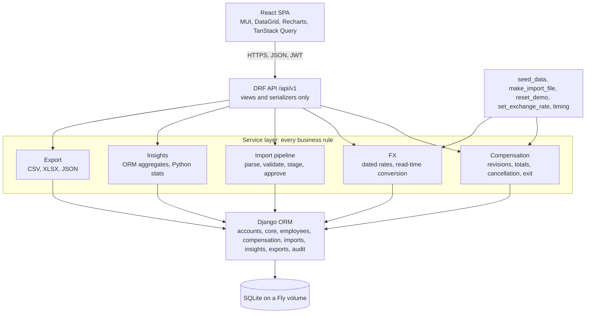
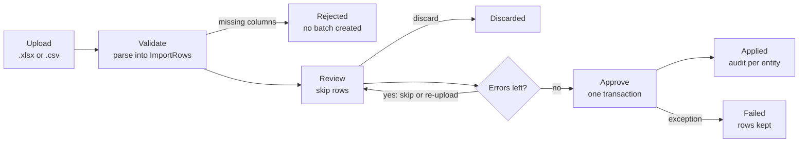

# ACME Salary Management: Engineering Spec, v2.23

Scope lives in `docs/REQUIREMENTS.md`. Reasoning lives in `docs/DECISIONS.md` (D1 to D75). This document says what to build and how. v2 folded in the 6 October spec review, v2.1 folds in the 7 October review (`docs/reviews/`) and the owner's decisions of 7 October, v2.2 applies the owner's answers to the plan-and-design questions (D24 to D30) to the by-level row in section 9 and the DNS and health-check wording in section 14, and, after the step 1 deploy, the health-check grace in section 14 (D31). v2.3 records the owner's step 2 answers (D36): revisions against an exit in F3, section 7 and section 8, the cancel rule in F3, and the import audit entries and count in F2. v2.4 records the owner's step 3 answers: `currency=local` on a single employee in section 8, and the session lifetime and reuse rules in F8 (D21). v2.5 records the owner's step 4 answers: a cancelled revision releases its date in section 5 (D43), and the taken-code and joining-date rules in section 7 (D44, D45), and the 400 for a component listed twice in section 8 (D46). v2.6 records the owner's identity decision (D48): the employee code is `ACME-<id>` in section 5, `legacy_code` takes `EmployeeID`'s place in F1, F2, section 7 and section 8, search and ordering follow in F4, and the seed numbers employees in joining order in section 11. It also records the amount bounds and the two above-BASE warnings in section 7 (D49). v2.7 records the owner's exit answer (D50): an exit dated before the only record starts, a record never current, cancels that record, in section 4 rule 6 and F3. v2.8 records the owner's answers at the step 4 close: `bonus_annual` and `note` are optional in section 8's bodies and the request strings are capped (D51), section 7's exit row reads "before" as F3 does, F2's audit count includes the `cancel` of an exit before pay starts, and section 8 names the API's own amount messages (D52). v2.9 records the owner's answers before step 5: every date is on or before 2100-12-31 in section 7 (D53), and a header with two code columns or a column given twice rejects the upload in F1 and section 7 (D54), and a text cell longer than its column is a row error in section 7 (D55). v2.10 records the owner's answers after the step 5 review (D56): a blank required cell is a row error in section 7, and section 8 names what an upload may cost before it is read, how much of a long cell a staged row keeps and a message repeats, and gives the row-limit error as a list. After the re-review (D57), a row whose action changed since upload refuses the approve in F2 and section 7, F1 and section 8 say openpyxl reads the first worksheet alone and never follows an external link, and section 8 gives both unreadable-file messages a next step. v2.11 records the owner's answers at the step 6 close (D59): in section 9 a group under five shows its headcount alone, by-level gives p10 to p90 and, like the distribution, needs twenty people, and comparing figures across filters is out of scope; F5's local rule reads as DESIGN 6 has it. v2.12 records the owner's answers at the start of step 7 (D60): F6's insight tables end with Reason, Currency and Rates, and a distribution under twenty people exports one row of its headcount. v2.13 records the owner's additions after step 7 (D62): section 9 gains `trend`, `cost-bridge`, `by-tenure` and `cost-mix` and three more gender-gap views, a card may have one control of its own (F5), a short gender comparison names the women or men it lacks, and a new build step 8 moves Hardening and Ship to steps 9 and 10. v2.14 records the owner's answers at the step 8 close (D62): the new views publish counts, shares, medians and gaps, and no amount from which a withheld row could be worked out, so in section 9 Bonus has no mean amounts, Quartiles rank women and men alone, By level counts other and undisclosed per country, and a cost-mix bar with a segment that 1 to 4 people hold shows its headcount alone. F6 and section 9 gain the reasons for these, a bridge part with nobody shows 0.00, and section 8 refuses an `on` before 1900-01-01. v2.15 records the owner's directory changes before step 9 (D63): in section 10 a pencil button on each row opens the employee in place of the row click, and in F4 the directory and its export are in code order when `ordering` is absent. v2.16 records the step the owner added before Hardening (D64): section 11's seed holds 10,000 employees on staff and 5,000 who left, on an experience ladder with every revision since joining, F4's directory opens on Active, F5's dashboard reads a period, `from` and `to`, in place of `on`, its movement cards over the whole period and the rest on `to`, section 9 adds what the period cost, section 10's grids page by number, and section 15 makes it step 9, so Hardening and Ship become steps 10 and 11. With the owner's approval, F1's import limit rises to 15,000 rows, the whole seeded organisation in one file, and section 16 adds a level history per record. v2.17 records the step 9 close, with defaults taken while the owner was away (D68, D69): in section 9 Spent in period is withheld when any day of the period had 1 to 4 people, with its reason in F6, in F5 Include exited does not apply to it either, and section 4 rule 3 and F3 say the insights read `to` where the directory reads `on`. v2.18 records the owner's changes at the step 9 approval (D69, D70): F5's Last N months start the day after the same day N months back, and reporting starts on 1 April 2020, the start of FY 2020-21, so section 8's period and F5's Custom lie from 2020-04-01, the default `from` is never before it, Include exited in section 9 adds only who left on or after it, and section 11's seed gives everyone employed that day a record starting then and skips an April that falls within six months of joining. After the deploy, section 11's seed target is 120 s, Fly having taken 63.9 s, and section 13 and F5 accept the summary from 1 April 2020 to today as the one exception to 500 ms (D64, D71). v2.19 records the step the owner added before Hardening on 8 October (D72): F9's Demo data page with its sample files and the reset that empties the database, the one endpoint that deletes (section 4 rule 6), F1's cap of 25,000 employees, section 7's warning on a revision that lowers gross and its no-op on a repeated scheduled revision, section 8's three `/admin/` routes, section 10's eighth page, section 11's base file, and section 15's renumbering, Hardening to step 11 and Ship to step 12. With the owner's approval, the cap is re-checked at approve, a reset during an approve is a 409 and gunicorn waits 600 s. v2.20 records the owner's answers at the step 10 close: section 5's audit enum gains `demo_reset` on the entity `demo_database`, and section 11's `make_import_file` gains `--stream` and `--offset`, which keep two files' joiners apart. v2.21 records step 11's hardening (D73): F8's proxy trust from the environment, the refresh throttle and parser and the IPv4-mapped rule, section 8's new refusals, section 13's security and import rows (the base approve as the second accepted exception), section 14's unprivileged image, required `DATABASE_PATH`, audited and pinned CI, and the demo login in the submission email rather than the README, in F8, section 15 and section 17. v2.22 records the step the owner added before Ship on 9 October (D74): section 15's step 12, an end-to-end pass through the UI recorded in `docs/TESTING.md`, so Ship becomes step 13 and P1 step 14, and section 17 lists the new document. v2.23 records the step the owner put before the end-to-end pass on 9 October (D75): section 15's step 12, Layout and Help, so the end-to-end pass becomes step 13, Ship step 14 and P1 step 15. At the step's close, with the owner's choices after the window checks, F4's rows per page are 10, 20 and 50, and section 10 gains the ninth page, Help, the frame of the window's height with `main` the one scroll container, grids of a fixed ten rows, the review's message slot and the dashboard's filters kept in view. Items marked P1 are specified but not built until the Ship step is committed. Acceptance criteria are tagged `[test]` (a unit or API test) or `[measured]` (recorded by `/perf-timing` on the seed).

## 1. System overview

One Docker container runs Django, which serves the REST API and the built React bundle. SQLite on a persistent volume is the only state. The browser talks JSON over HTTPS with a JWT. There is no queue, cache or second service. The container is deployed on Fly.io from step 1.

| Layer | Pin | Note |
| --- | --- | --- |
| Python | 3.14, `backend/.python-version`, image `python:3.14-slim` | |
| Django | 6.1.x | current mainstream line. 5.2 LTS also supports 3.14, see D16 |
| Django REST Framework | 3.18.x | |
| djangorestframework-simplejwt | 5.5.x with `rest_framework_simplejwt.token_blacklist` | pure Python, CI on 3.14 verifies |
| django-filter, django-cors-headers, whitenoise | latest | |
| gunicorn | 26.x | |
| openpyxl 3.1.5, defusedxml | | upload parsing and XML hardening |
| Faker (pinned to the patch) | latest | main dependency group: the seed runs in production on first boot |
| factory_boy, freezegun, pytest, pytest-django, pytest-cov, ruff, pre-commit | latest | dev group, excluded by `uv sync --no-dev` |
| uv | `uv.lock` committed, `uv sync` locally, in CI and in Docker | |
| Node | 26, `frontend/.nvmrc`, `engines` `26.x`, `engine-strict=true`, image `node:26-slim` | |
| React 19.x, react-router 8.x, TypeScript 6.0.x, Vite 8.x, Vitest 5.x, MUI 9.x, MUI X 9.x (community), Recharts 3.x, TanStack Query 5.x, react-hook-form 7.x, zod 4.x, MSW 3.0.x, Testing Library | latest majors | MSW handlers use the 3.x imports (`msw/http`) |

Every runtime dependency is listed in DECISIONS D16 with its reason. If a pure-Python library fails on 3.14, the fallback is Python 3.13 in `.python-version` and the Dockerfile.



## 2. Layering rule

Views authenticate, parse query parameters and hand off. Serializers check shape and types only. Every business rule (totals, revision dating, cancellation, exit, FX conversion, import validation and apply, insight maths) lives in a `services.py` or `queries.py` module that takes plain Python values and is unit-tested without HTTP. Services call the validators. Models hold fields, constraints and indexes, not behaviour. Serializers never compute or accept totals, and undeclared fields are dropped.

## 3. Code layout

```
backend/
  manage.py
  pyproject.toml                 # deps, ruff, pytest config
  uv.lock
  .python-version                # 3.14
  acme_salary/
    settings/{base,dev,prod,test}.py
    urls.py                      # /api/v1/*, /healthz, SPA catch-all
    spa.py                       # catch-all view serving index.html
  apps/
    accounts/                    # User (email login), login, refresh, logout, me
    core/                        # Country, Department, ExchangeRate, SalaryComponent, fx.py, lookup API,
                                 # management/commands: set_exchange_rate, timing
    employees/                   # Employee, directory API, exit
    compensation/                # CompensationRecord, CompensationLine, services.py, validators.py
    imports/                     # ImportBatch, ImportRow, parser.py, applier.py, API,
                                 # management/commands: make_import_file
    insights/                    # queries.py (one function per insight), API
    exports/                     # csv/xlsx/json writers, API
    audit/                       # AuditLog + record() helper
  seed/
    management/commands/seed_data.py, reset_demo.py
    profiles.py                  # per-country component sets, base anchors, level multipliers
  tests/                         # mirrors apps/, factories.py, conftest.py

frontend/
  .nvmrc                         # 26
  .npmrc                         # engine-strict=true
  src/
    api/           # fetch client, hand-written types, TanStack Query hooks, session handling
    pages/         # Login, Dashboard, Employees, EmployeeDetail, NewEmployee, Imports, ImportReview
    components/    # grid wrappers and server-model adapter, FilterBar, KpiCard, charts, forms
    lib/           # auth store, money and date formatters, constants
    test/          # Vitest + Testing Library + MSW handlers
```

## 4. Product rules

1. **Amounts are annual, in local currency, stored as Decimal.** Monthly figures are shown as annual divided by 12 in the UI, never stored. In Python every amount is a `Decimal`. SQLite stores them as REAL, so SQL arithmetic is used only to order and filter. Every value sent to a client is quantised in Python, half-up to 2 decimal places.
2. **Components are data, not columns.** `SalaryComponent` defines each component as global or per country, with a kind of earning, deduction or employer contribution. A compensation record holds one line per component. Ten components ship in v1: `BASE`, `TAX` and `EMPLOYER_CONTRIBUTION` are global, plus `HRA` and `ALLOWANCES` (IN), `NATIONAL_INSURANCE` (GB), `SOCIAL_INSURANCE` (DE), `HOLIDAY_ALLOWANCE` (NL), `AWS` and `CPF` (SG). Bonus is not a component: `bonus_annual` is a column on the record, as a signing or yearly bonus can go to anyone in any country. Header totals are denormalised: gross = sum of earning lines + bonus, net = gross minus employee deductions, total cost = gross plus employer contributions.
3. **Compensation is effective-dated with half-open intervals.** Each record has `effective_from` (inclusive) and `effective_to` (exclusive, equal to the next record's `effective_from`, `null` when open-ended). A record is current on date `d` when `effective_from <= d` and (`effective_to` is null or `effective_to > d`). The reporting date defaults to today in UTC and may be passed as `on=`. The insights read a period, `from` and `to`, instead, its last day their reporting date (D64). A record with `effective_from` after today is scheduled. A new revision's `effective_from` must be after the latest record's. Several scheduled revisions may exist. A scheduled record may be cancelled until it takes effect: cancellation sets `cancelled_at` and `cancelled_by`, the row stays, and every query that means "the records that count" excludes cancelled rows. On a record that has ever been current, amounts, lines, `effective_from`, `bonus_annual` and `note` are immutable; `effective_to` is owned by the service and is set by revise and exit. Each record carries a per-employee `version` number.
4. **Converted amounts are never stored.** Records hold local-currency amounts only. `ExchangeRate` is effective-dated by currency pair. Setting a rate inserts a new row and closes the previous one, so the table is the single source of truth. Conversion happens at read time in `core/fx.py` at the rate effective on the reporting date. Rates change only on the first day of a month, so each rate row is a month, and a date before the earliest rate uses the earliest rate. Reporting currency is USD by default, EUR selectable. A pair without a direct rate routes through USD. Local currency is always shown alongside, and the dashboard shows the rate's effective date.
5. **Import is staged.** Upload parses into `ImportBatch` and `ImportRow`. Review happens on the staged rows. Approve applies all accepted rows in one transaction. Live tables are never touched before approval.
6. **No row of pay data is ever deleted.** Employees are exited, never deleted: exit sets `last_date` and closes the open-ended record at `last_date + 1 day`. A `last_date` before the open record's `effective_from` is a `400`, except that an exit dated before the employee's only record starts, a record that has never been current, cancels that record (D50). A future `last_date` is a scheduled exit. Active on date `d` means `joining_date <= d` and (`last_date` is null or `last_date >= d`). A scheduled revision is cancelled by marking it, never by deleting it. The only operations that remove rows are `seed_data --reset` and `reset_demo`, which rebuild the demo database on the owner's command, and `POST /admin/reset-demo/`, the one endpoint that deletes, which empties the demo database for a reviewer behind the user's password and `confirm: "RESET"` (F9, D72). Nothing else may.
7. **Every write is audited.** Create, update, exit, revise, cancel, import apply and rate changes all write `AuditLog` with actor, before and after JSON, the employee where relevant, and the batch id where relevant.
8. **Insights are computed on demand.** ORM aggregates for sums and counts, Python `statistics` over the filtered values for medians and percentiles. No precomputed tables.
9. **One import template.** One row per employee: identity columns, `bonus_annual`, then one column per component code. Matched rows are classified by the decision table in F1.
10. **No Django admin.** `django.contrib.admin` is not installed. Nothing edits data outside the services.

## 5. Data model

Thirteen model tables: the custom user, two blacklist tables from SimpleJWT, four lookups, Employee, two compensation tables, two import tables, AuditLog. Django's own auth, content-type and migration tables come on top. Money is `Decimal(14,2)`, FX rates `Decimal(18,8)`, dates `DateField`. Timestamps use `default=timezone.now` rather than `auto_now_add` so the seed can set them.

Relationships: Employee to Country and Department. Employee 1:N CompensationRecord 1:N CompensationLine to SalaryComponent. ImportBatch 1:N ImportRow, each optionally matched to an Employee. AuditLog to Employee (nullable), User (nullable), ImportBatch (nullable).

`on_delete`: `PROTECT` for Country, Department and SalaryComponent. `CASCADE` for lines under a record and rows under a batch. `SET_NULL` for users and `import_batch`.

### Users

`accounts.User` extends `AbstractUser` with `username = None`, `email` unique and `USERNAME_FIELD = "email"`. Created in the first migration, before any other app. The blacklist app adds `OutstandingToken` and `BlacklistedToken`.

### Lookups

| Table | Columns | Notes |
| --- | --- | --- |
| `Country` | `code` CHAR(2) PK, `name`, `currency_code` CHAR(3), `min_gross_annual` Decimal(14,2) | Seeded IN, US, GB, DE, NL, SG. The minimum drives the below-minimum warning |
| `Department` | `id`, `code` unique, `name` | 12 seeded, section 11 |
| `ExchangeRate` | `from_currency` CHAR(3), `to_currency` CHAR(3), `rate` Decimal(18,8), `effective_from` DATE, `effective_to` DATE nullable, `created_by` FK nullable, `created_at` | 1 `from_currency` = `rate` `to_currency`. Unique (`from_currency`, `to_currency`, `effective_from`). Partial unique: one row with `effective_to = null` per pair. Checks `effective_to > effective_from`, `rate > 0`, `from_currency <> to_currency` |
| `SalaryComponent` | `id`, `code` unique, `name`, `kind` enum(`earning`, `deduction`, `employer_contribution`), `country` FK nullable, `sort_order`, `is_active` | `country = null` means global (`BASE`, `TAX`, `EMPLOYER_CONTRIBUTION`) |

### Employee

| Column | Type | Notes |
| --- | --- | --- |
| `id` | PK | the employee code is `ACME-<id>` with no leading zeros (ACME-17 is `/employees/17`). The database assigns it on every insert, API create, import create and seed alike, and nothing stores it (D48) |
| `legacy_code` | VARCHAR(32) unique, nullable | the code the legacy system gave the employee, exactly as the sheet carried it. Set once when an import creates the employee and never changed. NULL, never an empty string, for an employee created in the app |
| `full_name` | VARCHAR(120) | indexed |
| `email` | VARCHAR(254) unique | stored lowercase |
| `gender` | enum(`female`, `male`, `other`, `undisclosed`) | |
| `department` | FK Department | indexed with `country` |
| `designation` | VARCHAR(80) | indexed |
| `level` | SMALLINT | check `BETWEEN 1 AND 6`, indexed |
| `country` | FK Country | sets currency and applicable components |
| `joining_date` | DATE | indexed. May be in the future |
| `last_date` | DATE nullable | indexed. Check `last_date IS NULL OR last_date >= joining_date` |
| `updated_at` | DATETIME | set by the service on every write, `default=timezone.now`, not `auto_now`, so the seed controls it |
| `created_at` | DATETIME | `default=timezone.now` |

There is no `status` column. Active is derived from `joining_date` and `last_date` against the reporting date.

### CompensationRecord

| Column | Type | Notes |
| --- | --- | --- |
| `id` | PK | |
| `employee` | FK Employee | indexed with `effective_to`, and with `effective_from` |
| `version` | SMALLINT | unique with `employee`, assigned by the service as previous maximum plus one |
| `currency_code` | CHAR(3) | copied from country at write time |
| `bonus_annual` | Decimal(14,2), default 0, check `>= 0` | included in gross |
| `effective_from` | DATE | unique with `employee` among non-cancelled records, so a cancelled revision's date can be entered again (D43) |
| `effective_to` | DATE nullable | exclusive. `null` = open-ended. Partial unique: one open-ended, non-cancelled record per employee (`WHERE effective_to IS NULL AND cancelled_at IS NULL`). Check `effective_to > effective_from` |
| `cancelled_at`, `cancelled_by` | DATETIME nullable, FK User nullable | set by the cancel service on a scheduled record. Cancelled rows are excluded from every current-or-latest query and shown greyed in history |
| `gross_annual`, `net_annual`, `total_cost_annual` | Decimal(14,2) | computed from lines and bonus by the service, local currency. `gross_annual` indexed |
| `source` | enum(`ui`, `import`, `seed`) | |
| `import_batch` | FK ImportBatch nullable | |
| `note` | TEXT | reason for the revision |
| `created_by`, `created_at` | FK User nullable, DATETIME | |

### CompensationLine

| Column | Type | Notes |
| --- | --- | --- |
| `record` | FK CompensationRecord | cascade |
| `component` | FK SalaryComponent | unique with `record` |
| `annual_amount` | Decimal(14,2), check `>= 0` | |

### ImportBatch and ImportRow

| Table | Columns | Notes |
| --- | --- | --- |
| `ImportBatch` | `id`, `file_name`, `file_size`, `uploaded_by` FK, `uploaded_at`, `status` enum(`review`, `approved`, `discarded`, `failed`), `warnings` JSON, `total_rows`, `valid_rows`, `warning_rows`, `error_rows`, `skipped_rows`, `noop_rows`, `created_rows`, `updated_rows`, `revised_rows`, `applied_rows`, `approved_at`, `error_summary` TEXT | counts recomputed after every skip or unskip. `updated_rows` counts identity-only rows, `revised_rows` counts rows that produced a new record (with or without identity changes). `applied_rows` = created + updated + revised |
| `ImportRow` | `id`, `batch` FK, `row_number`, `legacy_code`, `full_name`, `raw` JSON, `normalized` JSON, `status` enum(`valid`, `warning`, `error`, `skipped`), `validation_status` enum(`valid`, `warning`, `error`), `messages` JSON list of `{field, severity, message}`, `action` enum(`create`, `update`, `revise`, `noop`) nullable, `matched_employee` FK nullable | unique (`batch`, `row_number`), index (`batch`, `status`). `legacy_code` and `full_name` denormalised for search. `validation_status` is what the rules produced, `status` adds `skipped`; unskip restores `status` from `validation_status`. `action` null when the row has no usable code |

### AuditLog

| Column | Type | Notes |
| --- | --- | --- |
| `actor` | FK User nullable | null for seed |
| `timestamp` | DATETIME | indexed |
| `action` | enum(`create`, `update`, `exit`, `revise`, `cancel`, `import_apply`, `set_rate`, `demo_reset`) | `import_apply` is written once per approved batch on the batch itself; the rows it applied carry `create`, `update` and `revise` with `import_batch` set. `demo_reset` is written once per reset (F9) on the entity `demo_database`, id 0, since a reset has no entity of its own, with the counts deleted in `before` and `{}` in `after` |
| `entity_type`, `entity_id` | VARCHAR, INT | indexed together |
| `employee` | FK Employee nullable | set on every employee and record write, indexed |
| `before`, `after` | JSON nullable | the detail serializer output |
| `import_batch` | FK nullable | groups one approval's writes |

## 6. Functional requirements

### F1. Spreadsheet import

- Accepts `.xlsx` and `.csv`, up to 15,000 data rows, the whole seeded organisation in one file (D64), and 10 MB. Extension and content type are checked. XLSX is opened with `read_only=True`, `data_only=True` and `keep_links=False`, with defusedxml installed, and only its first worksheet is read (D57). CSV must be UTF-8, BOM accepted.
- Template columns, in order: `legacy_code, full_name, email, department, designation, level, country_code, gender, joining_date, last_date, effective_from, bonus_annual`, then one column per component code (for India: `BASE, HRA, ALLOWANCES, TAX, EMPLOYER_CONTRIBUTION`). Required: `legacy_code, full_name, email, department, designation, level, country_code, gender, joining_date, BASE`. Blank component cells mean not applicable. Blank `bonus_annual` means zero.
- Header matching is case-, space-, underscore- and hyphen-insensitive. `EmployeeID`, `Employee Code`, `Emp ID` and `employee_code` are read as `legacy_code` when the sheet has no `legacy_code` column; when it has one, it wins and those columns get the unknown-column warning. Two or more of them with no `legacy_code` column, or any template column given twice, reject the upload and no batch is created (D54). Unknown columns, and data under a column with no header, are recorded in `ImportBatch.warnings` and ignored.
- `legacy_code` names the employee in the legacy system (D48). Surrounding spaces are trimmed and a numeric XLSX cell is read as its integer text (`58213.0` is `58213`); otherwise the match is exact and case-sensitive. The import serves the legacy system's employees only: an employee created in the app has no `legacy_code` and is never reached by a sheet. Missing required columns reject the upload with `400 {missing_columns, unknown_columns}` and no batch is created.
- Numbers: currency symbols and spaces stripped. A comma followed by exactly three digits with no dot anywhere is a thousands separator and is removed (`1,200` is 1200, `12,00,000` is 1200000). Any other comma is a decimal-separator error with a hint. Dot is the only decimal separator. More than two decimals is an error.
- Each row is validated against section 7 in this order: structure and types, identity references, duplicate code and email within the file, amounts changed, no-op, date rules. The worst severity becomes the row status.
- A `legacy_code` that matches no employee creates the employee and the first record: the database numbers the employee at approve and the sheet's code is stored as its `legacy_code`. An unknown code whose email already belongs to someone is the `email already belongs to` error, never a second person; that is what catches a mistyped code. `effective_from` defaults to `joining_date` with an info message. A sheet uploaded again after its batch was approved matches its own codes, so it updates or no-ops instead of duplicating.
- An import whose new employees would take the employees in the database, leavers included, past 25,000 is refused before staging, with no batch: `No more data can be imported: this file would take ACME past 25,000 employees (now 24,900, this file adds 500)`. Updates and revisions do not count. Approve re-checks it with the batch's non-error create rows, a `409` with the same wording, so two batches in review cannot pass it together (D72).
- Matched rows follow this table. Identity fields are `full_name, email, department, designation, level, gender, joining_date, last_date`. Amounts are `bonus_annual` and every component column. A `last_date` that appears or changes runs the exit service with its rules (F3), so the open record is closed and the `409` cases become row errors. A blank `last_date` on an exited employee is an error, `clearing last_date is not supported by import` (undo exit is P1).

| Identity changed | Amounts changed | `effective_from` | Action |
| --- | --- | --- | --- |
| no | no | any | `noop` |
| yes | no | any | `update`, identity fields only |
| any | yes | given and after the latest record | `revise`: a new record, identity fields updated in the same transaction if they changed |
| any | yes | blank | error `effective_from is required when amounts change` |
| any | yes | not after the latest record | error from section 7 |
| `country_code` differs | any | any | error `country change is not supported by import` |

A row whose `effective_from` and amounts repeat a scheduled revision already on file is a `noop` as well, so a generated file imported twice changes nothing (D72).

Acceptance:

- [ ] `[measured]` A 15,000-row file from `make_import_file --all --raises 1000` is parsed, validated and staged in under 30 s (D64) and the batch summary shows total, valid, warning, error counts.
- [ ] `[test]` A row with `BASE = -5000` is `error` with a message naming the field and value, and other rows are unaffected.
- [ ] `[test]` A file missing `country_code` is rejected with the missing column named and no batch is created.
- [ ] `[test]` A matched row identical to the current record is `noop`, and the date rule is not evaluated for it.
- [ ] `[test]` A matched row with a changed department and unchanged amounts is `update` and produces no new record on apply.
- [ ] `[test]` `1,200` normalises to 1200, `1.200.000,50` is an error with the separator hint, `12,00,000` normalises to 1200000.
- [ ] `[test]` A matched row with a new `last_date` closes the open record at `last_date + 1` on apply.
- [ ] `[test]` Any upload leaves `Employee` and `CompensationRecord` row counts unchanged until approval.
- [ ] `[test]` A file whose new employees bring the database to exactly 25,000 is staged, and one that would bring it to 25,001 is refused with the message above and no batch; a file of updates and revisions alone is staged whatever the count (D72).
- [ ] `[test]` A revision whose gross is lower than the record it replaces is a `warning` naming both figures, and one with an equal gross is not (D72).

### F2. Review and approve



- Grid of staged rows filterable by status and searchable by `legacy_code` or `full_name`, messages shown per cell.
- Row actions: skip, unskip. Batch actions: approve, discard. A wrong value is fixed in the spreadsheet and re-uploaded. Inline cell editing is P1.
- Approve applies valid and warning rows that are not skipped and not `noop`. If any error row remains unskipped, approve is refused with `409` and the count. Approve, skip, unskip and discard on a batch not in `review` are `409`.
- Approve is one database transaction. The date and duplicate rules are re-run against the database inside it. A row staged as new whose `legacy_code` another batch has taken in the meantime refuses the approve with the row re-marked (D24); it is never matched to that employee. A row that would now apply as another action than the one reviewed, because the employee changed since upload, refuses the approve the same way (D57). A row that has become a no-op is left out. All accepted rows apply or none do. On exception the batch becomes `failed` with `error_summary` and the rows are kept.
- Audit: one entry per entity written with `import_batch` set, so a create row writes a `create` entry on the employee and a `revise` entry on the record, an identity-only row writes one `update` entry, a revise row writes one `revise` entry on the new record (its `before` is the previous record's snapshot), and a row that changes identity fields or sets `last_date` as well as amounts writes its `update` or `exit` entry on the employee first and then the `revise` entry on the record, the same order as the API path. One `import_apply` entry is written on the batch itself with the counts in `after`.

Acceptance:

- [ ] `[test]` A batch with 3 error rows is refused on approve with `3 rows have errors`.
- [ ] `[test]` With those 3 rows skipped, approve sets `approved`, `applied_rows` = total minus skipped minus no-ops, and audit entries equal 2 x created + updated + revised + (revised rows that also changed identity or set `last_date`) + (exit rows whose only record had not started, which also write `cancel`, D50) + 1 for the batch.
- [ ] `[test]` A simulated failure mid-apply leaves zero partial employees or records and the batch is `failed`.
- [ ] `[test]` Approving an approved batch returns `409`.

### F3. Employees and compensation

- Create an employee with identity fields, `bonus_annual` and the first record's lines, in one transaction. The database numbers the employee (`ACME-<id>`); a body carrying `employee_code` or `legacy_code` is a `400`, whatever the value (D48). `effective_from` defaults to `joining_date`.
- Edit identity fields. A body carrying `employee_code` or `legacy_code` is a `400` whatever the value, and `country_code` cannot change (`400`).
- Add a revision: `effective_from` after the latest record's, lines, `bonus_annual`, note. The service closes the previous open-ended record at the new `effective_from`, assigns the next `version`, recomputes totals.
- Cancel a scheduled revision: allowed only while `effective_from > today`, else `409`. The service sets `cancelled_at` and `cancelled_by`, and the previous non-cancelled record's `effective_to` becomes the next non-cancelled scheduled record's `effective_from`, else `last_date + 1 day` when the employee has a `last_date`, else `null`. Audit action `cancel` with the full record in `before` and the cancelled row in `after`.
- Exit: `last_date >= joining_date` and `last_date + 1 > effective_from` of the open record, else `400`. Already exited, or non-cancelled scheduled revisions after `last_date`, is `409` (cancel them first). Closes the open-ended record at `last_date + 1 day`. Undo exit is P1.
- Exit before pay starts (D50): when the record after `last_date` is the employee's only non-cancelled record and has never been current, the exit cancels it instead of closing it, and writes the `exit` entry and then a `cancel` entry. The employee then has no live record: the directory lists them with no record and the detail says they left before pay started. While later revisions are scheduled, the `409` names one of them, not version 1, which cannot be cancelled (D26). A first record that has been current keeps the `400`.
- Revisions and exits: for an employee with a `last_date`, a revision dated after it is a `409`, and a revision dated on or before it is accepted and ends at `last_date + 1 day`. The same rule applies through the API, the import and the seed.
- Detail shows the record current on the reporting date, or the latest record labelled "from <date>" or "exited <date>", the revision history newest first with version and note, and the audit list.
- The same validators run for UI edits and imports.

Acceptance:

- [ ] `[test]` A revision dated before or on the latest record's `effective_from` returns `400` with the field message.
- [ ] `[test]` A revision dated the day after the current record is accepted, the previous record's `effective_to` equals the new `effective_from`, and exactly one record has `effective_to = null`.
- [ ] `[test]` A revision dated next year is scheduled: the directory and insights still show the current record today, and show the new one when `on=` (the directory) or `to=` (the insights, D64) is that date.
- [ ] `[test]` Cancelling the scheduled revision sets `cancelled_at`, keeps the row, reopens the previous record, and the row appears in history as cancelled. Cancelling a current record returns `409`.
- [ ] `[test]` Exit closes the open record at `last_date + 1`, the employee is excluded from insights on the day after, and a second exit returns `409`. A `last_date` before the open record's `effective_from` returns `400`.
- [ ] `[test]` An exit dated before the only record starts cancels it, writes `exit` then `cancel`, and the employee still renders in the directory and the detail. A first record that has been current keeps the `400`.
- [ ] `[test]` A body that includes `gross_annual` has it ignored and totals recomputed from lines and bonus.
- [ ] `[test]` `version` increments per employee and is unique with it.

### F4. Directory

- Server-side pagination, 10, 20 or 50 rows a page and 10 by default, so the default page fits the grid's fixed ten rows, a link with any other value falling back to 10 and the API's maximum staying 100 (the owner's choice of 9 October, D75). Ordering on `full_name, employee_code, department, country, designation, level, gross, joining_date`, `-` prefix for descending. `gross` is the reporting-currency annotation, and `employee_code` orders by id. Without `ordering` the directory and its export are in code order, ascending, the order the grid shows by default (D63).
- Filters: `country`, `department`, `designation`, `level`, `status` (`active`, the default, `exited` or `upcoming` for a future joiner, each judged on the reporting date, or `any` for everyone, D64), `gross_min`, `gross_max` in the reporting currency, `joined_after`, `joined_before`, `on`, `currency`. Multi-value filters are comma-separated. Search is for people typing: each word matches part of a name or an email, a `legacy_code` in any case, or an ACME code read as a number (`ACME-0017` and `acme-17` both find ACME-17). Import matching stays exact.
- Columns show local gross with its currency and the reporting-currency gross side by side, both from the record current on the reporting date, else the latest record with its label.
- Reporting-currency sort and filter are an annotation, not an indexed column: a `CASE WHEN currency_code = ... THEN rate` expression built in Python from the rate lookup for `on`, multiplied by `gross_annual` of the per-employee record that is current on `on`, else the latest non-cancelled record, selected with a correlated subquery. Range filters compare with a tolerance of 0.005. This is the one query the 300 ms target depends on and DESIGN.md specifies it.

Acceptance:

- [ ] `[measured]` Any directory request returns in under 300 ms at p95 on the seed's 15,000 employees.
- [ ] `[test]` Filters combine with AND and survive page changes and sorting.
- [ ] `[test]` `currency=local` with two countries in the filter returns `400`.

### F5. Insights dashboard

The questions in section 9, each a card or chart, honouring `country`, `department`, `include_exited` (default false) and a period, `from` and `to` (D64). `currency` is a parameter: `usd` by default, `eur`, or `local`. The dashboard offers `local` in the toggle only while exactly one country is selected, and switches back to `usd` when the filter stops being exactly one country. A switch from one country to another keeps `local`, in the new country's currency (D59). The rate month in use is shown ("October 2026 rates"). The dashboard bar decides who is counted, for every card but `trend`, `cost-bridge` and Spent in period, which count the people employed on each date: Include exited does not apply to them, and when it is ticked each says so in a caption (D62, D69). A card may have one control of its own, named in section 9, which decides how it slices or what it measures and is never a second country or department picker: it lives in the URL under the card's prefix, the card's export sends it, and Clear filters resets it (D62). The bar's period control offers Last 3 months, Last 6 months, Last 12 months (the default), Current FY to date, Last FY and Custom, ACME's financial year running from 1 April to 31 March, and each preset counts back from today, Last N months from the day after the same day N months back, or after that month's last day where the day does not exist, so Last 12 months on 8 October 2026 runs from 9 October 2025, 365 days, and Last 6 months on 31 October from 1 May (D69). The URL keeps the preset's name, so a shared link stays relative, and Custom keeps `from` and `to`, each from 2020-04-01, the reporting cut-off at the start of FY 2020-21, to 2100-12-31 and `from` on or before `to` (D70). Clear filters resets the period to Last 12 months. `trend` and `cost-bridge` run over the whole period, every other card shows the state on `to` and says so, and one rate, the one effective on `to`, converts the whole period, which the rate label says (D64).

- [ ] `[measured]` Every insight endpoint responds in under 500 ms on the seed. The summary over 1 April 2020 to today, the longest period the dashboard offers, is the one accepted exception, at 839 ms p95 on Fly with every preset within the target (D71).
- [ ] `[test]` Changing a filter refetches every card. The include-exited checkbox changes headcount by the number of exited employees in the filter who left on or after 2020-04-01, the reporting cut-off (D70).
- [ ] `[test]` Each preset gives its dates, the URL keeps a preset's name and a custom range's dates, Clear filters goes back to Last 12 months, and a `from` before 2020-04-01, a `to` after 2100-12-31 or a `from` after its `to` is a `400` (D64, D70).

### F6. Export

- The directory (current filters and `on` applied) and any insight table (its period applied, the JSON's filters naming `from` and `to`, D64) export as CSV, XLSX or JSON through `?file=`.
- Directory columns: employee code (`ACME-<id>`), legacy code, full name, email, department, designation, level, country, currency, gross (local), bonus (local), gross (reporting currency), status, joining date, last date, effective from, version.
- Insight tables: `summary` one row, `by-country` and `by-department` one row per group, `distribution` one row per band, `by-level` one row per level, `gender-gap` one row per group and gender. Every insight table ends with Reason, Currency and Rates: the screen's words for a withheld figure (`fewer than 5 people`, `fewer than 20 people`, on gender comparisons `fewer than 5 women`, `fewer than 5 men` or both, on a bonus gap the same with ` with a bonus` after it, on a bridge change withheld because another is short `withheld with the leavers`, `withheld with the joiners` or `withheld with the pay changes`, on a cost-mix country `<segment> held by fewer than 5 people`, and on a summary whose spend alone is withheld `fewer than 5 people on a day in the period` (D68)), the reporting currency and the rate month. A group with nobody in it gives no reason (D62). A withheld cell is empty, or `null` in JSON. A distribution under 20 people is one row of its headcount, with Reason `fewer than 20 people` when anyone is in it (D60). `trend` is one row per point of its period (D64), `cost-bridge` one row per part, `by-tenure` one row per band, `cost-mix` one row per country and segment, and gender-gap's Bonus, Quartiles and By level views one row per group and gender, per quartile, and per group and level, each for the card's control as the export sends it (D62).
- The export is the whole filtered set, not the visible page. CSV streams. XLSX builds server-side. File name `acme-<what>-YYYYMMDD-HHMM.<ext>`.
- Cells starting with `=`, `+`, `-`, `@`, tab or carriage return are prefixed with a single quote.
- The frontend fetches with the bearer token, receives a blob and triggers the save.
- `/exports/insights/{name}/` with an unknown name is `404`, as is `/insights/{name}/`.

Acceptance:

- [ ] `[test]` A filtered export has exactly the filtered rows across all pages.
- [ ] `[measured]` The default directory export, on Active, has 10,000 rows (D64).
- [ ] `[test]` A name starting with `=` is escaped in both CSV and XLSX.

### F7. Audit trail

- Every create, update, exit, revise and cancel on employees and compensation, every import apply and every rate change writes actor, timestamp, action, entity, employee, before and after JSON, batch id.
- Shown on the employee page as a plain list (who, when, what changed), one query through `AuditLog.employee`. A global audit page is P1.

Acceptance:

- [ ] `[test]` Each write path produces exactly one entry per entity with `before` and `after` matching the detail serializer.

### F8. Authentication

- Email and password login for one seeded HR Manager. Access token 30 minutes, refresh token 12 hours, rotation on, blacklist on. `POST /auth/logout {refresh}` blacklists the token. Login throttled to 5 attempts per minute per IP, and refresh to 30, with `NUM_PROXIES` from the environment: 1 on Fly, whose proxy appends the client as the last `X-Forwarded-For` hop, and 0 in compose, where nothing proxies gunicorn, so a client cannot mint buckets either way (D73). An IPv4-mapped IPv6 address is the IPv4 client it wraps. Refresh takes JSON only. The throttle cache is Django's `LocMemCache`, which is per process and correct with one worker.
- Every `/api/` route requires auth except login and refresh. `GET /healthz` is unauthenticated.
- Frontend: access token in memory, refresh in `localStorage` (D21 records why not an httpOnly cookie). On load, refresh once. On `401`, one in-flight refresh and one retry, then redirect to login.
- The demo login goes in the submission email, never in the public repository, since anyone holding it can change the demo data (D73). `python manage.py reset_demo` restores the seed and keeps users.

Acceptance:

- [ ] `[test]` Unauthenticated requests to every route except login, refresh and healthz return `401`.
- [ ] `[test]` A rotated-out refresh token is rejected. After logout the refresh token is rejected.
- [ ] `[test]` A rotated refresh token keeps the original expiry, so a session ends 12 hours after login however often it refreshes, and an access token never outlives its refresh token.
- [ ] `[test]` A refresh token presented after it was rotated out or logged out revokes every refresh token of that user and answers `401`; an expired token that was never rotated revokes nothing.
- [ ] `[test]` The sixth login attempt within a minute returns `429`.

### F9. Demo data

A page after Imports, behind the login, so a reviewer can empty the database and run the 10,000-employee import the brief names (D72). Two sections.

- Sample files, each in the import template's shape, downloadable as `.xlsx`. `base-15000.xlsx` is committed in `sample-data/`: the seed's 10,000 on staff and 5,000 leavers from seed 42, in joining order so ACME-1 is the longest-serving, each row the employee's current pay, or last pay with `last_date`, and `effective_from` at the joining date. It is regenerated by the same commit whenever the seed changes, like the golden hash, with a test that the file and the seed agree. Into an empty database it creates the organisation; into the seeded one it is a 15,000-row no-op, the scale test. Six more are generated on demand from the current database by `make_import_file`, so legacy codes always match, and their links are disabled with `Import the base file first` while the database is empty. Each draws its employees from its own fixed share of the directory, employee id modulo 5, so no two files touch the same person, they import cleanly in any order, and importing a file twice is a no-op: `newhires.xlsx` (500 new employees with fresh legacy codes, each joined on a day drawn from 60 days before the generation day to 14 days after, `effective_from` at the joining date, so a future joiner is Upcoming and counts from the day they join), `diwali-bonus.xlsx` (1,000 current employees with 5 to 15% of base added to their current `bonus_annual`, every other amount unchanged, effective the day the file is generated), `april-raises.xlsx` (1,000 with base up 3 to 8% and components scaled with it, effective 1 April next, which imports as scheduled revisions), `promotions.xlsx` (200 one level up, designation to match, base up 12 to 20% with components scaled, effective the day the file is generated, identity and amounts in one row), `exits.xlsx` (100 with `last_date` drawn from 14 days before the generation day to 60 days after: a past one leaves the counts at once, a future one is a scheduled exit on staff until the day, as the app counts someone employed through their last day (D42); the picker takes only people whose joining date and whose current record's start are on or before the drawn day and skips anyone with a scheduled revision, so no row errors) and `fix-me.xlsx` (50 rows with deliberate errors, the step 5 sample). Each is deterministic for a given database and `--seed`, and each download names what it exercises in one line. The page says in one line that the demo runs on a small shared machine and a large import can take a few minutes, and notes that after a base import every employee has one record dated at joining, so the trend and the bridge show joins and exits but no pay changes until revision files are imported, and that a revision file imported into an empty database creates its employees instead, after which the base file shows those rows as errors: empty the database and start with the base.
- Reset, `Empty the database`, in a danger zone at the bottom: a dialog that shows what will be deleted as live counts, a password field and a `type RESET` field, the button disabled until the confirmation box contains exactly `RESET`, case-sensitive with no surrounding spaces, and the password field is not empty. `POST /admin/reset-demo/` with `{password, confirm}` checks the logged-in user's password on the server and that `confirm` is `RESET`; wrong either way is a `403` with `password did not match` or `type RESET to confirm`. Throttle scope `reset`, 5 an hour. `409` while an import is being read, and `409` `an import is being applied; try again in a moment` when the reset waits out SQLite's 20 s lock on an approve in flight. In one transaction it empties employees, compensation records and lines, import batches and rows and the audit log, through `seed_data`'s truncation so `sqlite_sequence` is cleared and the next employee is ACME-1 again. Lookups, exchange rates and the user stay. Then it writes one `demo_reset` audit entry with the counts deleted, and returns them. Afterwards the page goes to Imports with `The database is empty. Import base-15000.xlsx to start.`

Acceptance:

- [ ] `[test]` The reset answers `403` to a wrong password and to a `confirm` that is not `RESET`, `429` on the sixth attempt in an hour, and `409` while a file is being read.
- [ ] `[test]` A reset returns the counts, leaves every pay table empty with `sqlite_sequence` cleared so the next employee is ACME-1, keeps lookups, rates and the user, who can still log in, and writes one `demo_reset` audit entry.
- [ ] `[test]` Each generated file has the template's columns, its rows come from its own share of the directory, two generations for the same seed and day are identical, and a file imported twice is a no-op.
- [ ] `[test]` The committed base file agrees with the seed row by row (slow), and into an empty database it creates the leavers exited.
- [ ] `[measured]` The base file into an empty database on the deployed instance is staged in under 30 s and approved in under 22.5 s with the burst balance in hand, and its throttled times and peak memory are recorded.

## 7. Validation rules

One validator module, `compensation/validators.py`, called by the services for import, API and seed. Rules produce `{field, severity, message}`. The worst severity becomes the row status.

| Check | Severity | Message pattern |
| --- | --- | --- |
| Required column missing from the header | rejects upload | `Missing required column: country_code` |
| Unknown column in header | batch warning | `Ignored unknown column: Remarks` |
| Two or more of `EmployeeID`, `Employee Code`, `Emp ID` and `employee_code`, and no `legacy_code` column (D54) | rejects upload | `EmployeeID and Emp ID could both be the legacy code; rename the right one to legacy_code` (three or more: `could all be`) |
| A template column given twice in the header (D54) | rejects upload | `email appears twice in the header; remove one` |
| File not UTF-8 | rejects upload | `file is not UTF-8` |
| New employees in the file would take the database past 25,000, leavers included (D72) | rejects upload | `No more data can be imported: this file would take ACME past 25,000 employees (now 24,900, this file adds 500)` |
| `legacy_code` blank | error | `legacy_code is required` |
| `full_name`, `email`, `department`, `designation`, `level`, `country_code`, `gender` or `joining_date` blank (D56). The other rules on that cell run only when it holds a value | error | `designation is required` |
| `legacy_code` longer than 32 characters | error | `legacy_code is longer than 32 characters` |
| `full_name`, `email`, `designation`, `department`, `country_code` or `gender` longer than its column: 120, 254, 80, 64, 64 and 64 characters (D55) | error | `full_name is longer than 120 characters` |
| `legacy_code` repeated within the file | error on both rows | `Duplicate legacy_code in rows 41 and 388` |
| `legacy_code` of a row staged as new taken by another batch approved meanwhile | error at approve, row re-marked (D24) | `legacy_code HR-58213 now belongs to ACME-17; upload the sheet again` |
| A staged `update` or `revise` that would apply as another action at approve, because the employee changed since upload; a row that has become a no-op is left out instead (D57) | error at approve, row re-marked | `ACME-2 changed since this sheet was uploaded; upload the sheet again` |
| `email` malformed | error | `email is not a valid address` |
| `email` repeated within the file | error on both rows | `Duplicate email in rows 12 and 90` |
| `email` in use by a different employee, an unknown `legacy_code` included | error | `email already belongs to ACME-217` |
| `employee_code` or `legacy_code` in an API create or edit, whatever the value | error | `employee_code is assigned by the system`, `legacy_code is set only by an import` |
| `country_code` not in Country | error | `Unknown country_code: XX` |
| `country_code` differs from the matched employee | error | `country change is not supported by import` |
| `department` not found | error | `Unknown department: Growth` (no auto-create) |
| `level` outside 1 to 6 | error | `level must be between 1 and 6` |
| `gender` outside the enum | error | `gender must be one of female, male, other, undisclosed` |
| A date unparseable (ISO and Excel date cells accepted) | error | `joining_date is not a valid date: 31/02/2024` |
| `joining_date`, `last_date` or `effective_from` after 2100-12-31, through the API, an import or the seed (D53) | error | `last_date must be on or before 2100-12-31, got 9999-12-31` |
| `last_date` before `joining_date` | error | `last_date precedes joining_date` |
| `joining_date` moved after the first record's `effective_from` | error | `joining_date is after the first record (effective 2020-01-01)` |
| `last_date` before the open record's `effective_from` | error | `last_date precedes the current record (effective 2026-04-01)` |
| `last_date` blank for an employee already exited | error | `clearing last_date is not supported by import` |
| `last_date` set but non-cancelled scheduled revisions follow it | error | `scheduled revision on 2027-04-01 must be cancelled before exit` |
| `effective_from` before `joining_date` | error | `effective_from precedes joining_date` |
| `effective_from` not after the latest record | error | `effective_from must be after 2025-04-01 (latest record)` |
| `effective_from` after the employee's `last_date` | error | `no revision after the exit on 2026-06-30` |
| Amounts changed and `effective_from` blank (matched row) | error | `effective_from is required when amounts change` |
| Component column not applicable to the country, non-blank (zero included) | error | `HRA is not a component for US` |
| Amount negative or non-numeric | error | `BASE must be a non-negative number, got -5000` |
| Comma used as decimal separator | error | `use a dot as the decimal separator, got 1.200.000,50` |
| More than two decimal places | error | `BASE has more than 2 decimal places` |
| `BASE` blank or missing | error | `BASE is required` |
| `BASE` given below 10, zero included | error | `BASE must be at least 10.00, got 5.00` |
| A line or `bonus_annual` above 9,999,999,999.99 | error | `HRA must be at most 9,999,999,999.99, got 12,000,000,000.00` |
| `bonus_annual` negative or non-numeric | error | `bonus_annual must be a non-negative number, got -1` |
| Deductions exceed gross | warning | `deductions exceed gross` |
| `bonus_annual` above `BASE` | warning | `bonus_annual 1,500,000.00 is above BASE 1,000,000.00` |
| A deduction above `BASE` | warning | `TAX 1,200,000.00 is above BASE 1,000,000.00` |
| Gross below `Country.min_gross_annual` or above 10x the country median | warning | `gross 300,000 INR is below the India minimum 400,000` |
| A revision's gross lower than the record it replaces, through the API, an import or the seed (D72) | warning | `gross falls from 1,450,000.00 to 1,380,000.00 INR` |
| Row identical to the current record, or repeating a scheduled revision dated on its `effective_from` (D72) | info, action `noop` | `No changes, row will be skipped on apply` |
| New employee with blank `effective_from` | info | `effective_from defaulted to joining_date 2024-03-01` |

## 8. API

REST under `/api/v1/`, paths with a trailing slash, JSON, JWT bearer on every route except login and refresh. `/healthz` is the one route at the site root, outside `/api/v1/`. List endpoints share one convention: `?page=&page_size=&ordering=&search=` plus named filters, `page_size` default 25 and maximum 100, responses `{count, next, previous, results}`. Multi-value filters are comma-separated. Department is referenced by `code`. `on=` is the reporting date, today by default. `currency` is `usd` (default), `eur`, or `local` when exactly one country is in the filter. On a single employee, `currency=local` means that employee's currency.

| Method | Path | Purpose |
| --- | --- | --- |
| POST | `/auth/login/`, `/auth/refresh/`, `/auth/logout/` | SimpleJWT login `{email, password}`, refresh, logout blacklists the refresh token |
| GET | `/auth/me/` | current user |
| GET | `/healthz` (site root) | unauthenticated, `{"status": "ok"}` after one database query |
| GET | `/meta/countries/`, `/meta/departments/`, `/meta/components/?country=` | lookups for filters and forms |
| GET | `/meta/exchange-rates/?on=` | one row per pair with `rate` and `effective_from`, plus `month_label` for the dashboard |
| POST | `/meta/exchange-rates/` | P1. v1 uses the `set_exchange_rate` management command |
| GET, POST | `/employees/` | directory with the filters in F4. Create with `{full_name, email, department, designation, level, country_code, gender, joining_date, bonus_annual?, effective_from?, note?, lines: [{component, annual_amount}]}` |
| GET, PATCH | `/employees/{id}/` | detail with the record current on `on`, accepts `currency`. Edit identity fields |
| POST | `/employees/{id}/exit/` | `{last_date}` |
| GET | `/employees/{id}/compensation/` | full history newest first, lines included, accepts `currency` and `on` |
| POST | `/employees/{id}/compensation/` | new revision `{effective_from, bonus_annual?, note?, lines}`. A missing bonus is zero, a missing note empty (D51) |
| DELETE | `/compensation/{id}/` | cancel a scheduled revision. The verb is DELETE, the service marks the row cancelled and removes nothing |
| PATCH | `/compensation/{id}/` | P1. In-place correction |
| GET | `/employees/{id}/audit/` | audit list for one employee |
| GET | `/imports/template/?country=` | XLSX template with that country's component columns, all countries when omitted. Unknown country is `404` |
| GET, POST | `/imports/` | list batches. Upload multipart, returns a batch in `review` |
| GET | `/imports/{id}/` | batch summary and counts |
| GET | `/imports/{id}/rows/?status=&search=` | paginated staged rows |
| POST | `/imports/{id}/rows/{rowId}/skip/`, `/unskip/` | toggle skip |
| PATCH | `/imports/{id}/rows/{rowId}/` | P1. Edit cells |
| POST | `/imports/{id}/approve/`, `/discard/` | approve refused with `409` while unskipped error rows remain or the batch is not in `review` |
| GET | `/insights/{name}/?country=&department=&include_exited=&from=&to=&currency=` | one endpoint per insight in section 9, over the period `from` to `to`, each from 2020-04-01, the reporting cut-off, to 2100-12-31, `to` today and `from` the first day of the 12 months ending on it, the day after the same day 12 months earlier and never before 2020-04-01, when not given (D64, D69, D70), plus the card's control where section 9 names one: `measure` on `trend`, `level` on `by-tenure`, `view` on `cost-mix` and `gender-gap`. A value outside the listed ones is a `400` |
| GET | `/exports/employees/?file=csv&...filters` | same filters as the directory, `file` is `csv`, `xlsx` or `json` |
| GET | `/exports/insights/{name}/?file=&...filters` | the insight's table, for the same filters and control |
| GET, POST | `/admin/reset-demo/` | GET the live counts `{employees, compensation_records, compensation_lines, import_batches, import_rows, audit_entries}`. POST `{password, confirm}` empties those tables in one transaction and returns the counts deleted, the one endpoint that deletes (F9, D72) |
| GET | `/admin/sample-files/` | `{employees, files: [{name, file_name, description, available}]}`, the files of F9 in page order, the generated ones unavailable while `employees` is 0 |
| GET | `/admin/sample-files/{name}/?seed=` | the file as an `.xlsx` attachment: `base` from `sample-data/`, the rest generated from the live tables for `seed`, 42 by default. Unknown name `404`, a generated file on an empty database `409` |

Errors: `400` with per-field messages, including a past-dated revision, a component listed twice in `lines` (`{"lines": ["BASE appears twice in lines"]}`), a `note` over 1,000 characters, a `department`, `country_code`, `gender` or line `component` over 64, or more than 20 `lines` (D51), a wrong upload extension or content type, and more than 15,000 data rows (`{"rows": ["file has 15,450 data rows, limit 15,000"]}`, D64, counted while streaming since the sheet's dimension header cannot be trusted). An upload that would cost more to read than the server has is refused the same way, with no batch (D56): an `.xlsx` whose parts unpack to more than 50 MB (`{"file": ["file unpacks to more than 50 MB"]}`), a row numbered past Excel's last (`row 12 is past row 1,048,576`), a row reaching past 200 cells, in a `.csv` too (`row 12 has more than 200 cells`), and an `.xlsx` of more than 2,000,000 XML elements, or of more than 300,000 that are not cell contents or shared strings (`file is too big to read`). The `.xlsx` limits are checked before openpyxl opens the file. One upload is read at a time, and a second one meanwhile is `409 {"detail": "another file is being read; try again in a moment"}` (D56). A file that cannot be read at all is `file is not a readable .xlsx workbook; save it again from Excel and upload it`, or `file is not a readable .csv; save it again from Excel and upload it` (D57). A staged row keeps at most 256 characters of a cell in `raw` and `normalized`, and a message repeats at most 64 characters of a value, each cut value ending in `…`. Approve reads only `normalized`, where a value that long is a row error already, so nothing applied is ever cut. A malformed amount is refused by the serializer before section 7's rules run, so the API answers with DRF's own message keyed by the line's index (`{"lines": {"1": {"annual_amount": ["A valid number is required."]}}}`, D46). An `on` before 1900-01-01 is a `400` wherever `on` is read (`{"on": ["on must be on or after 1900-01-01, got 1899-12-31"]}`) (D62). An insight's `from` or `to` before 2020-04-01, the reporting cut-off, or after 2100-12-31 is a `400` (`{"from": ["from must be on or after 2020-04-01, got 2020-03-31"]}`), and so is a `from` after its `to` (`{"from": ["from must be on or before to"]}`) (D64, D70). An upload whose new employees would take the database past 25,000 is a `400` with no batch (`{"rows": ["No more data can be imported: this file would take ACME past 25,000 employees (now 24,900, this file adds 500)"]}`, D72). A reset with the wrong password, or a `confirm` that is not `RESET`, is a `403` naming the field (`{"password": ["password did not match"]}`, `{"confirm": ["type RESET to confirm"]}`, both when both are wrong). `401` unauthenticated. `404` for unknown ids, insight names and template countries. `409` for batch state, double exit, cancelling a non-scheduled record, a revision dated after an exit, an upload or a reset while another file is being read, a reset while an import is being applied, an approve whose new employees would take the database past 25,000, and a generated sample file on an empty database. An `.xlsx` of more than 1,000 parts is refused before any is read (`{"file": ["file holds more than 1,000 parts"]}`, D73). `413` upload over 10 MB. `415` a refresh whose body is not JSON (D73). `429` login throttle, the refresh throttle, 30 a minute (D73), and the reset throttle, 5 an hour (D72). There is no `422`: a date before the first seeded rate uses the earliest rate (section 4 rule 4).

## 9. Insights

Population: employees active on the reporting date with a non-cancelled record current on that date. On the dashboard the reporting date is `to`, the period's last day (D64). `include_exited=true` adds employees with `last_date` before the reporting date and on or after 2020-04-01, the reporting cut-off, judged by `last_date` alone (D70), using their last non-cancelled record by `effective_from`. Future joiners are never included. The cut-off bounds the period only: a record that started earlier counts for the days it covers inside the period.

Maths: sums are aggregated per (group, currency) in SQL, multiplied by the Decimal rate in Python and quantised to 2 dp. Medians and percentiles convert each value in Python, then use `statistics.median` and `statistics.quantiles(n=100, method="inclusive")`, guarded: zero values gives `null`, one value gives that value for every percentile. Empty groups return count 0 and `null` for means and medians. Any group with fewer than 5 people, the whole population included, shows its headcount alone, with `null` for total cost, share, mean and median, so no card, screenshot or export shows one person's pay (D59). The spread figures, by-level's percentiles and the distribution's range, bands and markers, need 20 people and are `null` below that. Working one person's pay out by comparing figures across filters is out of scope: the only viewer is HR, who already sees every salary on the employee list (D59). `distribution` with p1 equal to p99 returns one band. The same thresholds hold on the cards added after step 7 (D62): 5 people for each part of a cost bridge, 20 for quartiles, and 5 women and 5 men for any gender comparison. A cost bridge whose leavers, joiners or stayers number 1 to 4 shows each of the three that has people in it as its headcount alone, the short one saying `fewer than 5 people` and the others naming it (`withheld with the leavers`), while its start and end stay shown, and a part with nobody shows 0.00. A gender comparison that is short is `null` with `fewer than 5 women`, `fewer than 5 men`, or `fewer than 5 women and fewer than 5 men`, on the card and in the export. A group with nobody in it gives no reason. Figures that add up across rows, totals and means, and shares where another card shows the total they are a share of, can give a withheld row back by subtraction. So the cards added after step 7 publish counts, shares, medians and gap percentages, and an amount that adds up only where the card needs it and no withheld row on the same page can be worked out from it (D62). Every card converts the whole period at the one rate effective on `to`, and says so (D64). The cards that describe who earns what show the state on `to` and say `on <to>`. Level and designation are the employee's own, today's or the last day's, so on an earlier `to` the cards that group by level use that level, and by-level, by-tenure's Level control and gender-gap's By level say so whenever `to` is not today: "Levels are as of today; anyone promoted after <to> appears at their new level" (D64).

| # | Question | Endpoint | Definition | Shown as |
| --- | --- | --- | --- | --- |
| 1 | How much do we spend and on how many people? | `summary` | headcount, annual total cost, mean gross, median gross on `to`, in the reporting currency, and what the period cost: each record's annual total cost pro-rated by the days it was current between `from` and `to`, counting the people employed on each date as `trend` does, `null` when 1 to 4 people were employed on any day of the period, since each day's cost is part of it (D64, D68). Country and department counts as subtitles | five KPI cards, the last Spent in period |
| 2 | Where does payroll go, by country? | `by-country` | per country: headcount, total cost, median gross, share of total | bar chart |
| 3 | Which departments cost most and pay most? | `by-department` | per department: headcount, total cost, mean and median gross | horizontal bar chart |
| 4 | How are salaries distributed? | `distribution` | histogram of gross in 12 equal-width bands between p1 and p99, values outside clipped into the end bands, p10 to p90 markers; `null` under 20 people (D59) | histogram |
| 5 | What does each level pay? | `by-level` | per level 1 to 6: p10, p25, median, p75 and p90 gross, all `null` when the level has fewer than 20 people. Never min or max, each of which is one person's pay (D59) | median dot on a p25 to p75 bar, with p10 to p90 whiskers |
| 6 | Is there a gender pay gap? | `gender-gap` | on annual pay: it follows EU Directive 2023/970 Article 9 and the UK's six gender pay gap measures and is not a statutory filing (no hours, no legal entities). `view=pay_gap` (the default): per country and overall, median gross for `female` and `male`, unadjusted, gap % = (median male minus median female) divided by median male. `view=bonus`: per country and overall, the share of women and of men receiving a bonus (one above zero in its own currency), the median bonus of each, and the mean and median bonus gap among those who receive one, never a mean amount. `view=quartiles`: the women and men in the filter ranked by gross in the reporting currency and split into four equal groups, with the share of women and of men in each. `view=by_level`: per country and level, the median gross of women and of men and the mean and the median gap, never a mean amount, flagging a mean gap of 5% or more either way before rounding, the threshold in EU Directive 2023/970 Article 10. Every gap is a share of men's pay. `other` and `undisclosed` are counted beside each view, never given a median, never ranked in a quartile, and in By level counted per country rather than per level. A short comparison is `null` with its reason (above) | grouped bars with gap label, a four-view control |
| 7 | How has total cost moved over the period? | `trend` | total cost (`measure=total_cost`, the default) or headcount (`measure=headcount`) on `from`, on each month-end between, and on `to` (D64), counting the people employed on each date (Include exited does not apply), every date at the one rate effective on `to`. The export carries both figures. Total cost `null` under 5 people | one line at a time, never two axes, a Total cost or Headcount control, subtitled with the period's dates |
| 8 | Why did total cost move over the period? | `cost-bridge` | from `from` to `to`, at the one rate effective on `to`, so its start and end are trend's first and last points (D64): start (the people employed on `from`), minus leavers (employed at the start and not the end), plus joiners (employed at the end and not the start), plus pay changes for those employed on both, end (the people employed on `to`). Include exited does not apply. The parts add up exactly: the card shows the balancing pay change, and a test holds the one summed from those who stayed within 3 cents per currency of it | a five-bar waterfall |
| 9 | Does pay rise with tenure? | `by-tenure` | median gross by completed years of service at `on`, or at the last date for someone who left: under 1, 1 to 3, 3 to 5, 5 to 10, 10 or more. Within one level, `level=all` (the default) or 1 to 6 | bars per band, a Level control |
| 10 | What is pay made of? | `cost-mix` | one bar per country. `view=cost` (the default): shares of total cost, base, each allowance of the country, bonus and employer contributions. `view=take_home`: shares of gross, net and each deduction. One decimal. A country with fewer than 5 people, or with a segment that 1 to 4 of them hold, shows its headcount alone with the reason (`Bonus held by fewer than 5 people`), since that share times its total cost on `by-country` would give back what they are paid. The segments come in one order for every bar | stacked bars to 100%, a Cost or Take-home control |

Deferred to P1, each one query and one card on the same pattern: `top-earners?n=20` and `recent-changes?days=90`. Also P1: raise-cycle analytics (the seed's 2024 cycle reads 46%), and compa-ratio and band adherence, which need a pay range table that does not exist (D62).

The seed keeps every revision since each employee joined, so every period from the reporting cut-off, 1 April 2020, is exact (D64, D70). The seed gives gender no effect on pay, so the gender views show gaps near zero, which is expected (D62).

## 10. Frontend pages

Nine pages. `/login` is outside the authenticated layout, the other eight are behind it (left nav, top bar with user and logout), in a frame of the window's height and at least 1024 px wide where `main` is the one scroll container and the nav and the top bar never scroll (D75). MUI X DataGrid community for every grid, at one fixed height of ten compact rows with its rows shaded alternately (D75): server-side pagination, single-column sort, the grid's own filter panel disabled, FilterBar only, page index mapped zero-based to DRF's one-based pages, and numbered pages in the footer (first, last, the current page's neighbours and ellipses) with a Go to page box beside Rows per page (D64). Recharts for charts. TanStack Query owns server state, query keys include every filter and `on`. react-hook-form + zod own forms, server field errors map back onto fields.

| Route | Page | What is on it |
| --- | --- | --- |
| `/login` | Login | email + password. Access token in memory, refresh in `localStorage`, redirect to the last route |
| `/` | Dashboard | FilterBar (country, department, reporting currency with `local` offered only for a single country, include exited checkbox, period control, D64), kept in view as the cards scroll, with a link to Help's answer on hidden figures (D75). Rate month label, with the summary's Export button. KPI row (insight 1, five cards with Spent in period). Charts for insights 2 to 10, each with its Export button and, where section 9 names one, its control, under three headings: What we spend (KPI row, trend, cost bridge, by country, by department, cost mix), How pay is structured (distribution, by level, by tenure) and Is pay fair (gender gap) |
| `/employees` | Directory | DataGrid with server-side everything. FilterBar with status, Active by default, so the directory opens at 10,000 (D64). Search. Column chooser. A pencil button on each row, `Edit <full name>`, opens detail (D63). Add employee, Export |
| `/employees/new` | New employee | identity form, bonus, first record lines with components loaded for the chosen country |
| `/employees/:id` | Employee detail | header card. Current record with lines, local and reporting currency, or the latest record with its label. Edit dialog. Revision history newest first with version and note, cancelled rows greyed with a "cancelled" label. Add revision. Cancel on scheduled rows. Mark exited. Audit tab |
| `/imports` | Imports | upload dropzone with template download. Batch list with status chips, counts and warnings |
| `/imports/:id` | Import review | summary strip (total, valid, warning, error, skipped, no-op) ending in one message slot that holds the approve blocker and then each batch warning, one at a time (D75). Status filter. DataGrid of rows with cell-level messages. Skip toggle. Approve (disabled with reason) and Discard. Template download link |
| `/demo` | Demo data | after Imports in the nav (D72). The seven sample files of F9, each with one line on what it exercises and a download, the generated ones disabled while the database is empty. The two notes. A danger zone with Empty the database, whose dialog shows the live counts and takes the password and `RESET` |
| `/help` | Help | under a divider with Demo data in the nav (D75). How it works in six numbered steps, Import, Review, Approve, Maintain, Understand and Share, with a line on the Demo data page, and Questions, twelve answered from this document and DECISIONS, each with an anchor. Static, no API call |

Error and empty states on every page, written as a sentence that says what to do next.

## 11. Seed data

`python manage.py seed_data --active 10000 --exited 5000 --seed 42 [--reset | --if-empty]` builds the dataset inside one transaction in under 120 s on Fly's shared CPU, the target raised from 60 s when Fly's first timing took 63.9 s (D64): 10,000 employees on staff on the reference date and 5,000 who left before it, which is how the brief's "10,000 employees" is read (D64), so a machine killed mid-seed leaves an empty database and the next boot seeds again. It goes through `compensation.services` bulk entry points, so seeded totals and audit rows obey the real rules. Writes use `bulk_create` in chunks of 1,000. `--if-empty` exits 0 without writing when the Employee table has rows. Without a flag, a non-empty database is an error. `--reset` and `reset_demo` truncate the business tables and clear their `sqlite_sequence` entries, so ids restart at 1 and a reseed is byte-identical to a fresh seed. `SEED_ADMIN_PASSWORD` is required when `DEBUG` is off and defaults to `change-me` in development. `reset_demo` keeps users. The database numbers the seeded employees in joining order, earliest first with ties in generation order, so ACME-1 is the earliest joiner and ACME-15000 the latest, leavers included. Each carries a `legacy_code` of `HR-` and five digits, drawn without repeats, unlike an ACME code on purpose (D48).

### Countries, components and anchors

Design parameters for a believable demo, not sourced statistics, all in `seed/profiles.py`. Global components for every country: `BASE` (earning), `TAX` (deduction, a recorded projection, never computed), `EMPLOYER_CONTRIBUTION` (one undifferentiated employer line). Bonus is the `bonus_annual` column.

| Country | Currency | Headcount share | Country-specific components | Level-3 base anchor (local, annual) | Minimum gross (local) |
| --- | --- | --- | --- | --- | --- |
| India (IN) | INR | 45% | `HRA`, `ALLOWANCES` (earnings) | 1,450,000 | 400,000 |
| United States (US) | USD | 20% | none beyond the global three | 135,000 | 35,000 |
| United Kingdom (GB) | GBP | 12% | `NATIONAL_INSURANCE` (deduction) | 68,000 | 24,000 |
| Germany (DE) | EUR | 10% | `SOCIAL_INSURANCE` (deduction) | 75,000 | 26,000 |
| Netherlands (NL) | EUR | 8% | `HOLIDAY_ALLOWANCE` (earning) | 72,000 | 26,000 |
| Singapore (SG) | SGD | 5% | `AWS` (earning, 13th month), `CPF` (deduction) | 100,000 | 30,000 |

### Generation rules

1. Departments: Engineering, Product, Design, Data, Sales, Marketing, Customer Support, Finance, HR, Legal, IT, Operations, with uneven shares (Engineering about 30%, Sales 15%, Support 12%, the rest split). Levels in a pyramid on the reference date (L1 25%, L2 25%, L3 20%, L4 15%, L5 10%, L6 5%). Designation derives from department and level. Level follows total years of experience, before joining and at ACME, through a ladder whose neighbours overlap by about a year, where a promotion can fall: L1 0 to 3, L2 3 to 6, L3 5 to 8, L4 7 to 11, L5 10 to 13, L6 12 and up, to about 30 for founders and veterans. Anyone can join at any level, set by their experience at joining, and nobody stays at their joining level once their experience moves past it. For an active employee, today's level is drawn from the pyramid, then today's experience inside its range, then a joining date from 1 January 2015 such that years at ACME never exceed total experience, and for a leaver the same on their last day (D64).
2. Base on the reference date, or on a leaver's last day = country level-3 anchor x level multiplier (L1 0.55, L2 0.75, L3 1.0, L4 1.4, L5 2.0, L6 3.0) x lognormal noise (sigma 0.18) x department multiplier (Engineering 1.15, Support 0.8) x 1 plus 2% a year of experience above the level's floor, at most 20%, with gross never under the country's minimum (D64). Components are percentages of base with small jitter: IN `HRA` 40% and `ALLOWANCES` 25%, NL `HOLIDAY_ALLOWANCE` 8%, SG `AWS` one month of base, deductions `NATIONAL_INSURANCE` 10%, `SOCIAL_INSURANCE` 20%, `CPF` 20%. `EMPLOYER_CONTRIBUTION` as a share of base: IN 12%, US 8%, GB 14%, DE 20%, NL 18%, SG 17%. `TAX` as a share of gross by level band: L1 to L2 10%, L3 to L4 20%, L5 to L6 30%. `bonus_annual` is 5 to 15% of base for about a third of employees, weighted toward US, GB and DE, zero for the rest. Tests do not assert medians.
3. Gender 48% female, 50% male, 2% other or undisclosed, drawn independently of pay. No planted gap.
4. Leavers leave every month from January 2015, in proportion to the headcount at the time, juniors (L1 twice and L2 one and a half times as often as the rest), nobody in their first 30 days, a steady 11% of the headcount a year with these counts, which the owner kept (D64). Their records close at `last_date + 1`, and they keep them (D64).
5. Revisions: one at joining, then one on every 1 April between joining and the earlier of `last_date` and the reference date 2026-10-06, every one kept, `effective_to` chained half-open. Someone who joined in the six months before an April, from 1 October on, skips that April, no raise and no promotion (D70). History is back-filled from today's pay, or the last day's, by dividing out each April revision: an ordinary raise is 3 to 8%, and the revision where the ladder moves someone up is 12 to 20% with the note `promotion to L<n>` (D64). Everyone employed on 1 April 2020, the reporting cut-off, has a record starting that day: where the record running into it started earlier, a revision that day repeats its lines and bonus with the note `Reporting cut-off, FY 2020-21: pay unchanged`, the one revision that changes nothing (D70). No seeded record is cancelled.
6. Exchange rates for two months: rows with `effective_from` 2026-09-01 (closed at 2026-10-01) and 2026-10-01 (open), for INR, GBP, EUR, SGD to USD and INR, GBP, USD, SGD to EUR, sixteen rows. Any date before 2026-09-01 uses the September rate. Other pairs route through USD.
7. One HR Manager `hr@acme.example` with `SEED_ADMIN_PASSWORD`.
8. Determinism is scoped to the business tables (Country, Department, SalaryComponent, ExchangeRate, Employee, CompensationRecord, CompensationLine, AuditLog). `created_at`, `updated_at` and audit timestamps are set to the reference datetime 2026-10-06T00:00:00Z by the service. Faker is pinned to the patch. The determinism test runs `--active 500 --exited 250 --seed 42` into a fresh in-memory database, dumps those tables to canonical CSV, and compares the SHA-256 to a golden hash committed in `tests/seed/golden.txt`, which also catches cross-machine drift. A second test runs `--reset` on the same database and checks the hash again. Users are excluded.

`python manage.py make_import_file --out <path> [--new N] [--raises N] [--bonus N] [--promotions N] [--exits N] [--errors N] [--all] [--base] [--effective YYYY-MM-DD] [--share K] [--joined-after YYYY-MM-DD] [--joined-until YYYY-MM-DD] [--stream NAME] [--offset N]` writes a template-shaped file: N new employees, N existing employees with a raise of 3 to 8% dated `--effective` (the first of next month by default), N with 5 to 15% of base added to their bonus, N promoted one level with base up 12 to 20%, N exited on a last day drawn from 14 days before the generation day to 60 days after, each on or after their joining date and their open record's start and none with a scheduled revision, so every row passes the exit rules, N deliberate errors, every employee with `--all`, leavers with their `last_date`, the 15,000 the import's limit allows (D64), or with `--base` the seed's 15,000 from the generator alone, every row `effective_from` at joining, which is `sample-data/base-15000.xlsx` (D72). `--share K` keeps to the employees whose id modulo 5 is K, and `--joined-after` and `--joined-until` bound the new employees' joining dates, from the day after the first to the second, each row's `effective_from` at its joining date. New joiners come from a named stream, `--stream`, past `--offset` of its codes and email numbers, so fix-me's twenty follow newhires' 500 and two files made from one database never share a code or an email. Rows name employees by `legacy_code`: an existing employee's own, an unused `HR-` code for a new joiner. Employees created in the app are never written.

## 12. Testing

Service layer first, API second, UI third. Backend suite on in-memory SQLite with small factories in under 60 s. Frontend unit suite in under 30 s. Both run in GitHub Actions on every push. Each step close runs the suites once in `/finish-step` and once in the commit hook. The test-reviewer reads results, it does not re-run.

| Layer | Tooling | Covers |
| --- | --- | --- |
| Service unit tests | pytest, pytest-django, factory_boy, freezegun | totals, net and cost maths. Revision dating: half-open chaining, next-day revision, scheduled revision, cancel and reopen, exit closing the record, one open-ended record invariant, version assignment. FX: rate by date, routing through USD, `set_exchange_rate` closing the previous row, missing rate, `convert` precision. Every rule in section 7 with one passing and one failing case. Parser header matching, number and date normalisation, comma decimal rejection. Import decision table, every row. Applier atomicity. Each insight query against a 30-row fixture with hand-computed expected values, including an exited employee, a scheduled revision, an empty group and a small gender group |
| API tests | DRF `APIClient` | auth on every route. Login throttle. Rotation and logout. Directory filters, ordering, pagination, `currency=local` validation. Create, revise, cancel, exit flows and their `400` and `409` cases. Upload, review, skip, approve happy path and the `409` cases. Export row counts, headers and formula escaping. `django_assert_num_queries` on list, detail and insight endpoints (CLAUDE.md names the same three) |
| Seed test | pytest, marked `slow` | determinism hash at 500 employees, shares and invariants, `--if-empty` behaviour |
| Frontend unit | Vitest, React Testing Library, MSW 3 | FilterBar to query-param mapping including `include_exited`. Money and date formatters. DataGrid server-model adapter including the zero-based page mapping. Session handling: refresh on load, single in-flight refresh on `401`. Import review status filter and approve-disabled reasoning. Login redirect |
| End-to-end (P1) | Playwright | login, import 50 rows, skip 2, approve, see them in the directory. Add a revision. Dashboard filter changes a KPI |

Coverage target 85% on `apps/compensation`, `apps/imports` and `apps/insights`, measured with pytest-cov, reported and not gated elsewhere. Tests are deterministic by construction: fixed seeds, frozen time, no network, explicit ordering before asserting order.

## 13. Non-functional requirements

| Area | Requirement | How |
| --- | --- | --- |
| Performance | Directory under 300 ms and insights under 500 ms at p95 on the seed's 15,000 employees, 10,000 of them active (D64), the summary from 1 April 2020 to today excepted (D71). Targets until `docs/PERFORMANCE.md` records them in step 11 | indexes in section 5, denormalised totals, `select_related`, query counts pinned in tests. The reporting-currency sort is an annotation and is measured |
| Import throughput | 15,000 rows staged in under 30 s and approved in under 22.5 s, 15 s per 10,000 rows (D64). The base file into an empty database, 15,000 creates with 5,000 exited on the spot, the heaviest case the import can face and a one-off a reviewer runs, is the second accepted exception, approved in 31.7 s on Fly with the burst balance in hand (D72) | openpyxl read-only streaming, pure Python validation, bulk service entry point, one transaction on approve |
| Correctness | Decimal in Python, REAL in SQLite, SQL arithmetic for ordering and filtering only, every client-facing value quantised half-up to 2 dp | `core/fx.py` and the serializers quantise. Range filters use a 0.005 tolerance |
| Determinism | seed, tests and demo produce the same business data every run | section 11 rule 8 |
| Security | every API route authenticated except login, refresh, healthz. Login and refresh throttled behind the proxy hops the deployment declares, one on Fly and none in compose (D73). CORS limited to the frontend origin. Secrets from environment. Uploads size- and type-checked, XML hardened | DRF default permission `IsAuthenticated`, throttle scopes `login` and `refresh` keyed on the client address with `NUM_PROXIES` from the environment and `LocMemCache`, `django-cors-headers`, `.env.example` committed, defusedxml |
| Data safety | no partial imports, no deletion of pay that has been in effect, every change attributable | transactions, scheduled-only cancel, `AuditLog` |
| SQLite | writers wait rather than fail during a long approve | `OPTIONS`: `transaction_mode: "IMMEDIATE"`, `init_command: "PRAGMA journal_mode=WAL;"`, `timeout: 20` |
| Memory | one container with a 15,000-row import in flight fits 1 GB | gunicorn one worker, eight threads. 15,000 staged `ImportRow` objects before `bulk_create` are the peak and are written in chunks of 1,000 |
| Long requests | an upload, approve or reset that outlasts Fly's proxy still completes, and the page shows its result. While an upload, approve, discard, reset, export or sample-file download is pending, nothing else can be started on the page and nothing on it can be touched | Fly's proxy closes a connection that carries no data for 60 s, so the pages treat a network error, a 502 or a 504 as still running and poll for the result (D72). Every such request runs behind one modal dialog that cannot be dismissed while it is pending, with a prompt before the page is left (D72, 9 October). gunicorn's timeout is 600 s, and step 10 confirms that a gthread worker lets a request outlast it |
| Code quality | formatted and linted, CI green on every commit | ruff, eslint + prettier, pre-commit, GitHub Actions |
| Portability | one command locally, one container in production | `docker compose up`, multi-stage Dockerfile |
| Accessibility | keyboard-navigable forms and grids, labelled inputs, visible focus | MUI defaults, no custom controls that bypass them |

## 14. Deployment

- Host: Fly.io, paid plan, app `acme-salary`, region `sin` (Singapore, chosen after `bom` was unavailable to the account), one shared-CPU machine with 1 GB, one volume `data` of 1 GB mounted at `/data`, daily snapshots as provided by Fly. One volume is the accepted risk for v1.
- Deployed in step 1 as an empty skeleton with the custom domain and TLS. CI's Docker build job is green from step 1.
- Custom domain: `acme.nutanprabhat.dev`, certificate issued through `fly certs`, a CNAME on Cloudflare to `acme-salary.fly.dev` with the proxy off. `.dev` is HSTS-preloaded, so the site loads only over the issued certificate. `ALLOWED_HOSTS`, `CORS_ALLOWED_ORIGINS` and `CSRF_TRUSTED_ORIGINS` carry this hostname only. Django 6.1 needs SQLite 3.37 or later, which the `python:3.14-slim` image's Debian provides; step 1 confirms with `python -c "import sqlite3; print(sqlite3.sqlite_version)"` in the image.
- Dockerfile: stage 1 `node:26-slim` runs `npm ci && npm run build` with Vite `base: "/"`. Stage 2 `python:3.14-slim` runs `uv sync --frozen --no-dev`, copies the runtime alone (`manage.py`, `acme_salary`, `apps`, `seed`, no tests and no `.env.example`), `frontend/dist` to `/app/spa` and `sample-data/base-15000.xlsx` to `/app/sample-data/` (D72), runs `python -m whitenoise.compress /app/spa` so assets ship gzip and brotli, and adds the unprivileged user `acme`, who runs the app: the entrypoint starts as root only to hand the volume to `acme` with `chown`, then re-executes itself through `setpriv` (D73). There is no `collectstatic`: the API is JSON only, the browsable API is off, and Django serves no static files of its own.
- Serving: WhiteNoise with `WHITENOISE_ROOT = /app/spa` serves `index.html` and `assets/` at the site root, with `WHITENOISE_IMMUTABLE_FILE_TEST` matching `/assets/` so hashed bundles get a one-year cache and `index.html` stays at 60 s. A Django catch-all view returns `index.html` for any path not under `/api/`, `/assets/` or `/healthz`.
- gunicorn: `--bind 0.0.0.0:${PORT:-8000} --workers 1 --threads 8 --timeout 600 --no-control-socket` (the control socket gunicorn 25.1 added for `gunicornc` is off: nothing uses it, and the app's user cannot write under `/root`, D73), 120 before step 10, raised so a throttled approve is never killed, since a slow success beats a failed import, and step 10 confirms that a gthread worker lets a request outlast the timeout (D72). Fly's proxy closes a connection that carries no data for 60 s, which no setting of the app changes, so the pages treat a cut request as still running and poll for its result.
- Entrypoint: `migrate`, `flushexpiredtokens`, `seed_data --active 10000 --exited 5000 --seed 42 --if-empty`, gunicorn. The seed is one transaction, so an interrupted first boot seeds again cleanly. `fly.toml` health check on `/healthz` with a 60 s grace period, sending `Host: acme.nutanprabhat.dev` because Fly's checker otherwise sends the machine's internal address and `ALLOWED_HOSTS` answers 400. Fly caps an HTTP service check grace at 60 s, so the configured value is effectively 60 s. A failed check does not restart the machine, it only stops routing and makes `fly deploy` wait. The seeded first boot happens once per volume; run that deploy with `--wait-timeout 10m` and record the measured boot in `docs/PERFORMANCE.md`. Later boots skip the seed and were healthy 6 s after init `[measured]`.
- Settings from environment: `SECRET_KEY`, `DEBUG=0`, `ALLOWED_HOSTS`, `CORS_ALLOWED_ORIGINS`, `CSRF_TRUSTED_ORIGINS`, `DATABASE_PATH=/data/db.sqlite3`, `SEED_ADMIN_PASSWORD`. `SECURE_PROXY_SSL_HEADER = ("HTTP_X_FORWARDED_PROTO", "https")`. DRF `NUM_PROXIES` from the environment, 1 on Fly, and `DATABASE_PATH` required by the production settings, so a missing secret cannot put the database on the ephemeral root filesystem (D73).
- `docker compose up` for local parity, publishing port 8000 on 127.0.0.1 with `NUM_PROXIES=0` and a local volume (D73).
- GitHub Actions `ci.yml` on push and pull request, every action pinned by commit SHA and every checkout with `persist-credentials: false` (D73): backend job with `setup-python` 3.14 and `uv sync`, then `ruff format --check`, `ruff check`, `pytest -q`, and `uvx pip-audit --strict` on the locked runtime dependencies (`uv export --frozen --no-dev`), which fails on any known vulnerability. Frontend job with `setup-node` reading `frontend/.nvmrc` and `cache: npm` on the lockfile, then `npm ci`, `npm audit --omit=dev`, which fails the same way, `npm run lint`, `npm test -- --run`, `npm run build`. A Docker build job after both pass. `npm install` never runs in CI.
- Demo video: screen recording of the live URL. Login, import the sample file, skip a flagged row, approve, open that employee, add a scheduled revision, dashboard filters, export.

## 15. Build order

This is the proposed order. `docs/PLAN.md`, written after the spec review and approved by the owner, turns it into the operative plan with files, tests, commits and estimates per step, and may reorder or split steps with a recorded reason. Each step is 2 to 6 commits. Each commit is one coherent change with its tests. A later step does not start before the earlier one is green and committed.

1. **Scaffold and skeleton, deployed.** Repo tooling (`uv`, `pyproject`, `.python-version`, `.nvmrc`, `.npmrc`, `.pre-commit-config.yaml`, CI). Django 6.1 project with `accounts.User` and `/healthz`. Vite app with a placeholder login page. Dockerfile, compose, `fly.toml`. First deploy with domain and TLS. CI green including the Docker job.
2. **Data layer, services, seed.** All models and migrations. `core/fx.py` and `set_exchange_rate` (arguments `FROM TO RATE --effective-from YYYY-MM-01`; a date that is not the first of a month, a date on or before the latest row for the pair, or an existing row for that month without `--replace` is an error). Compensation services: totals, revise, cancel, exit, and a bulk entry point used by the seed and the import apply. Validators. `audit.record()`. Factories. Seed profiles, `seed_data`, `make_import_file`, `reset_demo`. Tests for all of it, including determinism.
3. **Auth and directory.** SimpleJWT with blacklist, login, refresh, logout, throttle, `/auth/me`. Employee list and detail API with filters, ordering, reporting-currency annotation. React shell, session handling, login page, directory grid.
4. **Compensation API and employee pages.** Create employee, revise, cancel, exit, audit list. Detail page with edit dialog, add revision, cancel, mark exited, audit tab. New-employee page.
5. **Import pipeline.** Template, parser, staging, skip and unskip, approve, pages, 50-row sample with deliberate errors in `sample-data/`.
6. **Insights.** Six queries with the population rule and maths from section 9, endpoints, dashboard with FilterBar and the include-exited checkbox.
7. **Export.** Writers, endpoints, export menus, blob download, formula escaping.
8. **Insights, second set.** Added after step 7 (D62): `trend`, `cost-bridge`, `by-tenure`, `cost-mix` and the gender-gap card's Bonus, Quartiles and By level views, with their card controls and exports, in that order.
9. **Realistic seed, a period, numbered pages.** Added before Hardening (D64): the seed of 10,000 on staff and 5,000 leavers on an experience ladder with every revision kept, the directory on Active by default, the dashboard's period with `from` and `to` and what it cost, and numbered pages in every grid.
10. **Demo data.** Added before Hardening (D72): the Demo data page of F9, the base file and the six generated sample files, the reset endpoint, the 25,000 cap and the warning on a revision that lowers gross.
11. **Hardening.** `/perf-timing` and `docs/PERFORMANCE.md`, error and empty states, accessibility pass, the security audit's leads triaged and fixed with their tests as guards, the guardrails failing closed, an unprivileged image and audited CI, README with the live URL, the tour and the operator notes (the login in the submission email, D73) and `docs/AI-WORKFLOW.md`, "How this was built".
12. **Layout and Help.** Added before the end-to-end pass (D75): a fixed frame of the window's height with `main` the one scroll container, the directory and review grids in the space their page leaves, the dashboard's filter bar kept in view, full values on hover where a text cell truncates, and a ninth page, Help.
13. **End-to-end UI test.** Added before Ship (D74): the finished app driven through its real UI with the Claude in Chrome tools, in full on the seeded compose container and read-only on the live site, and recorded in `docs/TESTING.md`: what is built, page by page against F1 to F9 and section 10, the pass scenario by scenario, and every error path and edge case produced through the UI.
14. **Ship.** Final deploy, smoke test on the live URL, demo video, DECISIONS and README final, repository public.
15. **P1.** Only after step 14.

If time runs short, steps 7 and 11 shrink before anything in 1 to 6, 8, 9, 10, 12, 13 or 14 does, and step 15 does not start.

## 16. P1 (after step 14)

Inline cell editing in the import review grid (`PATCH /imports/{id}/rows/{rowId}/`). In-place correction of the current record (`PATCH /compensation/{id}/`). The insights still deferred in section 9. Trimming `bulk_apply`, whose approve of 15,000 creates is CPU-bound Python in Django's bulk inserts and the audit snapshots (D72). Byte-stable generated spreadsheets, since openpyxl stamps the save time into every file (D72). Generated TypeScript types from an OpenAPI schema. Column mapping for non-template sheets. Pay bands with compa-ratio. Saved filter presets. Global audit page and audit timeline view. `POST /meta/exchange-rates/` and a rate edit screen. Undo exit. Reporting-date picker in the UI. A level history per record, so the cards that group by level read each person's level on `to` (D64). Playwright end-to-end. mypy.

## 17. Repository layout

```
acme-salary/
  README.md                 # what, how to run, live URL, the tour, operator notes, demo video, how it was built (the login is in the submission email, D73)
  CLAUDE.md                 # conventions for the agent
  .pre-commit-config.yaml   # terminal commits run the same gate as the Claude Code hook
  docs/
    REQUIREMENTS.md         # the one-pager
    SPEC.md                 # this document, v2
    DECISIONS.md            # why, D1 to D19
    PERFORMANCE.md          # measured timings, filled in step 11
    PLAN.md                 # what and in what order, written after the spec review is approved
    DESIGN.md               # how: modules, contracts, flows, UI structure, visual direction
    AI-WORKFLOW.md          # how this was built: the loop, the .claude folder, what went wrong, the owner's decisions
    TESTING.md              # the end-to-end pass through the UI, step 13 (D74)
    reviews/                # spec review reports, the latest approved before step 1, and the security audit with its triage
  backend/
  frontend/
  sample-data/              # 50-row demo import with deliberate errors, and the 15,000-row base file (D72)
  Dockerfile, docker-compose.yml, entrypoint.sh, fly.toml
  .github/workflows/ci.yml
```
